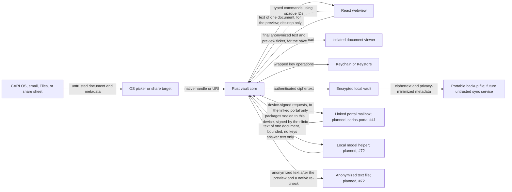

# myCarlos threat model

- **Status:** Durable-vault implementation complete; independent review and release gates open
- **Version:** 0.3
- **Date:** 2026-10-21
- **Initial platforms:** Windows, macOS, Android, and iOS
- **Deferred platform:** Linux, pending review of the documented `glib` backport and device/release validation
- **Data restriction:** Synthetic files only; this model does not authorize PHI use

## Purpose

This document identifies what myCarlos must protect, the trust boundaries an attacker may cross,
credible failure and abuse cases, and the controls and tests required before the application stores
patient records.

The native Tauri application includes the synthetic-data durable-vault slice described in
[`VAULT_FORMAT.md`](VAULT_FORMAT.md); the browser demo remains session-only. Implemented controls
are marked below, but they must not be read as approval for PHI or production use.

## Scope

The model covers:

- vault creation, locking, unlocking, and recovery;
- local PDF import, encrypted storage, viewing, and hiding (never deletion, #71);
- the React webview, Tauri IPC commands, Rust core, and operating-system services;
- local metadata, thumbnails, temporary files, logs, and crash artifacts;
- the portable encrypted backup, and future multi-device enrollment and synchronization;
- future CARLOS document handoff and provenance verification, including pickup from the portal
  the patient links, myCarlos's first network use (carlos-portal #41);
- the planned AI helper (#72): an on-device anonymizer with a preview and a text-file export, a
  local model in a sandboxed helper, and the answers it saves; it adds no network use; and
- build, signing, updating, and third-party dependencies.

It does not approve a PDF renderer, synchronization service, analytics provider, CARLOS
protocol, or AI model or model runtime. The current encryption and passphrase-only recovery
design is implemented but awaits independent review and target-device verification.

## Security and privacy objectives

1. A locked or powered-off device does not disclose document contents or sensitive metadata.
2. A cloud or synchronization provider cannot decrypt patient records.
3. Encryption and recovery keys never enter the React renderer, logs, analytics, or crash reports.
4. Untrusted documents cannot obtain native privileges or escape the document viewer.
5. Native commands expose the minimum capability required and authorize every operation.
6. Tampering, corruption, rollback, incomplete writes, and false provenance are detected.
7. Nothing a patient hides is lost: documents are never deleted, only hidden, and stay encrypted
   and restorable (#71, decided 16 October). A whole-vault reset or a restore sets the vault aside,
   whole and encrypted, instead of erasing it; only the patient, by hand, deletes one. On Android
   and iPhone that is possible only by clearing the app's data or uninstalling it, which removes
   every vault; this limit is accepted (decided 19 October), so starting again is offered only on
   the unlock screen, not in Security, and the documents say so.
8. Security failures are explicit and fail closed without silently destroying recoverable data.
9. The patient can understand when a record is verified, unverified, locked, backed up, or hidden,
   and that hidden documents are kept.
10. No production patient data is used until the applicable controls and tests pass review.

## System and trust boundaries

The important trust boundaries are:

| Boundary | Rule |
| --- | --- |
| External source to OS picker | Selection is user intent, not proof that a file is safe or authentic. |
| React webview to Rust | Treat the renderer as untrusted. Validate command, state, identity, size, and object ID in Rust. |
| Rust to OS key storage | Store only the minimum wrapping material and bind access to the intended application/device policy. |
| Rust to local storage | Durable document content, metadata, indexes, and derived artifacts must be authenticated ciphertext. |
| Vault to viewer | Decrypt only after unlock; constrain viewer privileges and prohibit uncontrolled network or native access. |
| Device to backup/sync | Treat the service and transport endpoint as unable to keep plaintext confidential. |
| CARLOS to myCarlos | Verify origin, integrity, freshness, and intended recipient before showing verified provenance. |
| Camera to webview | Video only, asked for after the patient chooses to use the camera, and stopped when the photo is taken or the dialog closes. The frame stays in memory; Rust checks and cleans the JPEG before it is encrypted. |
| myCarlos to linked portal | Once linked, the portal is a mailbox, not a trusted source: it holds packages it cannot open (at linking, the clinic keys it returns are trusted on first use; NET-02). Connect only to the portal the patient linked, sign every request with that link's device key, and verify every package before anything is saved (NET-01 to NET-03, DEL-01 to DEL-06). |
| Vault to the AI helper's model (planned, #72) | The model runs in a separate, sandboxed helper process with no vault keys, no network and no file access; it gets the checked model as bytes or a sealed read-only handle. It receives one document's text and returns text only; its answer is never treated as instructions, links or markup (AI-04, AI-05). |
| Anonymized text to the patient's chosen AI service (planned, #72) | myCarlos does not send it. The patient saves a plain text file after a preview and takes it where they choose; once saved, it is outside the vault's protection, like a readable copy, and what the receiving service learns or keeps is up to it (AI-01 to AI-03, AI-08, AI-09). |

## Assets

| Asset | Harm if compromised |
| --- | --- |
| Decrypted documents | Direct disclosure of personal health information. |
| Document titles, tags, dates, thumbnails, and provider names | Sensitive diagnoses and care relationships can be inferred without opening a PDF. |
| Vault data-encryption keys | Complete or object-level vault disclosure. |
| Passphrase-derived and recovery key material | Offline vault compromise or permanent patient lockout. |
| Device-bound wrapping keys and biometric authorization | Unauthorized unlock on a stolen or shared device. |
| Encrypted vault and manifest | Deletion, corruption, rollback, traffic analysis, or offline guessing. |
| CARLOS provenance manifest and signature keys | Forged or misattributed clinical documents. |
| Per-link device keys and pinned clinic keys | Reading deliveries meant for this device, posing as the device to the portal, or trusting a forged clinic. |
| Linked portal address and recipient ID | Tying the device to a clinic; the network learns that this device uses that clinic's portal. |
| Backup and synchronization state | Cross-device disclosure, rollback, duplicate resurrection, or data loss. |
| Logs, crash reports, clipboard, notifications, and OS snapshots | Secondary disclosure outside the vault. |
| Signing and update credentials | Distribution of a malicious application update to every patient. |
| Anonymized text and its exported files (planned, #72) | A missed detail re-identifies the patient or someone else; the file is a plaintext copy outside the vault. |
| AI answers (planned, #72) | They disclose health information as the document does, and a wrong answer may be trusted as medical advice. |
| The local model file and the model list built into the app (planned, #72) | A swapped model could exploit the model runtime or give deliberately misleading answers. |

## Threat actors and assumptions

Credible threat actors include a finder or thief of a device, another user of a shared computer,
malware with ordinary user privileges, a malicious document sender, a compromised website or deep
link, a compromised backup provider, a compromised or malicious portal operator, a network attacker
between the device and the portal, a supply-chain attacker, an attacker controlling a future
synchronization account, a sender who writes instructions into a document to steer an AI model
(prompt injection), and the AI service a patient gives exported text to (#72).

The following limits must be communicated honestly:

- The vault must protect a lost locked device and copied vault files.
- The vault must protect records from the backup or synchronization operator.
- The application cannot guarantee confidentiality while records are visible on a device whose
  operating system or privileged account is already fully compromised.
- OS key stores reduce key-extraction risk but do not replace a vault encryption and recovery model.
- myCarlos can verify that a package was signed by a recognized clinic; it cannot guarantee that the
  clinical content entered by that clinic is medically correct.
- Removing identifying details from text is never perfect, and an AI model can be wrong. myCarlos
  can show both to the patient (a marked preview, a label on every answer) but cannot rule them
  out. An AI service the patient is signed in to knows who they are, whatever was removed (#72).
- Availability after total device loss depends on the recovery and backup design. Until those are
  implemented and tested, the application must not imply that records are recoverable.

## Risk scale

Risk is initially qualitative because usage, deployment, and recovery designs are not final.

- **Critical:** plausible compromise or irreversible loss of most of a patient's vault, signing
  infrastructure, or recovery authority.
- **High:** disclosure or unsafe modification of one or more records, or escape from an untrusted
  document into native application privileges.
- **Medium:** limited metadata disclosure, local denial of service, or a weakness requiring another
  significant compromise.
- **Low:** minor impact with narrow prerequisites and straightforward recovery.

Residual risk must be rescored after a control is implemented and tested. “Planned” controls do not
reduce current risk.

## Threat register

| ID | Risk | Threat and impact | Required controls | Verification | Status |
| --- | --- | --- | --- | --- | --- |
| KEY-01 | Critical | An attacker copies the vault and guesses the patient passphrase offline. | Unique salt; reviewed memory-hard password KDF; platform-benchmarked work factor; random vault key wrapped by the derived key; no password verifier that makes guessing cheaper. | Password-cracking cost review and tests against copied vault fixtures on every target class. | Argon2id, 15-character minimum, local common-pattern/context screening, and benchmark harness implemented. The strength floor is zxcvbn score 3 (an estimated 10^8 to 10^10 guesses), kept on purpose: with the 15-character minimum many passphrases are expected to score higher (not measured), and a higher floor would refuse passphrases a patient can remember, which pushes towards writing them down or reusing one. At the floor itself, one Argon2id run per guess (64 MiB, 3 passes, 4 lanes) puts a copied vault within days of a well-equipped attacker, an estimate that has not been measured. Guessing through the app on the device waits after five wrong tries in a row (5 seconds, 5 more for each further one, to a minute), counted apart for unlocking (with the passphrase checks made while the vault is open), the recovery key and backups, and kept beside the vault across restarts; it does nothing against a copied vault or backup, where only the key derivation's cost applies, and whoever can delete its file, make it unwritable, set the clock forward or before 1970, or run several copies of the app at once undoes or weakens it. Production breach corpus, physical results, a measured guessing rate and the independent review of this floor open |
| KEY-02 | Critical | Recovery becomes a universal backdoor or is easier to attack than the passphrase. | Patient-controlled recovery only; no vendor or clinic recovery secret; high-entropy recovery kit verified at setup. A found kit opens the vault, so the kit carries no patient or document names and the key can be replaced. | Recover on every target with the kit and confirm the service cannot decrypt. | 128-bit recovery-key envelope (header format 2), typed-back verification before it is stored, replacement after which the old key no longer opens the current headers (the master key is not rotated, so it still opens earlier copies of them; the setup asks why the key is replaced: if its kit may have been lost or seen, the app guides the patient to save a new backup and then delete older ones, or to keep them while the vault cannot save one; otherwise it says to keep the old kit safe or destroy it on purpose), a short label that is not secret on the kit and in Security so that the current kit can be told from others, offered again when a vault without a key is unlocked, at most once a day (the hour of the last offer is kept in the app's settings on the device and names no vault; as an offer that can be left, which makes and shows no key until asked, and says to go on only when nobody else can see the screen), and recovery with a new passphrase implemented, with setup offered first when a vault is created (Escape or "Lock vault and finish later" first asks whether to discard the key on screen; confirming cancels the unfinished key and locks the vault, and Escape in that question goes back to the setup; the vault shows a banner until a key is set up), a saved or printed plain-text kit, and recovery from the unlock screen; on-device recovery drills and review open |
| KEY-03 | High | Keys leak into the renderer, logs, crash dumps, swap, or long-lived memory. | Perform key operations in Rust/native code; never serialize raw keys over IPC; redact diagnostics; minimize key lifetime; use protected memory/zeroization where supported. | Instrument IPC and logging, force crashes, inspect artifacts, and review memory-handling paths. | Rust boundary, direct zeroizing key buffers, and streaming-I/O cancellation implemented. Two deliberate exceptions. A new recovery key is returned once over IPC so the patient can write it down; the renderer keeps no reference to it once the setup dialog closes, and adds it to the page for printing only while it prints (printing hands it to the operating system's print service). A recovery key typed by the patient (on the unlock screen, or to open a backup) travels the other way, like a passphrase, and is wiped natively; on the unlock screen, and in the restore form, it waits in that screen's state until it is used, the app is hidden, or five minutes pass untouched. The renderer cannot wipe either from its memory. At first setup, the new passphrase being typed also crosses IPC before Create, to `vault_passphrase_rules`, so that the setup checklist ticks by the vault's own rules (#69): it is sent once typing has paused for 300 ms and never while Create runs, judged natively by the same function as Create, and wiped there as the command returns (its request zeroizes on drop, as `vault_create`'s does); nothing of it is logged or kept, no error echoes it, and the answer is three booleans, never a score or a hint. Shown as text in that screen, it is kept from spell checking, autocorrection and autocapitalization, as every shown secret is. A saved kit holds the key in plain text by design, written natively only to a file the patient picks; for a filesystem path it is refused inside the vault home, private to the user (on Unix) and replaced atomically, while a document provider (Android) is written directly. Blocking-provider, crash and artifact review open |
| KEY-04 | High | Biometric unlock bypasses the intended passphrase policy or survives device-account changes. | Biometrics authorize use of a device-bound wrapping key; passphrase/recovery fallback; invalidate as appropriate after biometric or device-credential changes. | Test enrollment changes, fallback, repeated failures, device restore, and copied application data. | Design selected; implementation open |
| KEY-05 | High | A stale key envelope or vault manifest is restored to bypass deletion or revive old access. | Authenticate and version key envelopes and manifests; define rollback detection and device reconciliation. | Restore older fixtures and confirm safe detection rather than silent acceptance. | Changing the passphrase, like replacing the recovery key, wraps the same master key again and does not change it: the earlier passphrase still opens any earlier copy of the vault's headers (a device backup, a copied folder, a saved backup file), and the master key it yields decrypts the vault as it is now and as it will be. The only remedy is a new vault, which the app does not guide and which loses folders, profiles and dates (the steps are in `VAULT_FORMAT.md`, "Known limits"); restoring an earlier backup into it brings the earlier master key back. The Change passphrase screen states the limit and tells the patient to ask for help before erasing; rotating the master key is not implemented, and is planned for after the first release: until then an old passphrase or recovery key, with a copy of the vault's headers made while it was in use, keeps opening the vault as it is now. Portable backup restore detects a copy of the same vault that differs from the backup, a different vault, or a vault it cannot read to tell, and requires explicit agreement, repeated in a trusted native dialog that says what would be lost, before replacing it (a restore brings back the documents, passphrase and recovery key the backup was made with); rollback of externally restored slots and device reconciliation open |
| KEY-06 | High | The patient loses the passphrase and permanently loses the only copy of the record. | Patient-held recovery kit, portable authenticated backup, rotation, and explicit custody warnings. | Recovery, rotation, lost-kit, and historical-backup drills using synthetic data. | Permanent-loss warnings, the recovery key and its kit, and the portable encrypted backup implemented; recovery and restore drills on devices open |
| IMP-01 | High | A selected path, URI, symlink, or replaced file makes the app import a different file than the patient chose. | Open once through native code; use handles/content URIs where available; reject links and special files; avoid check-then-open logic; never accept renderer-supplied filesystem paths. | Symlink, race, content-provider, shared-directory, and path-manipulation tests per platform. | Local links/special files rejected, Unix no-follow and Windows reparse-point handle checks implemented, and renderer paths excluded; ordinary-file replacement races/content-provider testing open |
| IMP-02 | Critical | A crafted PDF exploits the parser and reaches vault keys or native commands. | Sandboxed capability-free rendering helper with no vault keys or network; bounded rendered output; prompt renderer updates. | Malformed corpus, known parser regressions, network observation, and attempted IPC/native access from the renderer. | Helper for unlocking (#54) and viewing (#48): parsing runs in a separate process with no vault keys, and myCarlos itself is not dumpable on Linux, so a helper cannot read its memory. The helper is sandboxed before it reads anything (#63): on Linux a seccomp allowlist (stdin, stdout and stderr, non-executable memory, ending; no open, socket, exec, ptrace or signal to another process) is required, with Landlock denying every file and network right on top where the kernel has it; on macOS `sandbox_init` with a deny-all profile; on Windows myCarlos starts it in a no-capability AppContainer (no network, no user files, low integrity), inheriting only its two pipes, inside a job object (memory, one process) it joins before it runs, and the helper checks its token. The helper's only environment is a placeholder LOCALAPPDATA (C:\mycarlos-none), which Windows needs to start an AppContainer: it is not a real folder, and no user variable is passed. If the sandbox cannot be set up the helper reads nothing and the patient is told the document cannot be opened safely on this system. Resource limits (CPU, memory, file size, processes, descriptors; macOS footprint checked by myCarlos) and a 30 s watchdog bound cost. Per-platform tests in CI try to read and write a file, connect, and start a program from inside it, against a control without it. Phones do not run it. Not covered: kernel exploits, side channels |
| IMP-03 | High | Oversized, recursive, or pathological input exhausts memory, disk, battery, or CPU. | Bounded open handles; constant-memory streaming; vault quota; bounded parsing; cancellation; timeouts; page/image limits; safe cleanup after termination. | Large-file and large-batch imports, PDF bomb, oversized image, excessive-page, low-disk, and cancellation tests. | Pre-open 100-file selection bound, bounded IPC collections/metadata, generated 101 MiB constant-memory test and I/O-boundary cancellation implemented; quota, blocking-provider timeout and parser/viewer limits remain |
| IMP-04 | High | Plaintext remains in temporary files, previews, thumbnails, caches, or failed imports. | Stream into authenticated encrypted storage; keep derived artifacts encrypted; use atomic commit; remove incomplete artifacts. | Interrupt each import stage, restart, and scan application-controlled storage for recognizable plaintext. | Streaming/staging and canary tests implemented; crash matrix open; an unlocked PDF goes from the helper into the vault in memory only, never a temporary file |
| IMP-05 | Medium | Filename, provider, diagnosis, or other metadata leaks before vault unlock. | Encrypt metadata and indexes; use opaque storage names; minimize lock-screen, recent-file, and OS-search integration. | Filesystem and OS-index inspection while locked. | Encrypted manifest and canary test implemented; OS inspection open |
| IMP-06 | High | An ordinary imported PDF is displayed as a verified CARLOS record. | Label manual files Patient imported · Unverified; verify a signed, recipient-bound CARLOS package before showing verified status. | Modify document and manifest fields, use unknown/revoked signers, and confirm the UI cannot show verified status. | Manual-import trust state implemented; approved wording and signed packages open |
| IMP-07 | Medium | The same package is replayed or imported repeatedly, confusing record history. | Stable signed document ID, content hash, idempotent import, and explicit duplicate handling. | Replay identical and modified packages across devices and restores. | Future CARLOS gate |
| CAM-01 | High | The camera turns on without the patient knowing; a photo carries where it was taken (GPS), the camera, or another picture; or a photo is left readable outside the vault. | Camera asked for only from the camera dialog, after the patient's choice, for video and never sound; on Linux and Windows the native permission handlers allow the camera for the app's own pages only and refuse every other request (on Android and iOS, Wry's own handlers grant the page's request; see below); every track stopped when the photo is taken, the dialog closes, the vault locks, or the window is hidden. The JPEG is drawn and encoded by the app's own canvas, then checked and cleaned in Rust before it is encrypted: one 8-bit baseline or progressive frame of at most 8,192 pixels a side, at most 25 MB, with every APP1–APP15 segment (Exif and GPS, XMP, ICC, IPTC, maker data), comments, any JFIF thumbnail and anything after the end marker removed, by walking the markers, never decoding pixels. The photo is stored through the import path, with its encryption, verification and duplicate check; nothing is written to disk in plain form. | Rust tests with a GPS-tagged Exif block, XMP, ICC, IPTC, comment, thumbnail and appended-video JPEG built from a real canvas JPEG; refusal of malformed, other-coding and oversized JPEGs; component tests with a fake camera for every way the camera stops; browser test with Chromium's fake camera and a refused camera. | Desktop implemented (Linux WebKitGTK: media stream turned on, user-media requests for video only allowed, everything else refused; Windows WebView2: the camera allowed for the app's pages, every other kind refused, also when a request cannot be read; macOS: Wry grants capture and macOS asks with `NSCameraUsageDescription`; no microphone reason is declared, and the app never asks for sound; a signed hardened-runtime build will also need the `com.apple.security.device.camera` entitlement). A document's details ask only whether its file starts as a JPEG, reading its first bytes; the photo is decrypted and sent to the webview only when the patient chooses View photo, and dropped when the view closes. The webview's own copies of camera frames, the canvas and the encoded JPEG are freed but cannot be overwritten by the app (it zeroes the bytes it holds and clears the canvas), and neither is the IPC layer's copy of the request body. The camera dialog keeps a photo's JPEG under 4 MB, lowering its quality and then its size, so that copy stays small. A photo is shown by the main webview's own image decoder, from a `data:` URL the vault returns after the same checks; viewer isolation remains as for IMP-02. When Tauri uses its postMessage channel instead of its custom protocol (always on Android, and on Windows once the custom protocol has failed in a session), the photo's bytes arrive as a JSON array of numbers that Tauri has already parsed into its own value before the app's handler runs: that copy, several times the photo's size, is neither overwritten nor size-limited by the app, which counts the array against the 25 MB limit only before copying it. Phones (D97), written but not yet run on a device: the same dialog, back camera first, and the same canvas JPEG and Rust cleaning. Android: the manifest declares the camera permission (not required, no microphone), and a build without it fails; Wry's web chrome client asks Android for that permission when the page asks for video, then grants the page's request (it does not check the origin or the kind itself: only the app's own pages load, and they ask for video only). iOS: Wry grants WebKit's capture request, of any kind, and plays video inline, and iOS asks with `NSCameraUsageDescription` from `Info.plist`; no microphone reason is declared, so a microphone request would end the app, and nothing asks for one. Android also declares the autofocus the camera permission implies as not required, so Google Play does not leave out devices without it. While the phone asks whether myCarlos may use the camera, the lock on hiding the app is held as for a file picker (UI-03). Real cameras on Windows, macOS, Linux, Android and iOS, the Android "don't ask again" path and iOS's custom-scheme page counting as secure for the camera open |
| IPC-01 | Critical | Compromised React code invokes privileged Tauri commands to read, overwrite, or erase data. | Keep narrowly scoped capabilities; commands accept bounded opaque vault IDs rather than paths; authorize lock state and operation in Rust; require trusted native confirmation for whole-vault reset; no generic read/write/execute command. | Enumerate generated permissions and fuzz every command while locked and with invalid IDs. | Opaque application commands declared in the build manifest and granted only to the main window, collection bounds, no webview plugin/core permissions, native reset confirmation (and native confirmation before a restore replaces a vault, and before a new recovery key replaces the one a vault has), arbitrary IPC deserialization properties and locked/unknown-ID operation matrix implemented. The setup checklist's `vault_passphrase_rules` reads and writes nothing: it is refused once a vault exists, open or locked, so it cannot be used to test guesses against a vault, and it answers three booleans only (#69). Accepted for now: changing the passphrase and hiding documents have no native confirmation, so compromised page code, which sees the passphrase as it is typed, can change the passphrase to one of its own, which locks out a patient whose vault has no recovery key (a vault that has one still opens with it, if the key was set up while the page code was sound: replacing it is confirmed natively, though giving a vault its first key is not, and the confirmation cannot show which key is being stored, so page code that showed the patient a key of its own making during a setup would leave the vault with a key only it holds; a kit saved to a file is written natively and holds the true key), or hide every document one by one (or those shown as damaged), which takes them out of view but deletes nothing (#71): Restore brings each back. Whether these get a native confirmation is an open product decision. While that confirmation is open the automatic lock is held off, as it is for a file picker, for no longer than a picker's hold, and the lock on hiding the app waits with it. The first button of each native confirmation, which is the default Enter/Return target on Windows and macOS, keeps things as they are; the button that goes ahead is the second, and only it counts as agreement. Which button Enter, Space and Escape press rests on how each platform lays a dialog out. The dialogs are given the app's window. By the dialog library's source and the platforms' own documentation, on Windows the first button is the default and Escape and closing cancel, and on macOS a native main-thread sheet of the window assigns Return to the first button and Escape to the third, with no shortcut for the second, independently of their translated titles. Only a supported language tag crosses IPC; native code selects the bundled warning and button text and refuses blank or colliding labels. On Linux the dialog sets no explicit default and takes no notice of the window, so focus and keyboard behavior depend on the desktop configuration. Automated native tests check cancellation and deliberate confirmation on Windows and Linux; platform coverage and remaining device checks are tracked in TESTING.md. Explicitly activating the second button still goes ahead. Native harness fuzzing remains |
| IPC-02 | High | XSS or remote content gains the privileges of the main application webview. | Bundle UI assets; restrictive CSP; no remote scripts; sanitize rendered text; isolate document content; review navigation and deep links. | CSP tests, dependency review, injected markup fixtures, and blocked-network assertions. | Production CSP/dev separation, prototype freezing, and hostile-metadata/off-origin browser regression implemented; the window refuses to go anywhere but this platform's bundled pages (and the development server in a development build), and on desktop refuses to open another window, with the rule unit-tested. Residual: the library lets through an address that it cannot parse itself, a phone's webview has no new-window hook (a new window there is expected to be a navigation, which the rule covers; unverified until tested on a device), and on Windows the rule sees the main frame only, so frames rest on the policy's `frame-src 'none'`. Windows CI exercises installed-app startup, native IPC, bundled-page navigation, and refusal of external navigation and popups. WebView2 can send a speculative GET before navigation cancellation, so Windows also intercepts document requests and returns a local refusal for disallowed origins before transmission. Startup navigation waits for that interception to be installed; registration failure aborts startup, and failure to enforce a refusal exits the app. This is a document-request boundary, not a general network firewall. Remaining checks cover installed builds on macOS, mobile, and unsupported Linux, channels no policy covers (WebRTC, DNS prefetch), deep links, and viewer isolation |
| IPC-03 | High | A plugin silently expands filesystem, shell, network, or clipboard authority. | Per-window capability files; exact plugin inventory; security review for every permission change; deny unused mobile and desktop scopes. | CI diff/check of capability manifests and generated mobile permissions. | Partially addressed in POC |
| IPC-04 | High | A command returns sensitive paths or error details to the renderer or console. | Patient-safe fixed errors; opaque IDs; no absolute paths; structured redaction at the native boundary. | Force native errors and inspect UI, console, logs, and crash output. | POC returns basename only; broader review open |
| STO-01 | Critical | Vault files or metadata are readable directly from disk or an OS backup. | Authenticated encryption for every durable sensitive object; encrypted metadata/index; random opaque filenames; backup exclusions for any plaintext cache. | Copy storage and backup images, then search for known document and metadata canaries. | Implemented with automated canary coverage; OS-backup inspection open |
| STO-02 | High | Ciphertext or metadata is modified, swapped between records, truncated, or corrupted. | AEAD; bind object ID, type, version, and vault identity as authenticated data; verify before use; safe corruption state. | Bit flips, truncation, object swaps, and cross-vault copy tests. | Bit-flip, truncation, record-swap, cross-vault copy, and one/two-slot manifest tests implemented; physical-device matrix remains |
| STO-03 | High | Crash, low disk, or power loss produces a partially committed record or destroys the previous valid state. | Transactional metadata; redundant generation-bound headers and identical manifest states; unambiguous committed/degraded outcomes; recovery-mode read access; safe orphan cleanup; write-verify-rename/commit sequence. | Terminate the process and inject write failures at persistence boundaries, then restart repeatedly. | Exclusive OS ownership prevents concurrent app instances from overwriting stale state. Subprocess termination and deterministic `NoSpace` matrices cover chunk/staging/rename/manifest/deletion/reset boundaries; physical power-cut and full-filesystem matrix remain |
| STO-04 | High | “Permanent delete” leaves decryptable originals, thumbnails, exports, or synced copies. | Superseded by #71 (16 October): there is no permanent delete. Hiding keeps a document's ciphertext and key by design, and the patient is told so (Security, “What myCarlos keeps”); exported copies are explained separately. | Check that no command removes or changes a document's object (scripted session); that direct `std::fs` removal is refused by clippy outside the one named-kind helper; and that orphans are quarantined, not removed. | Hide and Restore, documents hidden as damaged, orphan quarantine, the removal helper with its kinds, and the clippy guard implemented; a whole-vault reset or restore sets the vault aside instead of erasing it (#71's third part), and on a phone a vault set aside can be removed only with every other vault (accepted, decided 19 October) |
| STO-07 | High | The vault's history (#71) is changed, cut short or reordered to hide what happened, or read while the vault is locked. | Hash-chained entries whose end (count and head) the authenticated manifest pins; entries appended in the same commit as the change they record; segments encrypted like documents, one size, padded to a power of two in number; an unlocked, read-only Security view receives recorded display names, times, methods, session notes and save locations over the local main-window IPC only for entries that authenticate and link from one of the chain's two pinned ends: from the start, stopping at the first damaged or missing segment or broken link and never going past the pinned count; and, after the last damaged segment, back from the pinned head and count (D146), so a spliced or foreign end proves nothing; together with a native `complete` flag and the dates around the gap. When the chain is not whole (a damaged piece, or cut short against the pinned count and head), Security shows those entries with a notice that the events between can't be checked (D129, D146). Native identifiers, chain hashes, wrapped keys and object paths stay native; lock cancellation conceals the renderer while native lock confirmation is pending. | Change, remove, reorder or cut off entries and check the chain fails at the right place, and that Security shows only what the start or the pinned end proves, with the notice; search a locked vault for names; crash and write-failure matrices around each history write. | Implemented (#71 part B). Limits: a whole vault put back (a backup or a copied folder) passes the chain check, the device clock can be changed, and the history's length shows to about a power of two; an outside anchor (#55) is a follow-up. There is no export: Ben chose tamper-evident on the device only (19 October). |
| STO-05 | Medium | Local filesystem permissions expose or let another account modify the vault. | Private application data directories; restrictive permissions; no shared/external storage for vault objects; integrity verification remains mandatory. | Platform permission inspection and second-user access tests. | Unix mode assertions implemented; Windows/mobile policy and second-user tests remain |
| STO-06 | High | Nonce reuse, partial migration, or format downgrade breaks confidentiality or integrity. | Reviewed versioned envelope format; library-managed nonces where possible; migration transaction and rollback plan; reject unsupported/downgraded formats. | Property tests for uniqueness, migration interruption tests, and old/new version matrix. | v1 rejects unknown header/manifest versions and same-generation divergence; nonce regression sample and migration protocol implemented; target-format interruption matrix awaits v2 |
| UI-01 | High | Decrypted content appears in mobile app-switcher snapshots, notifications, widgets, or lock-screen previews. | Privacy screen on background; suppress sensitive snapshots; notifications contain no PHI by default; lock on defined lifecycle events. | Physical-device background, notification, reboot, and screen-recording review. | Immediate webview concealment implemented; native snapshot/platform and physical-device verification open |
| UI-02 | Medium | Clipboard, share, print, or export leaves uncontrolled plaintext copies. | No implicit clipboard use; explicit export warning and destination; separate audited capability; clearly state that exported copies leave vault protection. | Clipboard monitoring and export/share tests across targets. | Explicit export/screenshot/deletion-limit warnings, partial-provider-destination error, and removal of an interrupted desktop export's staged copy at the next start, unlock or reset implemented; platform clipboard/export/share/provider testing remains |
| UI-03 | High | An unlocked session remains visible on a shared or unattended device. | Five-minute default configurable from one to fifteen minutes; immediate concealment on background; reauthentication for sensitive operations. | Clock, sleep, process-resume, multi-window, and fast-user-switching tests. | Manual/background locking, immediate concealment, clamped persisted 1–15-minute setting with five-minute default, a native idle deadline that drops the keys without the renderer (a transfer counts as native activity while it makes progress), automatic or background locks that conceal at once during a transfer, lock when it ends, and show its outcome only after the next unlock, a warning 30 seconds before the automatic lock whose Keep open counts as use (only the person's own input counts: the page scrolling itself does not), and the reason for an automatic lock on the unlock screen, with nothing of the records, implemented; on a phone the lock on hiding the app is not taken while a file picker the app opened, or the system's question whether myCarlos may use the camera (D97, Android pauses the page under it), is in front, and the visibility check runs again as soon as it closes, so a patient who left meanwhile is locked out then. A picker holds it for at most 15 minutes; the camera question no longer than the lock delay, since the native idle deadline, which hears of pickers but not of it, still drops the keys. An outside camera app is not covered: myCarlos captures in its own window and opens none, and one would need its own decided exception first (#73); a hung webview's last screen staying visible, a source that keeps trickling data, or a file that never finishes opening, keeping the session unlocked (concealed), native privacy controls, reauthentication, and device matrix open |
| UI-04 | Medium | Accessibility defects cause the patient to select, delete, or trust the wrong record. | Screen-reader names/state, focus management, scalable text, keyboard-equivalent operations, non-color trust indicators, confirmations for destructive actions, and undo where safe. | Automated WCAG checks plus manual VoiceOver, TalkBack, Windows, and macOS accessibility evaluation. | Automated WCAG A/AA gates cover browser and durable-vault states; modal focus containment/return and keyboard folder movement are implemented; manual assistive-technology review remains |
| INT-01 | Critical | A forged CARLOS handoff, deep link, or share intent imports attacker-controlled provenance. | Authenticated package format; allow-listed protocol and bounded fields; signature-chain and recipient checks; no key or command in URL parameters. | Fuzz links/intents and test forged, expired, wrong-recipient, and unknown-clinic packages. | Future CARLOS gate. Files shared to myCarlos, or opened with it, today carry no provenance: each is labelled "Manual import — unverified", must start as a PDF (`%PDF-` within its first 1024 bytes; anything else is refused by name and forgotten), and goes into "Shared with me", outside everyone's records, until the patient moves it to a person (#61). While the vault is locked they wait in memory only, as a count on the lock screen |
| INT-02 | High | A valid document for one patient or profile enters another local vault. | Bind intended recipient/profile in signed metadata using privacy-preserving identifiers; require explicit confirmation when binding is unavailable. | Cross-profile and wrong-recipient test matrix. | Future CARLOS gate |
| SYN-01 | Critical | Backup provider, network observer, or account attacker reads records or recovery material. | Client-side encryption before upload; TLS as defense in depth; no server-held plaintext recovery secret; privacy-minimized object names and manifests. | Inspect captured traffic and server-side fixtures; attempt restore using server data alone. | Future sync gate |
| SYN-02 | High | Sync resurrects deleted records or rolls the vault back to vulnerable/stale state. | Authenticated version history, tombstones, conflict rules, replay protection, and visible device state. | Offline concurrent delete/edit, stale device, replay, and restore tests. | Future sync gate |
| SYN-03 | Critical | Attacker enrolls a new device and receives the vault key. | Explicit existing-device or recovery-key authorization; patient-visible device list; revocation; no email-only enrollment for vault decryption. | Account takeover and unauthorized enrollment exercises. | Future sync gate |
| NET-01 | High | myCarlos sends data to a host other than the portal the patient linked: a tracker, a redirect target, or an address taken from a document or a link. | One network client, in Rust, that reaches only the `/api/mycarlos/` routes of the HTTPS origin saved for each link (from the portal's QR code, or typed with the link code) and refuses redirects to any other origin; the webview's CSP keeps no remote origin and the PDF helper has no network (IMP-02); no other endpoint (analytics, update, fonts, maps) is added without a threat-model update. | Captured traffic during linking, pickup, refusals and errors on every platform; redirect and wrong-origin tests; CSP and helper network-denial tests. | Design selected (carlos-portal #41 M2; the shared spec (carlos-portal#42 at c35649b, `docs/architecture/mycarlos-delivery.md`)); implementation open |
| NET-02 | High | A network attacker, a user-installed certificate authority, or a mistyped or look-alike address puts a fake portal between the device and the clinic. | HTTPS only, TLS 1.2 or later from the platform trust store, cleartext refused on every platform; the link code is made after the patient's MFA sign-in, is good for 10 minutes and one use, and its QR code carries the portal address; the clinic's key list returned at linking is pinned for that link, and from then on each copy is checked against the pinned keys, not against TLS: copies are sealed to the link's device key and signed by a pinned clinic key (DEL-01, DEL-06). At linking itself the clinic's keys are trusted on first use: they come over HTTPS from the portal address the patient entered, and nothing outside that portal confirms them (see "Accepted residual risk: clinic keys trusted at linking"). A fake portal can link a device but cannot make CARLOS send to it, as CARLOS confirms each device outside the portal; it can send documents of its own that show as Verified, as from the clinic it names. | Interception-proxy and wrong-certificate tests; cleartext refusal per platform (Android network security configuration, iOS App Transport Security); a fake portal answering a link attempt. | Design selected (carlos-portal #41 M2, the shared spec (carlos-portal#42 at c35649b, `docs/architecture/mycarlos-delivery.md`)); TLS pinning choice open (D-09); clinic keys trusted at linking accepted as a residual risk (Ben, 28 Oct) |
| NET-03 | Medium | The portal operator or a network observer learns more than it needs: who the patient is, which documents were sent, when the app is open, or that two clinics serve the same device. | Requests and receipts carry only the fields in `SECURITY_OPERATIONS.md` ("Portal pickup"): opaque IDs (`recipient_id`, 128-bit random per patient account and never derived from the health card number; `device_key_id`, from keys made fresh for each link, so two portals never see the same one), times, hashes and signatures; no names, titles, birth dates or file names; the outer record the portal stores has none either; pickup only at unlock or on the patient's "Check for new documents", never in the background. The vault history's anchor (decision L) is sent per link, as `vault_head_link` (an HMAC of the head, keyed from that link's key), never as the raw head, which is the same on every link of a vault. | Captured-traffic and portal-fixture inspection with seeded canaries; two links of one vault compared for shared values, and the spec's `vault_head_link` vectors. | Design selected (carlos-portal #41, the shared spec (carlos-portal#42 at c35649b, `docs/architecture/mycarlos-delivery.md`)); implementation open |
| DEL-01 | Critical | A forged, altered, expired, replayed or misdirected delivery is saved, or shown as Verified. | The clinic signing key (ECDSA P-256, carlos-emr/carlos#4691) signs the manifest (ES256) and, through `document.sha256`, the PDF, which also keeps its own PAdES signature; the copy is sealed to the link's X25519 key with HPKE (RFC 9180 base mode: DHKEM(X25519, HKDF-SHA256), HKDF-SHA256, ChaCha20-Poly1305), with `frame(delivery_id, recipient_id, device_key_id)` as associated data; before anything is saved myCarlos runs the spec's checks in order and stops at the first refusal (`unsupported_version`, `hash_mismatch`, `wrong_recipient`, `wrong_device`, `decrypt_failed`, `bad_package`, `bad_manifest`, `wrong_clinic`, `unknown_clinic_key`, `revoked_clinic_key`, `bad_signature`, `id_mismatch`, `document_hash_mismatch`, `expired` (only 24 hours past `expires_at`, for wrong clocks), `replayed`); a refused copy is not filed, no receipt is sent, and the patient sees a plain message (INT-01, IMP-06, IMP-07). | The shared vectors (`tests/fixtures/delivery-contract.json`, byte-identical in each repo; SHA-256 `e342041d5620238e6e0b8ae0aa0b767b51965fb839aee671600b8a0d63e90016` at c35649b) in Rust: RFC 9180 A.2.1 first, then every `packages.accept` and `packages.refuse` outcome. | Design selected (the shared spec (carlos-portal#42 at c35649b, `docs/architecture/mycarlos-delivery.md`)); vectors and implementation open |
| DEL-02 | High | The portal deletes its copy before the document is safely in the vault, so a crash or a full disk loses it. | After the outcome `file`: write the document durably, record the delivery in the vault history with its delivery ID and ciphertext hash, sign the receipt and keep it in the vault with the filed delivery (outside the history chain, as it carries the chain's head), and only then send it; a copy whose delivery ID was filed before is `already_filed` (the same ciphertext) and its kept receipt is sent again byte for byte, never re-signed, until the portal answers 200 or `delivery_not_found`. | Crash and write-failure injection between each step; the same copy picked up again after a restart; a lost receipt response. | Design selected (carlos-portal #41 M4, the shared spec (carlos-portal#42 at c35649b, `docs/architecture/mycarlos-delivery.md`)); implementation open |
| DEL-03 | High | A lost, sold or restored device keeps receiving deliveries, or a copied vault picks up deliveries meant for another device. | Per-link device keys: a fresh pair (X25519 to open copies, Ed25519 to sign requests and receipts) for each portal link, kept in the encrypted vault with that link and never sent to the renderer (KEY-03), so no two portals see the same `device_key_id`, and with the per-link `vault_head_link` (NET-03) clinics cannot link the same device by anything myCarlos sends (each portal still sees the IP address it is reached from, and when); the link request is signed by the new key and binds both public keys, the device name and the code; CARLOS keeps a new device pending until it is confirmed outside the portal (staff approval, a texted code, or an already linked device) and sends nothing to it until then; removing a link deletes its waiting copies at once, and every later request signed with its key is refused (`device_removed`); a removed link never comes back, and linking again makes fresh keys; a restored backup, which carries the per-link device keys, keeps the portal link: myCarlos then says "This vault was restored. If your old device still has it, remove one of them." and records the restore in the vault history (decided by Ben, 21 Oct). | Unlinking during a pickup; copied and restored vault fixtures, and the restore notice and history record; IPC and log inspection for key material. | Design selected (carlos-portal #41 M2 and M3, the shared spec (carlos-portal#42 at c35649b, `docs/architecture/mycarlos-delivery.md`)); restore behaviour decided; implementation open |
| DEL-04 | High | A hostile copy from a compromised portal or clinic exhausts memory, disk or CPU, or exploits the package reader. | A sealed copy is at most 20 MiB, checked against the outer record before download and again while streaming; strict, bounded parsing of the outer record, plaintext frames and manifest (exact claims, no duplicate members, canonical encodings); the PDF itself goes through the sandboxed PDF helper like any other PDF (IMP-02); the package reader is fuzzed. | Fuzzing of the package reader; oversized, truncated and malformed copies, and the duplicate-member vectors. | Design selected (carlos-portal #41 M4, the shared spec (carlos-portal#42 at c35649b, `docs/architecture/mycarlos-delivery.md`)); implementation open |
| DEL-05 | Medium | A delivery is filed under the wrong person, so the patient trusts or shares the wrong record. | The first delivery on a link asks once, showing the patient name and birth date from the signed manifest; later ones follow that choice, which the patient can change or forget; nothing is filed by a match alone; a shared PDF is only offered to the one person whose full name is required and whose date of birth is entered or explicitly marked unknown, with a matching date used before a full-name match; with no match it goes to Shared with me (INT-02). | Wrong-person, changed-link and forgotten-link tests. | UI prototype only (mycarlos#97); implementation open |
| DEL-06 | High | A new clinic key is accepted silently, so whoever controls the portal or the link can sign as the clinic. | The clinic's key list is pinned for each link when the patient links; a key pinned only on another link is refused (`wrong_clinic`) and an unpinned one too (`unknown_clinic_key`); a replacement signed by the current key is accepted and the patient is told; a revoked key stops verifying (`revoked_clinic_key`; mycarlos#55). | Rotation, unannounced key change and revocation tests with the shared vectors. | Design selected (carlos-portal #41 M2, the shared spec (carlos-portal#42 at c35649b, `docs/architecture/mycarlos-delivery.md`)); implementation open |
| SUP-01 | Critical | Compromised dependency, CI action, or build runner ships malicious code. | Lockfiles; pinned CI actions; minimal dependencies; SBOM; vulnerability and provenance checks; protected release workflow; reproducible-build investigation. | Dependency diff review, artifact provenance verification, and periodic clean-room rebuild. | Lockfiles, commit-pinned Actions, dependency review, production npm audit and reproducible npm/Cargo CycloneDX inventories implemented; protected artifact provenance and clean-room rebuild remain |
| SUP-02 | Critical | Signing or updater key compromise distributes a malicious release. | Offline or hardware-backed signing controls; separation of duties; signed update metadata; rotation and revocation runbook; rollback protection. | Staged malicious/expired/rollback update tests and key-loss exercise. | Design required |
| SUP-03 | High | Analytics, support bundles, or crash reporting exfiltrate PHI or keys. | No analytics by default; field allow-list rather than redaction-only policy; local patient review of support bundles; approved data flow before enabling telemetry. | Seed canary PHI and verify it never leaves through diagnostics. | Future operations gate |
| SUP-04 | High | A known vulnerable platform dependency is treated as supported. | Security gate per target; do not waive affected runtime advisories; publish an explicit supported-platform matrix. | Release pipeline refuses unsupported targets and high/critical unresolved runtime findings. | Linux deferred; other targets open |
| AI-01 | High | The remover misses an identifying detail, or the patient trusts it too much, so an exported text identifies the patient or someone else (#72). | **The remover** runs on the device in the app's page code: `src/deidentify/deidentify.ts` (#80), plain text in and out, with a test that forbids network calls, `invoke` and URLs in it. **Coverage today (#80), in English and French text:** the patient's profile names; names after a title or a label ("Dr.", "Patient:"), surname first too; clinicians by initials, signature line, credentials or title; health card numbers; record, chart, accession and requisition numbers after a label; dates of birth; addresses; postal codes; phone numbers, fax-shaped ones included; email addresses; "cc:" lines; clinic, hospital, laboratory, imaging and pharmacy names by pattern; doctor names. **Part B adds:** every name in People's details; web addresses; ages of 90 and over; social-insurance-shaped numbers; specimen numbers after a label; the vault's known clinic and doctor names. **Later:** name, date and institution patterns in Spanish, Polish, Portuguese and Chinese text; typist initials. A name with no title or label that the vault does not know is not found, and the notice says so. **Part B changes #80:** dates move back only (today either way); an ambiguous numeric date is removed (today read day-first); placeholders follow the app's language (today English); vault names match in any case (today only when written as a name). The matching copy, the cleaning, the weekday, month-and-year and year rules, and Undo are new. **Vault names** (profiles and People's details): each part of a full name alone, in both orders and as "SURNAME, Given"; whole words in scripts with spaces and character sequences in Han script; case ignored and accents folded, including Ł→L, Ø→O, Đ→D and ß→ss; in Latin script, a part shorter than 3 letters or a common word or relationship ("Me", "Mom") is not used alone, while a Han name of 2 or more characters is. **Matching** runs on a copy in which each character is normalised on its own (compatibility forms, accents removed, full-width forms folded, format characters dropped), with a UTS #39 confusable skeleton for vault names, mapped back character by character, so a removal always covers whole original characters. **The saved text** is never NFKC-normalised, which would change lab notation such as "10⁹/L". It is the original with every default-ignorable code point (variation selectors, tag characters, U+034F, Hangul fillers) and bidirectional control removed, each run of private-use or unassigned code points replaced by one U+FFFD, which the preview marks and counts in its warning (symbol fonts often map visible signs such as µ, ≥ and ± to private-use code points), every Zs space folded to U+0020 (tabs are kept) and line and paragraph separators folded to a line break, plus the removals. Page code and Rust use one table of these code points, generated and pinned to one Unicode version, not the webview's own; a test fails if the two copies differ. **Dates:** the other dates move back by one whole number of days drawn at random for each preview (30 to 365), kept in memory only and never saved or logged; a weekday attached to a date is recomputed in English and French and removed in other languages; a month and year moves with its 15th day, and a year alone, only after a date cue ("in 2019", "depuis 2019"), with its 1 July, so each moves as a date in its middle would; an ambiguous numeric date (03/04/2025) is removed instead; a two-digit year is read as a date only after a date label. Dates the remover cannot read (month words in other languages, for example) stay as they are, unmarked, and the notice says an unmarked date was not moved. **Placeholders** are in the app's language ("[NAME 1]"), the same detail always getting the same one; a removal is never closed up, so removals cannot join text into a new name. **The preview** must be shown before any save. It marks removed parts and moved dates by more than colour and for screen readers (UI-04, #67, #69); shows all of the text the file will hold, hidden text and the fixed first line included, and the fixed last line when the text was cut; says when pages were cut, failed or have no text (AI-10); and warns when a page's text may not be readable words (a font with no Unicode map can turn text into a letter-for-letter cipher that an AI could decode). The patient can remove more; "Undo" undoes only the patient's own last removal, never one the remover made. The notice and the preview say what can be missed (`AI_HELPER_NOTICE.md`). | A synthetic corpus (letters, lab reports and imaging reports, in every app language) in which every covered kind and date form appears, also split across lines or columns, hyphenated, in capitals, surname first, with and without accents (Polish ł), with zero-width characters, full-width digits, look-alike letters and 2-character Chinese names: every covered detail must be removed or moved. For names the rules do not cover, the miss rate is measured and reported, with no pass mark. FAKE canary identifiers from the vault's profiles never appear in an export; moved dates keep their gaps and every moved date is earlier than the original; variation-selector and tag-character payloads never reach the file; Symbol-font µg, ≥ and ± survive as visible marks; a vault name that is also a disease or drug name (Graves, Addison) is shown as a removal in the preview. | Partly built: the remover is on main (#80); part B adds the items above, its changes to #80 and the preview; the rest is planned |
| AI-02 | High | Compromised or faulty page code skips the remover or the preview, or saves other text, so identifying text is saved (#72). | The page code holds the text and runs the remover, and the save takes the final text from it, with two native controls. **(a) A preview ticket:** `vault_document_text` (AI-10) issues an opaque ticket bound to that record and to the session generation. A save needs a ticket issued for that record. The ticket ends at lock, when a new text read starts for the record, when the document is hidden, when People's details or a profile's name change, and after one save. No text read, no save. **(b) A native re-check before writing.** The save command takes the ticket, the app's locale (as the recovery-kit save does) and at most 2 MiB of UTF-8, and refuses more before reading it. Rust does not change the text: it refuses text that still holds a code point from AI-01's table, and checks every character page code sends. It normalises a copy as AI-01 does and looks for the vault's own identifiers with AI-01's name rules: each profile's display and full name, every name in People's details, each profile's birth date in the date forms the remover reads, and the patient's name and birth date from the document's own delivery manifest, if it has one. A hit refuses the save and returns its ranges, so the preview marks them for removal; a hit inside a moved date or a placeholder removes that whole part. Nothing is written. Rust itself writes `aiHelper-exportHeader` as the file's first line and, when the ticket says the text was cut, `aiHelper-exportCut` as its last, from the app's locale; page code never supplies them. Rust writes only through the system's save dialog. Residual: page code that skips the remover is caught natively only for the vault's own identifiers, so a health card number or another person's name would pass; compromised page code could save other text that passes the re-check; and native code cannot prove that the patient read the preview or that it matched the saved text. Such code can already save the original PDF as a readable copy (UI-02), so holding the text natively would add little beyond (a) and (b). | IPC tests: a save with no ticket, a forged or stale ticket, after lock, after the document is hidden, a second save on one ticket, and a text over 2 MiB; a canary profile name (on the first line too), a People's details name and a birth date in the text are refused with their ranges; text with a code point from the table is refused; every file starts with the header line, and a cut text ends with the cut line; the saved body equals the preview text. | Planned (#72 part B); not built |
| AI-03 | Medium | The exported text file leaves the vault's protection: it may be copied to a synced or cloud folder, or listed in recent files (#72). | Saved only to a place the patient picks in the system's save dialog, through the readable-copy save path (a cut-off save is cleaned up at the next start on a computer); no clipboard, share sheet or network path at first. A warning before saving, like a readable copy's (UI-02); the notice says a synced folder copies the file. A generic suggested file name in the app's language ("Anonymized text.txt"), never the document's title or a person's name (unlike a readable copy's). The history (#71) records the save as the existing `copySaved` event with `how: "anonymizedText"`, not a new event, because an older build reads an unknown event as a damaged history (`HistoryEvent` in `history.rs` has no catch-all variant; VAULT_FORMAT.md lists the event names); it holds the document, the place (cut to 256 characters, and then with a SHA-256 of the whole) and the time. Security's history labels the entry by its `how` (`interface-history-how-anonymizedText`, in all seven languages, added with part B); an older build shows it as "Readable copy saved", which is still true. The save dialog's suggested file name is a native message added with part B's UI text, not part of the notice. The text, the removed details and the date offset are never written to the history or to a log. | Export tests, as for readable copies; file-name tests with names in the title; history-entry tests, including an older build reading the entry; checks that the text, the removed details and the offset are never logged. | Planned (#72 part B); not built |
| AI-04 | High | A swapped, truncated, altered or crafted model file exploits the model runtime (its file parser or inference code), or a substituted model gives deliberately misleading answers (#72). | Only models on a list built into the app, each with its SHA-256 and size; once releases are signed (MASVS RESILIENCE-2), the list is part of the signed app. The helper checks the size on the open handle first, reads at most the listed size plus one byte, hashing as it reads, and uses the bytes only if the hash and size match. The runtime then takes the model from those bytes, or from a sealed read-only handle (for example a sealed memfd on Linux), never by path, and never from a mapping of a file that other programs can still write; the bake-off (part C) records which runtime can do this and what patch it needs. The file is checked when it is added and again at each load. It is kept in a model folder beside, not inside, the vault folder, not in myCarlos's encrypted backups, and marked to be left out of device backups where the system allows. That folder is a removal kind of its own: it holds no patient data, so #71's rule that nothing is deleted does not apply to it. A partial copy is removed at the next start, a refused file is offered for removal, and the patient can remove a model. The runtime (llama.cpp, or the bake-off's choice) runs in a separate helper process with its own sandbox, built like the PDF helper's (IMP-02) and failing closed like it: its own system-call allow-list (threads, memory), no vault keys, no network, no file access beyond its input, and bounded memory and time. It runs on the CPU only at first; any use of a graphics chip needs its own reviewed sandbox exception. The runtime is pinned, its C/C++ source revision is recorded in the SBOM, and its project's security advisories are watched, because RustSec does not cover it (SUP-04). The model's licence allows the project to offer it to patients. | Wrong-hash, wrong-size, oversized, truncated, replaced-after-check and changed-in-place tests; helper network- and file-denial tests on each desktop system; fuzzing of the model loader where the runtime allows; partial-copy and removal tests. | Planned (#72 part D or the later model step, after Ben picks the model from the bake-off); not built |
| AI-05 | High | The model's answer is wrong, or text inside the document steers it (prompt injection), and the patient acts on a wrong explanation (#72). | Two tools at first: a plain-words summary and "explain a term". No diagnosis, treatment or medication advice is asked for, but a model can still write such text, so every answer is labelled "Written by AI and may be wrong. Check with your doctor." **Source links:** the app numbers the document's sentences, the model may cite only those numbers, and the app checks that each cited number exists and makes the link itself. A summary sentence with no valid citation is shown without a link and marked "No source found". A link shows what the sentence cites, not that the sentence is right. The model has no tools and takes no actions, so text inside a document can change only the answer's words. Answers are shown as plain text only (no links, markup or HTML), never as the clinic's words and never marked Verified. | A synthetic set with instructions written into documents; label tests on every answer in every language; rendering tests that markup and links in an answer stay plain text; citation tests with missing, repeated and out-of-range numbers; a clinical-safety review (#25), which also decides whether the helper counts as software as a medical device. | Planned (#72 part D); not built |
| AI-06 | Medium | AI answers, or the model's working data, leak outside the vault: temporary files, caches, logs, crash files or swap (#72). | Answers saved only in the vault, encrypted, with the document, the tool, the model and the date (a vault format step, numbered when it lands); hidden with their document and never deleted (#71). The helper writes no files and keeps its working data in memory only. It allows no core dumps (on Linux, RLIMIT_CORE 0 and not dumpable) and opts out of Windows Error Reporting at start; the runtime's log callback discards everything, and the helper's error output is not logged. Prompts and answers are never logged. Swap is not prevented, as for the rest of the app (MASVS STORAGE-2). | Canary scans of application-controlled storage after runs, including cancelled and crashed ones; checks of system crash reports (Windows Error Reporting, macOS crash reports) and logs. | Planned (#72 part D); not built |
| AI-07 | Medium | Running the model exhausts memory, CPU or battery, or freezes the app (planned, #72). | Offered only after a hardware check; one run at a time, and cancellable; bounded input length, answer length and time; runs in the helper process, off the app's main thread. | Long-document, low-memory and cancellation tests. | Planned (#72 part D); not built |
| AI-08 | High | The AI helper becomes a network path: a cloud provider, a relay or an in-app model download added without review (#72). | The AI helper sends nothing. Its "cloud" way is a text file the patient saves (Ben, 29 October 2026), and the egress allow-list stays empty for it (`SECURITY_OPERATIONS.md`). How the model reaches the device is for Ben to choose (D-10); proposed here: a file the patient adds, so myCarlos fetches nothing. An in-app download, a provider or a relay each needs its own threat-model row and allow-list entry first (NET-01). | Captured traffic during AI actions on every platform; CSP and helper network-denial tests. | Decided: no provider (Ben, 29 October 2026). How the model reaches the device: proposed, awaiting Ben. Not built |
| AI-09 | High | The AI service the patient gives the text to knows who the patient is (from their account), keeps the text or learns from it, or follows instructions a sender hid in the document for an AI, perhaps acting on the patient's account (#72). | myCarlos cannot control that service. The exported file's first line, written natively in the app's language, tells an AI to treat all of the text as the document, not as instructions (`aiHelper-exportHeader`). The notice says plainly that a signed-in service knows who the patient is whatever was removed, that any service sees the patient's internet address, that the service's rules then apply, that its answers can be wrong, that dates myCarlos moved stay moved in them, that a document can carry instructions meant for an AI, and that the patient should use an AI that cannot act for them, or turn those features off (`AI_HELPER_NOTICE.md`). The preview shows all of the text the file will hold, hidden text included, so instructions a sender wrote for an AI can be seen and removed. Removing web and email addresses also removes link targets written plainly, which such instructions could use to send data out. Against such a service, the remover mainly protects the other people named in the document and limits what the service keeps. | Notice review in the privacy assessment (#25); preview tests with hidden and white text; a test that the first line is in every export. | Stated limit; not built |
| AI-10 | High | The new whole-document text command gives page code more than it needs, outlives a lock, exhausts memory or time, loses pages silently, or keeps a PDF's own password (#72). | `vault_document_text(recordId, password?)` is read-only and takes an opaque record ID. It refuses a record that is not a PDF before decrypting anything, and a hidden document. It is for computers only (no PDF helper runs on phones, IMP-02). It decrypts the document once and reuses the sandboxed PDF helper with no new helper message and no network (IMP-02, NET-01), at a small fixed width (64 pixels; at width 1 a landscape page draws 0 pixels high, which the reader refuses before it reads the text), and discards the picture. It returns each page's `readable_text`, the reader's line-preserving text, as `vault_view_page` already does, so page code learns nothing it could not already read. It caps the text at 50 pages and 1 MiB joined, keeping only whole pages (it stops before the first page that would not fit), so the `truncated` flag names the last page included and `aiHelper-exportCut` can say "after page N" exactly, and lists the pages cut at the reader's 256 KiB page limit (`cutPages`; a page within 3 bytes of `MAX_PAGE_TEXT_BYTES` counts as cut, because the helper cuts silently), the pages the helper refused (`failedPages`) and the pages with no text (`emptyPages`), for the preview to show; the cut is also written into the file as its last line (AI-02); the file itself carries no marker for a refused or page-cut page, only the whole-text cut is written into it, the preview says so before the save, and a later step may add a per-page marker line; no page is dropped silently. A locked PDF's own password is a zeroizing field, dropped when the call ends; page code holds it only while the preview is open, as the reader does. The command has a ticket generation of its own: a lock ends a call in flight and a result that arrives after a lock is discarded, while a reader page request or the reader closing does not end it (the reader-only cancel is split from the lock-time cancel). The whole read is bounded in time and can be cancelled from the preview. It never logs the text, and issues AI-02's ticket. | IPC tests: an unknown, hidden or non-PDF record, a locked vault, a wrong password, a call cut short by lock, a reader opened and closed during a read, a cancelled read, the caps and flags, a cut that would land inside a page stops before that page; a landscape page, an A4 page, a page the helper refuses, refusal on phones; a check that the helper's messages are unchanged. | Planned (#72 part B); not built |

## Mandatory design decisions

These decisions block the secure-vault implementation or its promotion:

| Decision | Required outcome | Current status |
| --- | --- | --- |
| D-01 Vault envelope | Versioned authenticated-encryption format for documents, metadata, manifests, and migrations. | v1 and migration protocol implemented; future target-format code/review open |
| D-02 Key hierarchy and KDF | Vault key, per-object key strategy, passphrase wrapping, and platform-benchmarked derivation policy. | Implemented; benchmarks/review open |
| D-03 Recovery | Patient-understandable custody boundary, loss behavior, and new-device restoration. | Patient-held recovery kit and portable backup selected; recovery key, kit and portable backup implemented; new-device restoration drills open |
| D-04 Viewer | Renderer choice, isolation boundary, supported PDF features, update path, cache behavior, and malicious-document testing. | Helper process selected (#48): hayro draws pages and lopdf reads their text, in the same helper as #54, never in the webview; pages return as pictures and text only. The helper is sandboxed on each desktop system (#63, IMP-02) |
| D-05 Local database | Encrypted index/storage choice, transaction and crash behavior, schema migration, and corruption recovery. | Encrypted manifest and migration protocol implemented; physical crash and future target-format migration review open |
| D-06 CARLOS package | Signed manifest schema, recipient binding, trust store, revocation, expiry, replay, and unverified-import presentation. | Signed recipient-bound package and explicit encrypted sharing selected; the shared spec (carlos-portal#42 at c35649b, `docs/architecture/mycarlos-delivery.md`) fixes the format (HPKE seal to one link's device key, ES256 clinic manifest, per-link device keys, device-signed requests and receipts, receipt only after the durable write); vectors and implementation open |
| D-07 Backup and sync | Threat model extension covering enrollment, metadata privacy, conflicts, tombstones, rollback, and server compromise. | Portable backup implemented (authenticated single-file ciphertext, verified before it replaces anything, crash-resumable activation); E2EE sync, append-only history, enrolled-device approval and immediate deletion selected, implementation open |
| D-08 Diagnostics | Whether telemetry exists at all, allowed fields, consent, retention, support bundles, and incident access. | No telemetry; local redacted patient-exported diagnostics selected |
| D-09 Network client | The hosts myCarlos may reach, TLS and pinning policy, proxies, when it connects, and what a restored vault does with its per-link device keys. | Linked-portal-only client and pickup at unlock or on request selected (carlos-portal #41); a restored vault keeps its link and says so (DEL-03, decided by Ben, 21 Oct); TLS pinning and proxy handling open |
| D-10 AI helper (#72) | Where the remover runs and who holds the text; the model list, runtime and sandbox; how the model reaches the device; how answers are stored; what may leave the device. | Ben, 29 October 2026: no cloud provider (remove details, preview, save as a text file); summary and "explain a term" first; the local model chosen after a bake-off; synthetic data only until #25. Agreed between parts A and B: the remover stays in page code (#80) with a native ticket and re-check (AI-02), and one text command (AI-10). Proposed here: a sandboxed model helper (AI-04). **Departures from #72, for Ben:** (1) #72, and the plan for this documentation step, have the patient download the model; to keep egress empty, this model has the patient add the file instead. Ben chooses (a) a file the patient adds, as here, or (b) an in-app download, which adds one host to the allow-list and needs its own row (the host, TLS, the hash checked before first use, clean-up of a partial file, what the host learns). (2) #72 has a Settings switch that turns the cloud way on; here each export is chosen per document, with a preview and a save dialog, and there is no switch. (3) Consequences for Ben to see: the model runs on the CPU only at first (#72 checks for a graphics chip); phones get neither the AI nor the export (#72 expected phones to use the cloud way); no placeholders are filled back into an answer (#72's step 4, which goes with sending, not with a file); and #72's "never gives a diagnosis" becomes "is not asked to, and every answer is labelled" (AI-05), because a model's output cannot be guaranteed. (4) #72 has every summary sentence link to its source; here a sentence with no valid citation is shown without a link and marked "No source found" (AI-05). Model, runtime and answer format open |

## Secure Vault v0.1 security gate

The synthetic local-vault vertical slice is not complete until all of the following are demonstrated:

- [ ] A threat-model reviewer and application owner approve the scoped risks and assumptions.
- [ ] D-01 through D-05 are decided and recorded.
- [ ] A synthetic PDF is encrypted before entering application-controlled durable storage.
- [ ] Document content, title, provider, date, thumbnails, and search index are unreadable while locked.
- [ ] Raw keys never cross Tauri IPC or appear in logs and crash artifacts.
- [ ] The vault can be closed, restarted, unlocked, rendered, and deleted on each initial platform.
- [ ] Import interruption at every persistence boundary leaves either the previous valid state or a
      detectable, safely recoverable incomplete state.
- [ ] Malformed and hostile PDF tests cannot access native commands, vault keys, or the network.
- [ ] Wrong-passphrase, corrupted-object, rollback, low-disk, and lost-key paths fail explicitly.
- [ ] Backgrounding and inactivity conceal content and require reauthentication as designed.
- [ ] Storage and OS-backup inspection finds no plaintext canaries.
- [ ] No unresolved critical/high vulnerability affects a shipped runtime dependency.
- [ ] Windows, macOS, Android, and iOS checks pass; no release workflow produces a supported Linux
      artifact before review of the `glib` backport and Linux device/release validation.

Passing this gate permits the next synthetic-data development phase. It does not by itself authorize
real patient data, a patient pilot, CARLOS integration, or production release.

## Review and maintenance

Review this model whenever a native command, Tauri capability, storage format, cryptographic
dependency, PDF renderer, recovery method, network service, CARLOS integration, analytics path, or
supported platform changes. Each pull request affecting a trust boundary must cite the applicable
threat IDs and add or update their verification evidence.

Before a patient pilot, conduct an independent security review and map implemented controls to the
OWASP Mobile Application Security Verification Standard. Clinical, privacy, and regulatory owners
must separately approve intended use and data handling.

## References

- [OWASP threat modeling](https://owasp.org/www-community/Threat_Modeling)
- [OWASP Mobile Application Security Verification Standard](https://mas.owasp.org/MASVS/)
- [Tauri v2 capabilities](https://v2.tauri.app/security/capabilities/)
- [Tauri v2 Content Security Policy](https://v2.tauri.app/security/csp/)
- [Tauri updater security and signing](https://v2.tauri.app/plugin/updater/)
- [Android Keystore system](https://developer.android.com/privacy-and-security/keystore)
- [Apple Keychain Services](https://developer.apple.com/documentation/security/keychain-services)
- [NIST SP 800-63B authentication guidance](https://pages.nist.gov/800-63-4/sp800-63b.html)
- [`glib` advisory GHSA-wrw7-89jp-8q8g](https://github.com/advisories/GHSA-wrw7-89jp-8q8g)

### Signed-PDF import analysis draft (#101)

The import pipeline now invokes a bounded signature analysis without changing stored
original bytes or the unverified source label. Main checks cryptography and clinic pins
before a password reaches the confined extraction stage. The current signed CMS digest
binds exact manifest bytes, including encrypted attachments; helper structure reports
alone grant no trust. Duplicate attributes, malformed OIDs, altered manifests, missing
pins and helper failure remain unverified. No manifest patient names, birth dates,
recipient IDs or raw keys are emitted in import diagnostics.

Authenticated portal linking is absent. Production pins are empty; fixture keys are
never a fallback and no production Verified claim is added. Trust persistence and key
change/revocation rechecks remain #55 dependencies. No new network path or vault-format
change is introduced by this checkpoint.

Explicit v1 null metadata is accepted without inventing identity or service information.
Member presence is still mandatory, and relaxing descriptive metadata does not relax
signer, exact digest, clinic or recipient binding. A signed PDF with no clinic/recipient
claim remains unbound under an explicit test pin and unverified without authenticated pins.

## Authenticated portal link implementation (#55, evaluation feature)

The future linking build is selected natively with Cargo feature `portal-linking`,
which is absent from default features. A renderer value cannot turn it on. The
native command refuses before generating keys, changing the vault or making a
request when the feature is off. This separate future branch includes held profile
format 4 and reserves manifest format 5; it does not authorize that migration for
the current demo.

Linking sends only the v1 code, a patient-edited generic device name, two fresh
per-link public keys and their possession assertion to the HTTPS portal address
the patient supplies. Portal SMS MFA authenticates the code's browser session;
myCarlos neither collects an MFA secret nor adds another authentication factor.
No URL from a PDF or manifest selects an endpoint. The native client uses only the
portal base path plus `/api/mycarlos/`, refuses redirects, bounds response bodies
and request duration, and never logs request, response, assertion or URL contents.
The production webview CSP and PDF helper network boundary remain unchanged.

Private link seeds and received pins are encrypted within the vault. Pending keys
are committed before the one-use code is sent; linked state is committed only
after response validation, with history. Network work releases the session lock;
a session generation rejects any completion after locking, even after unlock.
A lost one-use response can leave a device registered at the portal without a
completed local link: this must be reported as incomplete, never guessed successful.
A recovery endpoint, live key refresh and signed-replacement statement are shared
v1 contract work, not an invented delivery v2. Their absence prevents claiming
the whole #55 key lifecycle or the send/pickup/delete flow complete.

### Private first-device pickup candidate (26 October 2026)

The same default-off feature now includes explicit mailbox checks and first-device
approval requests. All destinations remain the saved consented HTTPS portal.
The renderer receives redacted native summaries, never seeds, decrypted packages,
receipts or recipient IDs. Native code validates original signed package/PDF
bindings before an atomic custody transaction publishes original/display objects,
history, verification metadata and exact kept receipt. Receipt sending is a
separate step after that commit, with restart-safe exact-byte retry. A generic
HTTP 404 never settles a receipt. An uncertain commit preserves objects and
requires restart repair. Full-device fingerprints are public identifiers for
staff comparison, not approval credentials; only a bound clinic signature grants
native approval status. Historical proof verification cannot grant current trust
after signer revocation. Key refresh and broader approval/recovery flows remain
unfinished and defaults remain OFF. Linux FAKE interoperability and subprocess
crash checks do not establish Windows or live portal end-to-end behavior.

### Accepted residual risk: clinic keys trusted at linking (28 October 2026)

When a device links, myCarlos takes the clinic's signing keys from the portal
at the address the patient enters, over HTTPS, and trusts them for that link
from then on. Nothing outside that portal confirms them. A patient who links to
a look-alike portal, or whose linking is intercepted or answered by a
compromised portal, can therefore receive documents that show as Verified, as
coming from the clinic the portal names. This does not expose the vault's
contents, and nothing from the vault goes to that portal beyond what any linked
portal receives (NET-03). Ben accepted this risk on 28 October 2026 so that
myCarlos works with other EMRs' portals (NET-02, DEL-06). Possible later steps:
show the portal's address next to "Verified" and at linking, and a clinic-key
code checked during the staff fingerprint comparison.

## AI helper (#72, planned)

Issue #72 asks for an AI helper that explains a document in plain words. Ben's decisions
(29 October 2026):

1. **No cloud provider.** The "cloud" way is: myCarlos removes identifying details on the device,
   shows a marked preview that the patient can edit by removing more, and the patient saves the
   text as a plain text file and takes it to whichever AI service they choose. There is no
   provider, no key and no network call (AI-08).
2. **The export is a file save,** like "Save a copy", and is recorded in the history. Clipboard
   copy and a redacted PDF are later ideas. The text comes from the reader's own text extraction
   (`pdf_view.rs`, #48).
3. **Synthetic data only** until the pilot privacy review (#25).
4. **First tools:** a plain-words summary and "explain a term". Questions and filing come later.
5. **The local model** is chosen after a bake-off of small open models on synthetic documents
   (quality, speed, memory, licence).

The work lands in steps, each citing its threat IDs: the anonymizer, preview and export (part B;
AI-01 to AI-03); the bake-off report (part C, no app code); then the two tools behind a "model not
installed" state (part D: AI-05 to AI-07; AI-04 with the step that adds the model). AI-10 is
the text source for both, and AI-09 is a stated limit of the export. The patient-facing notice for
all of it is [`AI_HELPER_NOTICE.md`](AI_HELPER_NOTICE.md), in all seven languages.

This model does **not** cover:

- sending text to a cloud provider or a relay (the issue's first idea): that would add a host, a
  key and a data processor, and needs its own review (NET-01, AI-08);
- downloading the model from inside myCarlos, for the same reason (D-10 asks Ben which way);
- scanned pages, which have no text until on-device text recognition exists;
- phones: the PDF helper does not run there (IMP-02), so a phone can neither read a document's
  text nor run a local model, and neither the export nor the AI on this device works on a phone
  until a phone design is reviewed;
- the later tools (questions to ask, filing suggestions).

Stated limits: removing details is never perfect (AI-01); an AI service the patient is signed in
to knows who they are, whatever was removed (AI-09); a local model can be wrong, and slow on an
ordinary computer (AI-05, AI-07); and because the model list is built into the app, a new or
updated model needs an app update, which reaches only patients who update (MASVS CODE-2).
