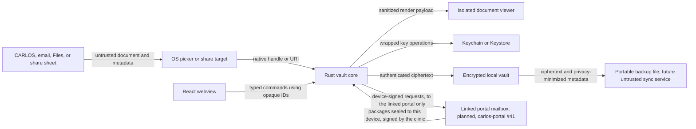

# myCarlos threat model

- **Status:** Durable-vault implementation complete; independent review and release gates open
- **Version:** 0.3
- **Date:** 2026-10-21
- **Initial platforms:** Windows, macOS, Android, and iOS
- **Deferred platform:** Linux, pending review of the documented `glib` backport and device/release validation
- **Data restriction:** Synthetic files only; this model does not authorize PHI use

## Purpose

This document identifies what myCarlos must protect, the trust boundaries an attacker may cross,
credible failure and abuse cases, and the controls and tests required before the application stores
patient records.

The native Tauri application includes the synthetic-data durable-vault slice described in
[`VAULT_FORMAT.md`](VAULT_FORMAT.md); the browser demo remains session-only. Implemented controls
are marked below, but they must not be read as approval for PHI or production use.

## Scope

The model covers:

- vault creation, locking, unlocking, and recovery;
- local PDF import, encrypted storage, viewing, and deletion;
- the React webview, Tauri IPC commands, Rust core, and operating-system services;
- local metadata, thumbnails, temporary files, logs, and crash artifacts;
- the portable encrypted backup, and future multi-device enrollment and synchronization;
- future CARLOS document handoff and provenance verification, including pickup from the portal
  the patient links, myCarlos's first network use (carlos-portal #41); and
- build, signing, updating, and third-party dependencies.

It does not approve a PDF renderer, synchronization service, analytics provider, or CARLOS
protocol. The current encryption and passphrase-only recovery design is implemented but awaits
independent review and target-device verification.

## Security and privacy objectives

1. A locked or powered-off device does not disclose document contents or sensitive metadata.
2. A cloud or synchronization provider cannot decrypt patient records.
3. Encryption and recovery keys never enter the React renderer, logs, analytics, or crash reports.
4. Untrusted documents cannot obtain native privileges or escape the document viewer.
5. Native commands expose the minimum capability required and authorize every operation.
6. Tampering, corruption, rollback, incomplete writes, and false provenance are detected.
7. Deletion removes the ability to decrypt the deleted object, including derived artifacts.
8. Security failures are explicit and fail closed without silently destroying recoverable data.
9. The patient can understand when a record is verified, unverified, locked, backed up, or deleted.
10. No production patient data is used until the applicable controls and tests pass review.

## System and trust boundaries

The important trust boundaries are:

| Boundary | Rule |
| --- | --- |
| External source to OS picker | Selection is user intent, not proof that a file is safe or authentic. |
| React webview to Rust | Treat the renderer as untrusted. Validate command, state, identity, size, and object ID in Rust. |
| Rust to OS key storage | Store only the minimum wrapping material and bind access to the intended application/device policy. |
| Rust to local storage | Durable document content, metadata, indexes, and derived artifacts must be authenticated ciphertext. |
| Vault to viewer | Decrypt only after unlock; constrain viewer privileges and prohibit uncontrolled network or native access. |
| Device to backup/sync | Treat the service and transport endpoint as unable to keep plaintext confidential. |
| CARLOS to myCarlos | Verify origin, integrity, freshness, and intended recipient before showing verified provenance. |
| Camera to webview | Video only, asked for after the patient chooses to use the camera, and stopped when the photo is taken or the dialog closes. The frame stays in memory; Rust checks and cleans the JPEG before it is encrypted. |
| myCarlos to linked portal | The portal is a mailbox, not a trusted source: it holds packages it cannot open. Connect only to the portal the patient linked, sign every request with that link's device key, and verify every package before anything is saved (NET-01 to NET-03, DEL-01 to DEL-06). |

## Assets

| Asset | Harm if compromised |
| --- | --- |
| Decrypted documents | Direct disclosure of personal health information. |
| Document titles, tags, dates, thumbnails, and provider names | Sensitive diagnoses and care relationships can be inferred without opening a PDF. |
| Vault data-encryption keys | Complete or object-level vault disclosure. |
| Passphrase-derived and recovery key material | Offline vault compromise or permanent patient lockout. |
| Device-bound wrapping keys and biometric authorization | Unauthorized unlock on a stolen or shared device. |
| Encrypted vault and manifest | Deletion, corruption, rollback, traffic analysis, or offline guessing. |
| CARLOS provenance manifest and signature keys | Forged or misattributed clinical documents. |
| Per-link device keys and pinned clinic keys | Reading deliveries meant for this device, posing as the device to the portal, or trusting a forged clinic. |
| Linked portal address and recipient ID | Tying the device to a clinic; the network learns that this device uses that clinic's portal. |
| Backup and synchronization state | Cross-device disclosure, rollback, duplicate resurrection, or data loss. |
| Logs, crash reports, clipboard, notifications, and OS snapshots | Secondary disclosure outside the vault. |
| Signing and update credentials | Distribution of a malicious application update to every patient. |

## Threat actors and assumptions

Credible threat actors include a finder or thief of a device, another user of a shared computer,
malware with ordinary user privileges, a malicious document sender, a compromised website or deep
link, a compromised backup provider, a compromised or malicious portal operator, a network attacker
between the device and the portal, a supply-chain attacker, and an attacker controlling a future
synchronization account.

The following limits must be communicated honestly:

- The vault must protect a lost locked device and copied vault files.
- The vault must protect records from the backup or synchronization operator.
- The application cannot guarantee confidentiality while records are visible on a device whose
  operating system or privileged account is already fully compromised.
- OS key stores reduce key-extraction risk but do not replace a vault encryption and recovery model.
- myCarlos can verify that a package was signed by a recognized clinic; it cannot guarantee that the
  clinical content entered by that clinic is medically correct.
- Availability after total device loss depends on the recovery and backup design. Until those are
  implemented and tested, the application must not imply that records are recoverable.

## Risk scale

Risk is initially qualitative because usage, deployment, and recovery designs are not final.

- **Critical:** plausible compromise or irreversible loss of most of a patient's vault, signing
  infrastructure, or recovery authority.
- **High:** disclosure or unsafe modification of one or more records, or escape from an untrusted
  document into native application privileges.
- **Medium:** limited metadata disclosure, local denial of service, or a weakness requiring another
  significant compromise.
- **Low:** minor impact with narrow prerequisites and straightforward recovery.

Residual risk must be rescored after a control is implemented and tested. “Planned” controls do not
reduce current risk.

## Threat register

| ID | Risk | Threat and impact | Required controls | Verification | Status |
| --- | --- | --- | --- | --- | --- |
| KEY-01 | Critical | An attacker copies the vault and guesses the patient passphrase offline. | Unique salt; reviewed memory-hard password KDF; platform-benchmarked work factor; random vault key wrapped by the derived key; no password verifier that makes guessing cheaper. | Password-cracking cost review and tests against copied vault fixtures on every target class. | Argon2id, 15-character minimum, local common-pattern/context screening, and benchmark harness implemented. The strength floor is zxcvbn score 3 (an estimated 10^8 to 10^10 guesses), kept on purpose: with the 15-character minimum many passphrases are expected to score higher (not measured), and a higher floor would refuse passphrases a patient can remember, which pushes towards writing them down or reusing one. At the floor itself, one Argon2id run per guess (64 MiB, 3 passes, 4 lanes) puts a copied vault within days of a well-equipped attacker, an estimate that has not been measured. Guessing through the app on the device waits after five wrong tries in a row (5 seconds, 5 more for each further one, to a minute), counted apart for unlocking (with the passphrase checks made while the vault is open), the recovery key and backups, and kept beside the vault across restarts; it does nothing against a copied vault or backup, where only the key derivation's cost applies, and whoever can delete its file, make it unwritable, set the clock forward or before 1970, or run several copies of the app at once undoes or weakens it. Production breach corpus, physical results, a measured guessing rate and the independent review of this floor open |
| KEY-02 | Critical | Recovery becomes a universal backdoor or is easier to attack than the passphrase. | Patient-controlled recovery only; no vendor or clinic recovery secret; high-entropy recovery kit verified at setup. A found kit opens the vault, so the kit carries no patient or document names and the key can be replaced. | Recover on every target with the kit and confirm the service cannot decrypt. | 128-bit recovery-key envelope (header format 2), typed-back verification before it is stored, replacement after which the old key no longer opens the current headers (the master key is not rotated, so it still opens earlier copies of them; the setup asks why the key is replaced: if its kit may have been lost or seen, the app guides the patient to save a new backup and then delete older ones, or to keep them while the vault cannot save one; otherwise it says to keep the old kit safe or destroy it on purpose), a short label that is not secret on the kit and in Security so that the current kit can be told from others, offered again when a vault without a key is unlocked, at most once a day (the hour of the last offer is kept in the app's settings on the device and names no vault; as an offer that can be left, which makes and shows no key until asked, and says to go on only when nobody else can see the screen), and recovery with a new passphrase implemented, with setup offered first when a vault is created (Escape or "Lock vault and finish later" first asks whether to discard the key on screen; confirming cancels the unfinished key and locks the vault, and Escape in that question goes back to the setup; the vault shows a banner until a key is set up), a saved or printed plain-text kit, and recovery from the unlock screen; on-device recovery drills and review open |
| KEY-03 | High | Keys leak into the renderer, logs, crash dumps, swap, or long-lived memory. | Perform key operations in Rust/native code; never serialize raw keys over IPC; redact diagnostics; minimize key lifetime; use protected memory/zeroization where supported. | Instrument IPC and logging, force crashes, inspect artifacts, and review memory-handling paths. | Rust boundary, direct zeroizing key buffers, and streaming-I/O cancellation implemented. Two deliberate exceptions. A new recovery key is returned once over IPC so the patient can write it down; the renderer keeps no reference to it once the setup dialog closes, and adds it to the page for printing only while it prints (printing hands it to the operating system's print service). A recovery key typed by the patient (on the unlock screen, or to open a backup) travels the other way, like a passphrase, and is wiped natively; on the unlock screen, and in the restore form, it waits in that screen's state until it is used, the app is hidden, or five minutes pass untouched. The renderer cannot wipe either from its memory. At first setup, the new passphrase being typed also crosses IPC before Create, to `vault_passphrase_rules`, so that the setup checklist ticks by the vault's own rules (#69): it is sent once typing has paused for 300 ms and never while Create runs, judged natively by the same function as Create, and wiped there as the command returns (its request zeroizes on drop, as `vault_create`'s does); nothing of it is logged or kept, no error echoes it, and the answer is three booleans, never a score or a hint. Shown as text in that screen, it is kept from spell checking, autocorrection and autocapitalization, as every shown secret is. A saved kit holds the key in plain text by design, written natively only to a file the patient picks; for a filesystem path it is refused inside the vault home, private to the user (on Unix) and replaced atomically, while a document provider (Android) is written directly. Blocking-provider, crash and artifact review open |
| KEY-04 | High | Biometric unlock bypasses the intended passphrase policy or survives device-account changes. | Biometrics authorize use of a device-bound wrapping key; passphrase/recovery fallback; invalidate as appropriate after biometric or device-credential changes. | Test enrollment changes, fallback, repeated failures, device restore, and copied application data. | Design selected; implementation open |
| KEY-05 | High | A stale key envelope or vault manifest is restored to bypass deletion or revive old access. | Authenticate and version key envelopes and manifests; define rollback detection and device reconciliation. | Restore older fixtures and confirm safe detection rather than silent acceptance. | Changing the passphrase, like replacing the recovery key, wraps the same master key again and does not change it: the earlier passphrase still opens any earlier copy of the vault's headers (a device backup, a copied folder, a saved backup file), and the master key it yields decrypts the vault as it is now and as it will be. The only remedy is a new vault, which the app does not guide and which loses folders, profiles and dates (the steps are in `VAULT_FORMAT.md`, "Known limits"); restoring an earlier backup into it brings the earlier master key back. The Change passphrase screen states the limit and tells the patient to ask for help before erasing; rotating the master key is not implemented, and is planned for after the first release: until then an old passphrase or recovery key, with a copy of the vault's headers made while it was in use, keeps opening the vault as it is now. Portable backup restore detects a copy of the same vault that differs from the backup, a different vault, or a vault it cannot read to tell, and requires explicit agreement, repeated in a trusted native dialog that says what would be lost, before replacing it (a restore brings back the documents, passphrase and recovery key the backup was made with); rollback of externally restored slots and device reconciliation open |
| KEY-06 | High | The patient loses the passphrase and permanently loses the only copy of the record. | Patient-held recovery kit, portable authenticated backup, rotation, and explicit custody warnings. | Recovery, rotation, lost-kit, and historical-backup drills using synthetic data. | Permanent-loss warnings, the recovery key and its kit, and the portable encrypted backup implemented; recovery and restore drills on devices open |
| IMP-01 | High | A selected path, URI, symlink, or replaced file makes the app import a different file than the patient chose. | Open once through native code; use handles/content URIs where available; reject links and special files; avoid check-then-open logic; never accept renderer-supplied filesystem paths. | Symlink, race, content-provider, shared-directory, and path-manipulation tests per platform. | Local links/special files rejected, Unix no-follow and Windows reparse-point handle checks implemented, and renderer paths excluded; ordinary-file replacement races/content-provider testing open |
| IMP-02 | Critical | A crafted PDF exploits the parser and reaches vault keys or native commands. | Sandboxed capability-free rendering helper with no vault keys or network; bounded rendered output; prompt renderer updates. | Malformed corpus, known parser regressions, network observation, and attempted IPC/native access from the renderer. | Design selected; implementation open |
| IMP-03 | High | Oversized, recursive, or pathological input exhausts memory, disk, battery, or CPU. | Bounded open handles; constant-memory streaming; vault quota; bounded parsing; cancellation; timeouts; page/image limits; safe cleanup after termination. | Large-file and large-batch imports, PDF bomb, oversized image, excessive-page, low-disk, and cancellation tests. | Pre-open 100-file selection bound, bounded IPC collections/metadata, generated 101 MiB constant-memory test and I/O-boundary cancellation implemented; quota, blocking-provider timeout and parser/viewer limits remain |
| IMP-04 | High | Plaintext remains in temporary files, previews, thumbnails, caches, or failed imports. | Stream into authenticated encrypted storage; keep derived artifacts encrypted; use atomic commit; remove incomplete artifacts. | Interrupt each import stage, restart, and scan application-controlled storage for recognizable plaintext. | Streaming/staging and canary tests implemented; crash matrix open |
| IMP-05 | Medium | Filename, provider, diagnosis, or other metadata leaks before vault unlock. | Encrypt metadata and indexes; use opaque storage names; minimize lock-screen, recent-file, and OS-search integration. | Filesystem and OS-index inspection while locked. | Encrypted manifest and canary test implemented; OS inspection open |
| IMP-06 | High | An ordinary imported PDF is displayed as a verified CARLOS record. | Label manual files Patient imported · Unverified; verify a signed, recipient-bound CARLOS package before showing verified status. | Modify document and manifest fields, use unknown/revoked signers, and confirm the UI cannot show verified status. | Manual-import trust state implemented; approved wording and signed packages open |
| IMP-07 | Medium | The same package is replayed or imported repeatedly, confusing record history. | Stable signed document ID, content hash, idempotent import, and explicit duplicate handling. | Replay identical and modified packages across devices and restores. | Future CARLOS gate |
| CAM-01 | High | The camera turns on without the patient knowing; a photo carries where it was taken (GPS), the camera, or another picture; or a photo is left readable outside the vault. | Camera asked for only from the camera dialog, after the patient's choice, for video and never sound; the native permission handlers allow the camera for the app's own pages only and refuse every other request; every track stopped when the photo is taken, the dialog closes, the vault locks, or the window is hidden. The JPEG is drawn and encoded by the app's own canvas, then checked and cleaned in Rust before it is encrypted: one 8-bit baseline or progressive frame of at most 8,192 pixels a side, at most 25 MB, with every APP1–APP15 segment (Exif and GPS, XMP, ICC, IPTC, maker data), comments, any JFIF thumbnail and anything after the end marker removed, by walking the markers, never decoding pixels. The photo is stored through the import path, with its encryption, verification and duplicate check; nothing is written to disk in plain form. | Rust tests with a GPS-tagged Exif block, XMP, ICC, IPTC, comment, thumbnail and appended-video JPEG built from a real canvas JPEG; refusal of malformed, other-coding and oversized JPEGs; component tests with a fake camera for every way the camera stops; browser test with Chromium's fake camera and a refused camera. | Desktop implemented (Linux WebKitGTK: media stream turned on, user-media requests for video only allowed, everything else refused; Windows WebView2: the camera allowed for the app's pages, every other kind refused, also when a request cannot be read; macOS: Wry grants capture and macOS asks with `NSCameraUsageDescription`; no microphone reason is declared, and the app never asks for sound; a signed hardened-runtime build will also need the `com.apple.security.device.camera` entitlement). A document's details ask only whether its file starts as a JPEG, reading its first bytes; the photo is decrypted and sent to the webview only when the patient chooses View photo, and dropped when the view closes. The webview's own copies of camera frames, the canvas and the encoded JPEG are freed but cannot be overwritten by the app (it zeroes the bytes it holds and clears the canvas), and neither is the IPC layer's copy of the request body. When Tauri uses its postMessage channel instead of its custom protocol (always on Android, and on Windows once the custom protocol has failed in a session), the photo's bytes arrive as a JSON array of numbers that Tauri has already parsed into its own value before the app's handler runs: that copy, several times the photo's size, is neither overwritten nor size-limited by the app, which counts the array against the 25 MB limit only before copying it. The camera dialog keeps a photo's JPEG under 4 MB, lowering its quality and then its size, so that copy stays small. A photo is shown by the main webview's own image decoder, from a `data:` URL the vault returns after the same checks; viewer isolation remains as for IMP-02. Real cameras on Windows, macOS and Linux, and phone capture, open |
| IPC-01 | Critical | Compromised React code invokes privileged Tauri commands to read, overwrite, or erase data. | Keep narrowly scoped capabilities; commands accept bounded opaque vault IDs rather than paths; authorize lock state and operation in Rust; require trusted native confirmation for whole-vault reset; no generic read/write/execute command. | Enumerate generated permissions and fuzz every command while locked and with invalid IDs. | Opaque application commands declared in the build manifest and granted only to the main window, collection bounds, no webview plugin/core permissions, native reset confirmation (and native confirmation before a restore replaces a vault, and before a new recovery key replaces the one a vault has), arbitrary IPC deserialization properties and locked/unknown-ID operation matrix implemented. The setup checklist's `vault_passphrase_rules` reads and writes nothing: it is refused once a vault exists, open or locked, so it cannot be used to test guesses against a vault, and it answers three booleans only (#69). Accepted for now: changing the passphrase and deleting documents have no native confirmation, so compromised page code, which sees the passphrase as it is typed, can change the passphrase to one of its own, which locks out a patient whose vault has no recovery key (a vault that has one still opens with it, if the key was set up while the page code was sound: replacing it is confirmed natively, though giving a vault its first key is not, and the confirmation cannot show which key is being stored, so page code that showed the patient a key of its own making during a setup would leave the vault with a key only it holds; a kit saved to a file is written natively and holds the true key), or delete every document one by one (or remove those shown as damaged), the equal of the reset that is confirmed natively. Whether these get a native confirmation is an open product decision. While that confirmation is open the automatic lock is held off, as it is for a file picker, for no longer than a picker's hold, and the lock on hiding the app waits with it. The first button of each native confirmation, which is the default Enter/Return target on Windows and macOS, keeps things as they are; the button that goes ahead is the second, and only it counts as agreement. Which button Enter, Space and Escape press rests on how each platform lays a dialog out. The dialogs are given the app's window. By the dialog library's source and the platforms' own documentation, on Windows the first button is the default and Escape and closing cancel, and on macOS the dialog is an alert of the window, whose first button takes Return and whose "Cancel" takes Escape. On Linux the dialog sets no explicit default and takes no notice of the window, so focus and keyboard behavior depend on the desktop configuration. Automated native tests check cancellation and deliberate confirmation on Windows and Linux; platform coverage and remaining device checks are tracked in TESTING.md. Explicitly activating the second button still goes ahead. Native harness fuzzing remains |
| IPC-02 | High | XSS or remote content gains the privileges of the main application webview. | Bundle UI assets; restrictive CSP; no remote scripts; sanitize rendered text; isolate document content; review navigation and deep links. | CSP tests, dependency review, injected markup fixtures, and blocked-network assertions. | Production CSP/dev separation, prototype freezing, and hostile-metadata/off-origin browser regression implemented; the window refuses to go anywhere but this platform's bundled pages (and the development server in a development build), and on desktop refuses to open another window, with the rule unit-tested. Residual: the library lets through an address that it cannot parse itself, a phone's webview has no new-window hook (a new window there is expected to be a navigation, which the rule covers; unverified until tested on a device), and on Windows the rule sees the main frame only, so frames rest on the policy's `frame-src 'none'`. Windows CI exercises installed-app startup, native IPC, bundled-page navigation, and refusal of external navigation and popups. WebView2 can send a speculative GET before navigation cancellation, so Windows also intercepts document requests and returns a local refusal for disallowed origins before transmission. Startup navigation waits for that interception to be installed; registration failure aborts startup, and failure to enforce a refusal exits the app. This is a document-request boundary, not a general network firewall. Remaining checks cover installed builds on macOS, mobile, and unsupported Linux, channels no policy covers (WebRTC, DNS prefetch), deep links, and viewer isolation |
| IPC-03 | High | A plugin silently expands filesystem, shell, network, or clipboard authority. | Per-window capability files; exact plugin inventory; security review for every permission change; deny unused mobile and desktop scopes. | CI diff/check of capability manifests and generated mobile permissions. | Partially addressed in POC |
| IPC-04 | High | A command returns sensitive paths or error details to the renderer or console. | Patient-safe fixed errors; opaque IDs; no absolute paths; structured redaction at the native boundary. | Force native errors and inspect UI, console, logs, and crash output. | POC returns basename only; broader review open |
| STO-01 | Critical | Vault files or metadata are readable directly from disk or an OS backup. | Authenticated encryption for every durable sensitive object; encrypted metadata/index; random opaque filenames; backup exclusions for any plaintext cache. | Copy storage and backup images, then search for known document and metadata canaries. | Implemented with automated canary coverage; OS-backup inspection open |
| STO-02 | High | Ciphertext or metadata is modified, swapped between records, truncated, or corrupted. | AEAD; bind object ID, type, version, and vault identity as authenticated data; verify before use; safe corruption state. | Bit flips, truncation, object swaps, and cross-vault copy tests. | Bit-flip, truncation, record-swap, cross-vault copy, and one/two-slot manifest tests implemented; physical-device matrix remains |
| STO-03 | High | Crash, low disk, or power loss produces a partially committed record or destroys the previous valid state. | Transactional metadata; redundant generation-bound headers and identical manifest states; unambiguous committed/degraded outcomes; recovery-mode read access; safe orphan cleanup; write-verify-rename/commit sequence. | Terminate the process and inject write failures at persistence boundaries, then restart repeatedly. | Exclusive OS ownership prevents concurrent app instances from overwriting stale state. Subprocess termination and deterministic `NoSpace` matrices cover chunk/staging/rename/manifest/deletion/reset boundaries; physical power-cut and full-filesystem matrix remain |
| STO-04 | High | “Permanent delete” leaves decryptable originals, thumbnails, exports, or synced copies. | Per-object keys or equivalent cryptographic-erasure design; delete wrapped key and derived artifacts; propagate tombstones to backup/sync; explain external exports separately. | Attempt recovery from live storage, backups, caches, and another device after deletion. | Live-vault key removal, ciphertext cleanup, and startup completion of interrupted whole-vault resets implemented; backup/sync/cache verification open |
| STO-05 | Medium | Local filesystem permissions expose or let another account modify the vault. | Private application data directories; restrictive permissions; no shared/external storage for vault objects; integrity verification remains mandatory. | Platform permission inspection and second-user access tests. | Unix mode assertions implemented; Windows/mobile policy and second-user tests remain |
| STO-06 | High | Nonce reuse, partial migration, or format downgrade breaks confidentiality or integrity. | Reviewed versioned envelope format; library-managed nonces where possible; migration transaction and rollback plan; reject unsupported/downgraded formats. | Property tests for uniqueness, migration interruption tests, and old/new version matrix. | v1 rejects unknown header/manifest versions and same-generation divergence; nonce regression sample and migration protocol implemented; target-format interruption matrix awaits v2 |
| UI-01 | High | Decrypted content appears in mobile app-switcher snapshots, notifications, widgets, or lock-screen previews. | Privacy screen on background; suppress sensitive snapshots; notifications contain no PHI by default; lock on defined lifecycle events. | Physical-device background, notification, reboot, and screen-recording review. | Immediate webview concealment implemented; native snapshot/platform and physical-device verification open |
| UI-02 | Medium | Clipboard, share, print, or export leaves uncontrolled plaintext copies. | No implicit clipboard use; explicit export warning and destination; separate audited capability; clearly state that exported copies leave vault protection. | Clipboard monitoring and export/share tests across targets. | Explicit export/screenshot/deletion-limit warnings, partial-provider-destination error, and removal of an interrupted desktop export's staged copy at the next start, unlock or reset implemented; platform clipboard/export/share/provider testing remains |
| UI-03 | High | An unlocked session remains visible on a shared or unattended device. | Five-minute default configurable from one to fifteen minutes; immediate concealment on background; reauthentication for sensitive operations. | Clock, sleep, process-resume, multi-window, and fast-user-switching tests. | Manual/background locking, immediate concealment, clamped persisted 1–15-minute setting with five-minute default, a native idle deadline that drops the keys without the renderer (a transfer counts as native activity while it makes progress), automatic or background locks that conceal at once during a transfer, lock when it ends, and show its outcome only after the next unlock, a warning 30 seconds before the automatic lock whose Keep open counts as use (only the person's own input counts: the page scrolling itself does not), and the reason for an automatic lock on the unlock screen, with nothing of the records, implemented; a hung webview's last screen staying visible, a source that keeps trickling data, or a file that never finishes opening, keeping the session unlocked (concealed), native privacy controls, reauthentication, and device matrix open |
| UI-04 | Medium | Accessibility defects cause the patient to select, delete, or trust the wrong record. | Screen-reader names/state, focus management, scalable text, keyboard-equivalent operations, non-color trust indicators, confirmations for destructive actions, and undo where safe. | Automated WCAG checks plus manual VoiceOver, TalkBack, Windows, and macOS accessibility evaluation. | Automated WCAG A/AA gates cover browser and durable-vault states; modal focus containment/return and keyboard folder movement are implemented; manual assistive-technology review remains |
| INT-01 | Critical | A forged CARLOS handoff, deep link, or share intent imports attacker-controlled provenance. | Authenticated package format; allow-listed protocol and bounded fields; signature-chain and recipient checks; no key or command in URL parameters. | Fuzz links/intents and test forged, expired, wrong-recipient, and unknown-clinic packages. | Future CARLOS gate |
| INT-02 | High | A valid document for one patient or profile enters another local vault. | Bind intended recipient/profile in signed metadata using privacy-preserving identifiers; require explicit confirmation when binding is unavailable. | Cross-profile and wrong-recipient test matrix. | Future CARLOS gate |
| SYN-01 | Critical | Backup provider, network observer, or account attacker reads records or recovery material. | Client-side encryption before upload; TLS as defense in depth; no server-held plaintext recovery secret; privacy-minimized object names and manifests. | Inspect captured traffic and server-side fixtures; attempt restore using server data alone. | Future sync gate |
| SYN-02 | High | Sync resurrects deleted records or rolls the vault back to vulnerable/stale state. | Authenticated version history, tombstones, conflict rules, replay protection, and visible device state. | Offline concurrent delete/edit, stale device, replay, and restore tests. | Future sync gate |
| SYN-03 | Critical | Attacker enrolls a new device and receives the vault key. | Explicit existing-device or recovery-key authorization; patient-visible device list; revocation; no email-only enrollment for vault decryption. | Account takeover and unauthorized enrollment exercises. | Future sync gate |
| NET-01 | High | myCarlos sends data to a host other than the portal the patient linked: a tracker, a redirect target, or an address taken from a document or a link. | One network client, in Rust, that reaches only the `/api/mycarlos/` routes of the HTTPS origin saved for each link (from the portal's QR code, or typed with the link code) and refuses redirects to any other origin; the webview's CSP keeps no remote origin and the PDF helper has no network (IMP-02); no other endpoint (analytics, update, fonts, maps) is added without a threat-model update. | Captured traffic during linking, pickup, refusals and errors on every platform; redirect and wrong-origin tests; CSP and helper network-denial tests. | Design selected (carlos-portal #41 M2; the shared spec (carlos-portal#42 at c35649b, `docs/architecture/mycarlos-delivery.md`)); implementation open |
| NET-02 | High | A network attacker, a user-installed certificate authority, or a mistyped or look-alike address puts a fake portal between the device and the clinic. | HTTPS only, TLS 1.2 or later from the platform trust store, cleartext refused on every platform; the link code is made after the patient's MFA sign-in, is good for 10 minutes and one use, and its QR code carries the portal address; the clinic's key list returned at linking is pinned for that link, and content safety never rests on TLS: copies are sealed to the link's device key and signed by a pinned clinic key (DEL-01, DEL-06); a fake portal can link a device but cannot make CARLOS send to it, as CARLOS confirms each device outside the portal. | Interception-proxy and wrong-certificate tests; cleartext refusal per platform (Android network security configuration, iOS App Transport Security); a fake portal answering a link attempt. | Design selected (carlos-portal #41 M2, the shared spec (carlos-portal#42 at c35649b, `docs/architecture/mycarlos-delivery.md`)); TLS pinning choice open (D-09) |
| NET-03 | Medium | The portal operator or a network observer learns more than it needs: who the patient is, which documents were sent, when the app is open, or that two clinics serve the same device. | Requests and receipts carry only the fields in `SECURITY_OPERATIONS.md` ("Portal pickup"): opaque IDs (`recipient_id`, 128-bit random per patient account and never derived from the health card number; `device_key_id`, from keys made fresh for each link, so two portals never see the same one), times, hashes and signatures; no names, titles, birth dates or file names; the outer record the portal stores has none either; pickup only at unlock or on the patient's "Check for new documents", never in the background. The vault history's anchor (decision L) is sent per link, as `vault_head_link` (an HMAC of the head, keyed from that link's key), never as the raw head, which is the same on every link of a vault. | Captured-traffic and portal-fixture inspection with seeded canaries; two links of one vault compared for shared values, and the spec's `vault_head_link` vectors. | Design selected (carlos-portal #41, the shared spec (carlos-portal#42 at c35649b, `docs/architecture/mycarlos-delivery.md`)); implementation open |
| DEL-01 | Critical | A forged, altered, expired, replayed or misdirected delivery is saved, or shown as Verified. | The clinic signing key (ECDSA P-256, carlos-emr/carlos#4691) signs the manifest (ES256) and, through `document.sha256`, the PDF, which also keeps its own PAdES signature; the copy is sealed to the link's X25519 key with HPKE (RFC 9180 base mode: DHKEM(X25519, HKDF-SHA256), HKDF-SHA256, ChaCha20-Poly1305), with `frame(delivery_id, recipient_id, device_key_id)` as associated data; before anything is saved myCarlos runs the spec's checks in order and stops at the first refusal (`unsupported_version`, `hash_mismatch`, `wrong_recipient`, `wrong_device`, `decrypt_failed`, `bad_package`, `bad_manifest`, `wrong_clinic`, `unknown_clinic_key`, `revoked_clinic_key`, `bad_signature`, `id_mismatch`, `document_hash_mismatch`, `expired` (only 24 hours past `expires_at`, for wrong clocks), `replayed`); a refused copy is not filed, no receipt is sent, and the patient sees a plain message (INT-01, IMP-06, IMP-07). | The shared vectors (`tests/fixtures/delivery-contract.json`, byte-identical in each repo; SHA-256 `e342041d5620238e6e0b8ae0aa0b767b51965fb839aee671600b8a0d63e90016` at c35649b) in Rust: RFC 9180 A.2.1 first, then every `packages.accept` and `packages.refuse` outcome. | Design selected (the shared spec (carlos-portal#42 at c35649b, `docs/architecture/mycarlos-delivery.md`)); vectors and implementation open |
| DEL-02 | High | The portal deletes its copy before the document is safely in the vault, so a crash or a full disk loses it. | After the outcome `file`: write the document durably, record the delivery in the vault history with its delivery ID and ciphertext hash, sign the receipt and keep it in the vault with the filed delivery (outside the history chain, as it carries the chain's head), and only then send it; a copy whose delivery ID was filed before is `already_filed` (the same ciphertext) and its kept receipt is sent again byte for byte, never re-signed, until the portal answers 200 or `delivery_not_found`. | Crash and write-failure injection between each step; the same copy picked up again after a restart; a lost receipt response. | Design selected (carlos-portal #41 M4, the shared spec (carlos-portal#42 at c35649b, `docs/architecture/mycarlos-delivery.md`)); implementation open |
| DEL-03 | High | A lost, sold or restored device keeps receiving deliveries, or a copied vault picks up deliveries meant for another device. | Per-link device keys: a fresh pair (X25519 to open copies, Ed25519 to sign requests and receipts) for each portal link, kept in the encrypted vault with that link and never sent to the renderer (KEY-03), so no two portals see the same `device_key_id`, and with the per-link `vault_head_link` (NET-03) clinics cannot link the same device by anything myCarlos sends (each portal still sees the IP address it is reached from, and when); the link request is signed by the new key and binds both public keys, the device name and the code; CARLOS keeps a new device pending until it is confirmed outside the portal (staff approval, a texted code, or an already linked device) and sends nothing to it until then; removing a link deletes its waiting copies at once, and every later request signed with its key is refused (`device_removed`); a removed link never comes back, and linking again makes fresh keys; a restored backup, which carries the per-link device keys, keeps the portal link: myCarlos then says "This vault was restored. If your old device still has it, remove one of them." and records the restore in the vault history (decided by Ben, 21 Oct). | Unlinking during a pickup; copied and restored vault fixtures, and the restore notice and history record; IPC and log inspection for key material. | Design selected (carlos-portal #41 M2 and M3, the shared spec (carlos-portal#42 at c35649b, `docs/architecture/mycarlos-delivery.md`)); restore behaviour decided; implementation open |
| DEL-04 | High | A hostile copy from a compromised portal or clinic exhausts memory, disk or CPU, or exploits the package reader. | A sealed copy is at most 20 MiB, checked against the outer record before download and again while streaming; strict, bounded parsing of the outer record, plaintext frames and manifest (exact claims, no duplicate members, canonical encodings); the PDF itself goes through the sandboxed PDF helper like any other PDF (IMP-02); the package reader is fuzzed. | Fuzzing of the package reader; oversized, truncated and malformed copies, and the duplicate-member vectors. | Design selected (carlos-portal #41 M4, the shared spec (carlos-portal#42 at c35649b, `docs/architecture/mycarlos-delivery.md`)); implementation open |
| DEL-05 | Medium | A delivery is filed under the wrong person, so the patient trusts or shares the wrong record. | The first delivery on a link asks once, showing the patient name and birth date from the signed manifest; later ones follow that choice, which the patient can change or forget; nothing is filed by a match alone; a shared PDF is only offered to the one person whose optional birth date, then full name, matches (both optional per person, decided by Ben, 21 Oct; a vault format change); with no match it goes to Shared with me (INT-02). | Wrong-person, changed-link and forgotten-link tests. | UI prototype only (mycarlos#97); implementation open |
| DEL-06 | High | A new clinic key is accepted silently, so whoever controls the portal or the link can sign as the clinic. | The clinic's key list is pinned for each link when the patient links; a key pinned only on another link is refused (`wrong_clinic`) and an unpinned one too (`unknown_clinic_key`); a replacement signed by the current key is accepted and the patient is told; a revoked key stops verifying (`revoked_clinic_key`; mycarlos#55). | Rotation, unannounced key change and revocation tests with the shared vectors. | Design selected (carlos-portal #41 M2, the shared spec (carlos-portal#42 at c35649b, `docs/architecture/mycarlos-delivery.md`)); implementation open |
| SUP-01 | Critical | Compromised dependency, CI action, or build runner ships malicious code. | Lockfiles; pinned CI actions; minimal dependencies; SBOM; vulnerability and provenance checks; protected release workflow; reproducible-build investigation. | Dependency diff review, artifact provenance verification, and periodic clean-room rebuild. | Lockfiles, commit-pinned Actions, dependency review, production npm audit and reproducible npm/Cargo CycloneDX inventories implemented; protected artifact provenance and clean-room rebuild remain |
| SUP-02 | Critical | Signing or updater key compromise distributes a malicious release. | Offline or hardware-backed signing controls; separation of duties; signed update metadata; rotation and revocation runbook; rollback protection. | Staged malicious/expired/rollback update tests and key-loss exercise. | Design required |
| SUP-03 | High | Analytics, support bundles, or crash reporting exfiltrate PHI or keys. | No analytics by default; field allow-list rather than redaction-only policy; local patient review of support bundles; approved data flow before enabling telemetry. | Seed canary PHI and verify it never leaves through diagnostics. | Future operations gate |
| SUP-04 | High | A known vulnerable platform dependency is treated as supported. | Security gate per target; do not waive affected runtime advisories; publish an explicit supported-platform matrix. | Release pipeline refuses unsupported targets and high/critical unresolved runtime findings. | Linux deferred; other targets open |

## Mandatory design decisions

These decisions block the secure-vault implementation or its promotion:

| Decision | Required outcome | Current status |
| --- | --- | --- |
| D-01 Vault envelope | Versioned authenticated-encryption format for documents, metadata, manifests, and migrations. | v1 and migration protocol implemented; future target-format code/review open |
| D-02 Key hierarchy and KDF | Vault key, per-object key strategy, passphrase wrapping, and platform-benchmarked derivation policy. | Implemented; benchmarks/review open |
| D-03 Recovery | Patient-understandable custody boundary, loss behavior, and new-device restoration. | Patient-held recovery kit and portable backup selected; recovery key, kit and portable backup implemented; new-device restoration drills open |
| D-04 Viewer | Renderer choice, isolation boundary, supported PDF features, update path, cache behavior, and malicious-document testing. | Sandboxed capability-free helper selected; implementation open |
| D-05 Local database | Encrypted index/storage choice, transaction and crash behavior, schema migration, and corruption recovery. | Encrypted manifest and migration protocol implemented; physical crash and future target-format migration review open |
| D-06 CARLOS package | Signed manifest schema, recipient binding, trust store, revocation, expiry, replay, and unverified-import presentation. | Signed recipient-bound package and explicit encrypted sharing selected; the shared spec (carlos-portal#42 at c35649b, `docs/architecture/mycarlos-delivery.md`) fixes the format (HPKE seal to one link's device key, ES256 clinic manifest, per-link device keys, device-signed requests and receipts, receipt only after the durable write); vectors and implementation open |
| D-07 Backup and sync | Threat model extension covering enrollment, metadata privacy, conflicts, tombstones, rollback, and server compromise. | Portable backup implemented (authenticated single-file ciphertext, verified before it replaces anything, crash-resumable activation); E2EE sync, append-only history, enrolled-device approval and immediate deletion selected, implementation open |
| D-08 Diagnostics | Whether telemetry exists at all, allowed fields, consent, retention, support bundles, and incident access. | No telemetry; local redacted patient-exported diagnostics selected |
| D-09 Network client | The hosts myCarlos may reach, TLS and pinning policy, proxies, when it connects, and what a restored vault does with its per-link device keys. | Linked-portal-only client and pickup at unlock or on request selected (carlos-portal #41); a restored vault keeps its link and says so (DEL-03, decided by Ben, 21 Oct); TLS pinning and proxy handling open |

## Secure Vault v0.1 security gate

The synthetic local-vault vertical slice is not complete until all of the following are demonstrated:

- [ ] A threat-model reviewer and application owner approve the scoped risks and assumptions.
- [ ] D-01 through D-05 are decided and recorded.
- [ ] A synthetic PDF is encrypted before entering application-controlled durable storage.
- [ ] Document content, title, provider, date, thumbnails, and search index are unreadable while locked.
- [ ] Raw keys never cross Tauri IPC or appear in logs and crash artifacts.
- [ ] The vault can be closed, restarted, unlocked, rendered, and deleted on each initial platform.
- [ ] Import interruption at every persistence boundary leaves either the previous valid state or a
      detectable, safely recoverable incomplete state.
- [ ] Malformed and hostile PDF tests cannot access native commands, vault keys, or the network.
- [ ] Wrong-passphrase, corrupted-object, rollback, low-disk, and lost-key paths fail explicitly.
- [ ] Backgrounding and inactivity conceal content and require reauthentication as designed.
- [ ] Storage and OS-backup inspection finds no plaintext canaries.
- [ ] No unresolved critical/high vulnerability affects a shipped runtime dependency.
- [ ] Windows, macOS, Android, and iOS checks pass; no release workflow produces a supported Linux
      artifact before review of the `glib` backport and Linux device/release validation.

Passing this gate permits the next synthetic-data development phase. It does not by itself authorize
real patient data, a patient pilot, CARLOS integration, or production release.

## Review and maintenance

Review this model whenever a native command, Tauri capability, storage format, cryptographic
dependency, PDF renderer, recovery method, network service, CARLOS integration, analytics path, or
supported platform changes. Each pull request affecting a trust boundary must cite the applicable
threat IDs and add or update their verification evidence.

Before a patient pilot, conduct an independent security review and map implemented controls to the
OWASP Mobile Application Security Verification Standard. Clinical, privacy, and regulatory owners
must separately approve intended use and data handling.

## References

- [OWASP threat modeling](https://owasp.org/www-community/Threat_Modeling)
- [OWASP Mobile Application Security Verification Standard](https://mas.owasp.org/MASVS/)
- [Tauri v2 capabilities](https://v2.tauri.app/security/capabilities/)
- [Tauri v2 Content Security Policy](https://v2.tauri.app/security/csp/)
- [Tauri updater security and signing](https://v2.tauri.app/plugin/updater/)
- [Android Keystore system](https://developer.android.com/privacy-and-security/keystore)
- [Apple Keychain Services](https://developer.apple.com/documentation/security/keychain-services)
- [NIST SP 800-63B authentication guidance](https://pages.nist.gov/800-63-4/sp800-63b.html)
- [`glib` advisory GHSA-wrw7-89jp-8q8g](https://github.com/advisories/GHSA-wrw7-89jp-8q8g)
