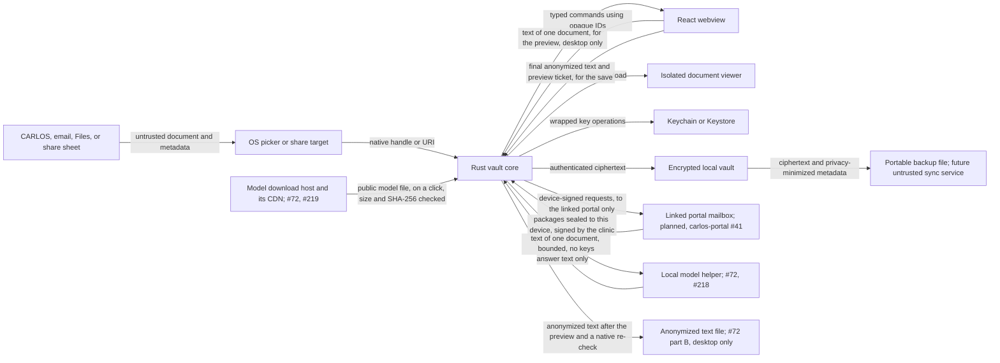

# myCarlos threat model

- **Status:** Durable-vault implementation complete; independent review and release gates open
- **Version:** 0.3
- **Date:** 2026-10-21
- **Initial platforms:** Windows, macOS, Android, and iOS
- **Deferred platform:** Linux, pending review of the documented `glib` backport and device/release validation
- **Data restriction:** Synthetic files only; this model does not authorize PHI use

## Purpose

This document identifies what myCarlos must protect, the trust boundaries an attacker may cross,
credible failure and abuse cases, and the controls and tests required before the application stores
patient records.

The native Tauri application includes the synthetic-data durable-vault slice described in
[`VAULT_FORMAT.md`](VAULT_FORMAT.md); the browser demo remains session-only. Implemented controls
are marked below, but they must not be read as approval for PHI or production use.

## Scope

The model covers:

- vault creation, locking, unlocking, and recovery;
- local PDF import, encrypted storage, viewing, and hiding (never deletion, #71);
- the React webview, Tauri IPC commands, Rust core, and operating-system services;
- local metadata, thumbnails, temporary files, logs, and crash artifacts;
- the portable encrypted backup, and future multi-device enrollment and synchronization;
- future CARLOS document handoff and provenance verification, including pickup from the portal
  the patient links, myCarlos's first network use (carlos-portal #41);
- the AI helper (#72): an on-device anonymizer with a preview and a text-file export (built), a
  local model in a sandboxed helper and the answers it gives (the runtime, the model download and kept answers on main, #218, #219, #212); its
  only network use is the model download, on a click (AI-08); and
- build, signing, updating, and third-party dependencies.

It does not approve a PDF renderer, synchronization service, analytics provider, CARLOS
protocol, or AI model or model runtime. The current encryption and passphrase-only recovery
design is implemented but awaits independent review and target-device verification.

## Security and privacy objectives

1. A locked or powered-off device does not disclose document contents or sensitive metadata.
2. A cloud or synchronization provider cannot decrypt patient records.
3. Encryption and recovery keys never enter the React renderer, logs, analytics, or crash reports.
4. Untrusted documents cannot obtain native privileges or escape the document viewer.
5. Native commands expose the minimum capability required and authorize every operation.
6. Tampering, corruption, rollback, incomplete writes, and false provenance are detected.
7. Nothing a patient hides is lost: documents are never deleted, only hidden, and stay encrypted
   and restorable (#71, decided 16 October). A whole-vault reset or a restore sets the vault aside,
   whole and encrypted, instead of erasing it; only the patient, by hand, deletes one. On Android
   and iPhone that is possible only by clearing the app's data or uninstalling it, which removes
   every vault; this limit is accepted (decided 19 October), so starting again is offered only on
   the unlock screen, not in Security, and the documents say so.
8. Security failures are explicit and fail closed without silently destroying recoverable data.
9. The patient can understand when a record is verified, unverified, locked, backed up, or hidden,
   and that hidden documents are kept.
10. No production patient data is used until the applicable controls and tests pass review.

## System and trust boundaries

The important trust boundaries are:

| Boundary | Rule |
| --- | --- |
| External source to OS picker | Selection is user intent, not proof that a file is safe or authentic. |
| React webview to Rust | Treat the renderer as untrusted. Validate command, state, identity, size, and object ID in Rust. |
| Page to the Android activity | On Android the WebView has exactly one JavaScript interface, `MyCarlosSystemBars`, added by the patched `MainActivity` (scripts/configure-android-security.mjs). It has one `@JavascriptInterface` method, `set(colour, darkBackground)`, which accepts only a `#rrggbb` string (checked against `^#[0-9a-fA-F]{6}$`; anything else is ignored) and a boolean, and runs on the UI thread. All it can do is set the colour of the strip behind the status bar and the tone of the bar icons. It reads nothing, returns nothing and reaches no vault, file or network. The most that a hostile page or frame could do through it is change that strip's colour; Android injects the interface into every frame of the WebView, so it is only the app's own page that can reach it while two things hold: the CSP (`frame-src 'none'; object-src 'none'`, no iframe, object, embed or `window.open` in the app) and the navigation check (a top-level navigation goes through Rust's `may_navigate`, which allows only the bundled pages; see IPC-02). |
| Rust to OS key storage | Store only the minimum wrapping material and bind access to the intended application/device policy. |
| Rust to local storage | Durable document content, metadata, indexes, and derived artifacts must be authenticated ciphertext. |
| Vault to viewer | Decrypt only after unlock; constrain viewer privileges and prohibit uncontrolled network or native access. |
| Device to backup/sync | Treat the service and transport endpoint as unable to keep plaintext confidential. |
| CARLOS to myCarlos | Verify origin, integrity, freshness, and intended recipient before showing verified provenance. |
| Camera to webview | Video only for a photo, asked for after the patient chooses to use the camera, and stopped when the photo is taken or the dialog closes. For a video recording (#359) video with sound, asked for after the patient chooses Record video (VID-01). The frame stays in memory; Rust checks and cleans the JPEG before it is encrypted. |
| myCarlos to linked portal | Once linked, the portal is a mailbox, not a trusted source: it holds packages it cannot open (at linking, the clinic keys it returns are trusted on first use; NET-02). Connect only to the portal the patient linked, sign every request with that link's device key, and verify every package before anything is saved (NET-01 to NET-03, DEL-01 to DEL-06). |
| Vault to the AI helper's model (#72; the reader and the helper on main, #217, #218) | The model runs in a sandboxed helper mode of the app (`--mycarlos-model-helper`) with no vault keys, no network and no file access; it gets the checked model as a sealed memfd (Linux) or by path with writers denied (Windows) (AI-04, AI-07). It receives one document's pages and returns grammar-bound text only; its answer is never treated as instructions, links or markup (AI-05). |
| myCarlos to the model's download host (#219) | On a click only: HTTPS to the catalogue entry's pinned address and its CDN, no other host, no cookies or credentials. The file is public and holds no patient data; the host sees the computer's IP address, the time and which file; the size and SHA-256 are checked before the file is used (AI-04, AI-08). |
| Anonymized text to the patient's chosen AI service (#72 part B, desktop only) | myCarlos does not send it. The patient saves a plain text file after a preview and takes it where they choose; once saved, it is outside the vault's protection, like a readable copy, and what the receiving service learns or keeps is up to it (AI-01 to AI-03, AI-08, AI-09). |

## Assets

| Asset | Harm if compromised |
| --- | --- |
| Decrypted documents | Direct disclosure of personal health information. |
| Document titles, tags, dates, thumbnails, and provider names | Sensitive diagnoses and care relationships can be inferred without opening a PDF. |
| Vault data-encryption keys | Complete or object-level vault disclosure. |
| Passphrase-derived and recovery key material | Offline vault compromise or permanent patient lockout. |
| Device-bound wrapping keys and biometric authorization | Unauthorized unlock on a stolen or shared device. |
| Encrypted vault and manifest | Deletion, corruption, rollback, traffic analysis, or offline guessing. |
| CARLOS provenance manifest and signature keys | Forged or misattributed clinical documents. |
| Per-link device keys and pinned clinic keys | Reading deliveries meant for this device, posing as the device to the portal, or trusting a forged clinic. |
| Linked portal address and recipient ID | Tying the device to a clinic; the network learns that this device uses that clinic's portal. |
| Backup and synchronization state | Cross-device disclosure, rollback, duplicate resurrection, or data loss. |
| Logs, crash reports, clipboard, notifications, and OS snapshots | Secondary disclosure outside the vault. |
| Signing and update credentials | Distribution of a malicious application update to every patient. |
| Anonymized text and its exported files (#72 part B, desktop only) | A missed detail re-identifies the patient or someone else; the file is a plaintext copy outside the vault. |
| AI answers (#72; kept in the vault with #212) | They disclose health information as the document does, and a wrong answer may be trusted as medical advice. |
| The local model file and the model list built into the app (#72, #219) | A swapped model could exploit the model runtime or give deliberately misleading answers. |

## Threat actors and assumptions

Credible threat actors include a finder or thief of a device, another user of a shared computer,
malware with ordinary user privileges, a malicious document sender, a compromised website or deep
link, a compromised backup provider, a compromised or malicious portal operator, a network attacker
between the device and the portal, a supply-chain attacker, an attacker controlling a future
synchronization account, a sender who writes instructions into a document to steer an AI model
(prompt injection), and the AI service a patient gives exported text to (#72).

The following limits must be communicated honestly:

- The vault must protect a lost locked device and copied vault files.
- The vault must protect records from the backup or synchronization operator.
- The application cannot guarantee confidentiality while records are visible on a device whose
  operating system or privileged account is already fully compromised.
- OS key stores reduce key-extraction risk but do not replace a vault encryption and recovery model.
- myCarlos can verify that a package was signed by a recognized clinic; it cannot guarantee that the
  clinical content entered by that clinic is medically correct.
- Removing identifying details from text is never perfect, and an AI model can be wrong. myCarlos
  can show both to the patient (a marked preview, a label on every answer) but cannot rule them
  out. An AI service the patient is signed in to knows who they are, whatever was removed (#72).
- Availability after total device loss depends on the recovery and backup design. Until those are
  implemented and tested, the application must not imply that records are recoverable.

## Risk scale

Risk is initially qualitative because usage, deployment, and recovery designs are not final.

- **Critical:** plausible compromise or irreversible loss of most of a patient's vault, signing
  infrastructure, or recovery authority.
- **High:** disclosure or unsafe modification of one or more records, or escape from an untrusted
  document into native application privileges.
- **Medium:** limited metadata disclosure, local denial of service, or a weakness requiring another
  significant compromise.
- **Low:** minor impact with narrow prerequisites and straightforward recovery.

Residual risk must be rescored after a control is implemented and tested. “Planned” controls do not
reduce current risk.

## Threat register

| ID | Risk | Threat and impact | Required controls | Verification | Status |
| --- | --- | --- | --- | --- | --- |
| KEY-01 | Critical | An attacker copies the vault and guesses the patient passphrase offline. | Unique salt; reviewed memory-hard password KDF; platform-benchmarked work factor; random vault key wrapped by the derived key; no password verifier that makes guessing cheaper. | Password-cracking cost review and tests against copied vault fixtures on every target class. | Argon2id, 15-character minimum, local common-pattern/context screening, and benchmark harness implemented. The strength floor is zxcvbn score 3 (an estimated 10^8 to 10^10 guesses), kept on purpose: with the 15-character minimum many passphrases are expected to score higher (not measured), and a higher floor would refuse passphrases a patient can remember, which pushes towards writing them down or reusing one. At the floor itself, one Argon2id run per guess (64 MiB, 3 passes, 4 lanes) puts a copied vault within days of a well-equipped attacker, an estimate that has not been measured. Guessing through the app on the device waits after five wrong tries in a row (5 seconds, 5 more for each further one, to a minute), counted apart for unlocking (with the passphrase checks made while the vault is open), the recovery key and backups, and kept beside the vault across restarts; it does nothing against a copied vault or backup, where only the key derivation's cost applies, and whoever can delete its file, make it unwritable, set the clock forward or before 1970, or run several copies of the app at once undoes or weakens it. Production breach corpus, physical results, a measured guessing rate and the independent review of this floor open |
| KEY-02 | Critical | Recovery becomes a universal backdoor or is easier to attack than the passphrase. | Patient-controlled recovery only; no vendor or clinic recovery secret; high-entropy recovery kit verified at setup. A found kit opens the vault, so the kit carries no patient or document names and the key can be replaced. | Recover on every target with the kit and confirm the service cannot decrypt. | 128-bit recovery-key envelope (header format 2), typed-back verification before it is stored, replacement after which the old key no longer opens the current headers (the master key is not rotated, so it still opens earlier copies of them; the setup asks why the key is replaced: if its kit may have been lost or seen, the app guides the patient to save a new backup and then delete older ones, or to keep them while the vault cannot save one; otherwise it says to keep the old kit safe or destroy it on purpose), a short label that is not secret on the kit and in Security so that the current kit can be told from others, offered again when a vault without a key is unlocked, at most once a day (the hour of the last offer is kept in the app's settings on the device and names no vault; as an offer that can be left, which makes and shows no key until asked, and says to go on only when nobody else can see the screen), and recovery with a new passphrase implemented, with setup offered first when a vault is created (Escape or "Lock vault and finish later" first asks whether to discard the key on screen; confirming cancels the unfinished key and locks the vault, and Escape in that question goes back to the setup; the vault shows a banner until a key is set up), a saved or printed plain-text kit, and recovery from the unlock screen; on-device recovery drills and review open |
| KEY-03 | High | Keys leak into the renderer, logs, crash dumps, swap, or long-lived memory. | Perform key operations in Rust/native code; never serialize raw keys over IPC; redact diagnostics; minimize key lifetime; use protected memory/zeroization where supported. | Instrument IPC and logging, force crashes, inspect artifacts, and review memory-handling paths. | Rust boundary, direct zeroizing key buffers, and streaming-I/O cancellation implemented. Two deliberate exceptions. A new recovery key is returned once over IPC so the patient can write it down; the renderer keeps no reference to it once the setup dialog closes, and adds it to the page for printing only while it prints (printing hands it to the operating system's print service). A recovery key typed by the patient (on the unlock screen, or to open a backup) travels the other way, like a passphrase, and is wiped natively; on the unlock screen, and in the restore form, it waits in that screen's state until it is used, the app is hidden, or five minutes pass untouched. The renderer cannot wipe either from its memory. At first setup, the new passphrase being typed also crosses IPC before Create, to `vault_passphrase_rules`, so that the setup checklist ticks by the vault's own rules (#69): it is sent once typing has paused for 300 ms and never while Create runs, judged natively by the same function as Create, and wiped there as the command returns (its request zeroizes on drop, as `vault_create`'s does); nothing of it is logged or kept, no error echoes it, and the answer is three booleans, never a score or a hint. Shown as text in that screen, it is kept from spell checking, autocorrection and autocapitalization, as every shown secret is. A saved kit holds the key in plain text by design, written natively only to a file the patient picks; for a filesystem path it is refused inside the vault home, private to the user (on Unix) and replaced atomically, while a document provider (Android) is written directly. Blocking-provider, crash and artifact review open |
| KEY-04 | High | Biometric unlock bypasses the intended passphrase policy or survives device-account changes. | Biometrics authorize use of a device-bound wrapping key; passphrase/recovery fallback; invalidate as appropriate after biometric or device-credential changes. | Test enrollment changes, fallback, repeated failures, device restore, and copied application data. | Design selected; implementation open |
| KEY-05 | High | A stale key envelope or vault manifest is restored to bypass deletion or revive old access. | Authenticate and version key envelopes and manifests; define rollback detection and device reconciliation. | Restore older fixtures and confirm safe detection rather than silent acceptance. | Changing the passphrase, like replacing the recovery key, wraps the same master key again and does not change it: the earlier passphrase still opens any earlier copy of the vault's headers (a device backup, a copied folder, a saved backup file), and the master key it yields decrypts the vault as it is now and as it will be. The only remedy is a new vault, which the app does not guide and which loses folders, profiles and dates (the steps are in `VAULT_FORMAT.md`, "Known limits"); restoring an earlier backup into it brings the earlier master key back. The Change passphrase screen states the limit and tells the patient to ask for help before erasing; rotating the master key is not implemented, and is planned for after the first release: until then an old passphrase or recovery key, with a copy of the vault's headers made while it was in use, keeps opening the vault as it is now. Portable backup restore detects a copy of the same vault that differs from the backup, a different vault, or a vault it cannot read to tell, and requires explicit agreement, repeated in a trusted native dialog that says what would be lost, before replacing it (a restore brings back the documents, passphrase and recovery key the backup was made with); rollback of externally restored slots and device reconciliation open |
| KEY-06 | High | The patient loses the passphrase and permanently loses the only copy of the record. | Patient-held recovery kit, portable authenticated backup, rotation, and explicit custody warnings. | Recovery, rotation, lost-kit, and historical-backup drills using synthetic data. | Permanent-loss warnings, the recovery key and its kit, and the portable encrypted backup implemented; recovery and restore drills on devices open |
| KEY-07 | Low | A mistyped recovery key or hand-over key passes its 10-bit check by chance (1 time in 1,024) and is tried: a wasted try at unlock (it counts toward the wait), or a hand-over box that takes a recovery key for a hand-over key and says "wrong key". Nothing is exposed. | The check is the last 2 of the 28 characters, made from the key with a label that differs for the two kinds; it is not secret and does not weaken the 128-bit key; the typed-back key is checked before anything is tried; the wait after repeated wrong tries. | An exact count of all 868 one-character slips of one key and a 40,000-key simulation for the rates (Rust tests, #527, in review); fixed-key tests. | Today the check is 10 bits. A longer check is a format change for kits already printed, and `key-check-rates-20261126.md` recommends against it: an open question for Ben (PRIVACY_REVIEW, question 22), not a decision |
| IMP-01 | High | A selected path, URI, symlink, or replaced file makes the app import a different file than the patient chose. | Open once through native code; use handles/content URIs where available; reject links and special files; avoid check-then-open logic; never accept renderer-supplied filesystem paths. | Symlink, race, content-provider, shared-directory, and path-manipulation tests per platform. | Local links/special files rejected, Unix no-follow and Windows reparse-point handle checks implemented, and renderer paths excluded; ordinary-file replacement races/content-provider testing open |
| IMP-02 | Critical | A crafted PDF exploits the parser and reaches vault keys or native commands. | Sandboxed capability-free rendering helper with no vault keys or network; bounded rendered output; prompt renderer updates. | Malformed corpus, known parser regressions, network observation, and attempted IPC/native access from the renderer. | Helper for unlocking (#54) and viewing (#48): parsing runs in a separate process with no vault keys, and myCarlos itself is not dumpable on Linux, so a helper cannot read its memory. The helper is sandboxed before it reads anything (#63): on Linux a seccomp allowlist (stdin, stdout and stderr, non-executable memory, ending; no open, socket, exec, ptrace or signal to another process) is required, with Landlock denying every file and network right on top where the kernel has it; on macOS `sandbox_init` with a deny-all profile; on Windows myCarlos starts it in a no-capability AppContainer (no network, no user files, low integrity), inheriting only its two pipes, inside a job object (memory, one process) it joins before it runs, and the helper checks its token. The helper's only environment is a placeholder LOCALAPPDATA (C:\mycarlos-none), which Windows needs to start an AppContainer: it is not a real folder, and no user variable is passed. If the sandbox cannot be set up the helper reads nothing and the patient is told the document cannot be opened safely on this system. Resource limits (CPU, memory, file size, processes, descriptors; macOS footprint checked by myCarlos) and a 30 s watchdog bound cost. Per-platform tests in CI try to read and write a file, connect, and start a program from inside it, against a control without it. Phones do not run it. Not covered: kernel exploits, side channels |
| IMP-03 | High | Oversized, recursive, or pathological input exhausts memory, disk, battery, or CPU. | Bounded open handles; constant-memory streaming; vault quota; bounded parsing; cancellation; timeouts; page/image limits; safe cleanup after termination. | Large-file and large-batch imports, PDF bomb, oversized image, excessive-page, low-disk, and cancellation tests. | Pre-open 100-file selection bound, bounded IPC collections/metadata, generated 101 MiB constant-memory test and I/O-boundary cancellation implemented; quota, blocking-provider timeout and parser/viewer limits remain |
| IMP-04 | High | Plaintext remains in temporary files, previews, thumbnails, caches, or failed imports. | Stream into authenticated encrypted storage; keep derived artifacts encrypted; use atomic commit; remove incomplete artifacts. | Interrupt each import stage, restart, and scan application-controlled storage for recognizable plaintext. | Streaming/staging and canary tests implemented; crash matrix open; an unlocked PDF goes from the helper into the vault in memory only, never a temporary file |
| IMP-05 | Medium | Filename, provider, diagnosis, or other metadata leaks before vault unlock. | Encrypt metadata and indexes; use opaque storage names; minimize lock-screen, recent-file, and OS-search integration. | Filesystem and OS-index inspection while locked. | Encrypted manifest and canary test implemented; OS inspection open |
| IMP-06 | High | An ordinary imported PDF is displayed as a verified CARLOS record. | Label manual files Patient imported · Unverified; verify a signed, recipient-bound CARLOS package before showing verified status. | Modify document and manifest fields, use unknown/revoked signers, and confirm the UI cannot show verified status. | Manual-import trust state implemented; approved wording and signed packages open |
| IMP-07 | Medium | The same package is replayed or imported repeatedly, confusing record history. | Stable signed document ID, content hash, idempotent import, and explicit duplicate handling. | Replay identical and modified packages across devices and restores. | Future CARLOS gate |
| IMP-08 | High | A picture the patient brings from their files (a JPEG from a phone, a PNG screenshot, a scan, another app) carries where it was taken (GPS), when, the device, a second picture inside it (an Exif thumbnail), a comment or text chunk, or something hidden after its end; or it is cut or built to crash or exhaust the reader (a tiny file that declares a huge size, a chunk whose length runs past the file, a bad checksum, an animation). | Each JPEG is read by walking its marker segments in Rust before it is encrypted: one 8-bit baseline or progressive frame, a size cap, no trailing bytes. Everything but the picture is dropped. Two things are put back, rebuilt and never copied: the Exif **orientation** (a 34-byte block holding only that number, so a portrait photo is not shown sideways) and the picture's **colour profile, rebuilt** (only the colour numbers of a matrix and curve RGB profile are read out, each checked to its exact type, size and range, and a new profile is written around them with a zeroed header and our own fixed description and copyright, so no maker, model, date, creator, id, text or hidden bytes survive; a lookup-table or other profile is dropped and the picture shows as sRGB; skin and rash colours matter). Whatever follows the first end-of-image marker (the gain map and MPF index that Ultra HDR and iPhone files append) is never copied. A file is told apart by its own first bytes, not its name; a JPEG that merely contains the text %PDF- is cleaned as a picture. A **PNG** is read as a list of chunks, never decoded (`photo_png.rs`): each length is checked against the file with checked arithmetic and each CRC against its bytes, and only IHDR, PLTE, tRNS, gAMA, cHRM, sRGB, IDAT and IEND are written out, byte for byte; text (tEXt, zTXt, iTXt), eXIf, tIME, pHYs, every unknown ancillary chunk and anything after IEND are dropped; the **colour profile (iCCP) is never copied** (it is deflate-compressed, and reading it would need an inflater on the path from an untrusted file), but its uncompressed NAME is read: exactly `Display P3` becomes a fixed cICP chunk (12, 13, 0, 1) and exactly `sRGB` a fixed sRGB chunk, so an iPhone screenshot keeps its colours, and any other profile is dropped (the picture shows as sRGB); a profile that does not match its name is replaced by what the name says and none of its bytes is carried; an unknown critical chunk, a repeated or misplaced chunk, a bad zlib header and an **animated PNG** (acTL, fcTL, fdAT) are refused; the declared size is capped at 8192 pixels a side and 50 million pixels in all (24 million on a phone), so a small file cannot become a huge picture when the system draws it. **What does survive:** the image data (IDAT) is copied as it is and is never decoded here, so the pixels themselves survive (a place, time or name that is written INTO the picture, as in a screenshot of a map, is part of the picture), and so would bytes placed after the end of the compressed stream inside an IDAT chunk, or an unusual but valid choice of filters or block sizes: they are inert, never drawn, but present in the stored copy. Cutting them would need decoding the stream, which is not done on this path. **A damaged compressed stream is not detected at import:** the header and checksums are checked, the stream is not decoded, so such a file is added and then fails to show (the patient can hide it; the vault has no delete); it cannot harm the app, as the system's own decoder meets it only inside its usual limits. HEIC and other types are refused with a plain message (share or save as JPEG). A picture is cleaned again when it is shown, so one stored by an older version is never drawn with its details. | Unit tests with FAKE JPEGs carrying GPS, a thumbnail, a comment, trailing bytes, a gain map and MPF index after the picture, a FAKE profile with a device maker, model, creator, id, date, text tags and hidden bytes (none survives), 27 kinds of malformed or unsupported profile, more than nine profile segments, oversize and truncated frames; a run on the output gives the same bytes; the file-type test with a JPEG that holds %PDF-. For PNG: FAKE place, time and camera in tEXt, zTXt, iTXt, eXIf, tIME and an unknown chunk (none survives), an APNG, a huge declared size, a bad CRC in every chunk kind, every truncation, chunk lengths that overflow, misordered chunks, and generated chunk lists (the output never grows, cleaning it again changes nothing, no panic); a picture the system decodes before and after cleaning has the same pixels. | Implemented for JPEG (first picture step) and PNG (second). Open question: a PNG's colour profile is dropped, not rebuilt (it would need a pinned `miniz_oxide` for a bounded inflate) |
| CAM-01 | High | The camera turns on without the patient knowing; a photo carries where it was taken (GPS), the camera, or another picture; or a photo is left readable outside the vault. | Camera asked for only from the camera dialog, after the patient's choice, for video and never sound (the recording dialog's sound is VID-01); on Linux and Windows the native permission handlers allow the camera for the app's own pages only and refuse every other request, the microphone only as VID-01 says (on macOS and iOS the patched Wry answers the same way, #359 PR 7; on Android Wry's own handler grants the page's request, see VID-01); every track stopped when the photo is taken, the dialog closes, the vault locks, or the window is hidden. The JPEG is drawn and encoded by the app's own canvas, then checked and cleaned in Rust before it is encrypted: one 8-bit baseline or progressive frame of at most 8,192 pixels a side, at most 25 MB, with every APP1–APP15 segment (Exif and GPS, XMP, ICC, IPTC, maker data), comments, any JFIF thumbnail and anything after the end marker removed, by walking the markers, never decoding pixels. The photo is stored through the import path, with its encryption, verification and duplicate check; nothing is written to disk in plain form. | Rust tests with a GPS-tagged Exif block, XMP, ICC, IPTC, comment, thumbnail and appended-video JPEG built from a real canvas JPEG; refusal of malformed, other-coding and oversized JPEGs; component tests with a fake camera for every way the camera stops; browser test with Chromium's fake camera and a refused camera. | Desktop implemented (Linux WebKitGTK: media stream turned on, user-media requests for video, alone or with sound, allowed for the app's pages, everything else refused, sound alone included; Windows WebView2: the camera and the microphone allowed for the app's pages, every other kind refused, also when a request cannot be read; macOS: the patched Wry (#359 PR 7) grants video, alone or with sound, from the app's own main frame only, and denies everything else without a prompt, then macOS asks with `NSCameraUsageDescription` and, for sound, `NSMicrophoneUsageDescription`; a signed hardened-runtime build will also need the `com.apple.security.device.camera` and `com.apple.security.device.audio-input` entitlements). A document's details ask only whether its file starts as a JPEG, reading its first bytes; the photo is decrypted and sent to the webview only when the patient chooses View photo, and dropped when the view closes. The webview's own copies of camera frames, the canvas and the encoded JPEG are freed but cannot be overwritten by the app (it zeroes the bytes it holds and clears the canvas), and neither is the IPC layer's copy of the request body. The camera dialog keeps a photo's JPEG under 4 MB, lowering its quality and then its size, so that copy stays small. A photo is shown by the main webview's own image decoder, from a `data:` URL the vault returns after the same checks; viewer isolation remains as for IMP-02. When Tauri uses its postMessage channel instead of its custom protocol (always on Android, and on Windows once the custom protocol has failed in a session), the photo's bytes arrive as a JSON array of numbers that Tauri has already parsed into its own value before the app's handler runs: that copy, several times the photo's size, is neither overwritten nor size-limited by the app, which counts the array against the 25 MB limit only before copying it. Phones (D97), written but not yet run on a device: the same dialog, back camera first, and the same canvas JPEG and Rust cleaning. Android: the manifest declares the camera permission and the microphone's (`RECORD_AUDIO`, `MODIFY_AUDIO_SETTINGS`), neither required, and a build without them fails; Wry's web chrome client asks Android for that permission when the page asks for video (and for `RECORD_AUDIO` when it asks for sound), then grants the page's request (it does not check the origin or the kind itself: only the app's own pages load, and the photo dialog asks for video only). iOS: the patched Wry answers WebKit's capture request the same way as on macOS (video, alone or with sound, from the app's own main frame; nothing else), and plays video inline (the patched method is called only on macOS 12 and later and iOS 15 and later; on older systems WebKit's own default answers and the app's decision is not applied), and iOS asks with `NSCameraUsageDescription` and `NSMicrophoneUsageDescription` from `Info.plist`; the photo dialog never asks for sound. Android also declares the autofocus the camera permission implies as not required, so Google Play does not leave out devices without it. While the phone asks whether myCarlos may use the camera, the lock on hiding the app is held as for a file picker (UI-03). Real cameras on Windows, macOS, Linux, Android and iOS, the Android "don't ask again" path and iOS's custom-scheme page counting as secure for the camera open |
| VID-01 | High | The camera and microphone are on while the patient does not know: before they chose Record video, while a recording is paused or its window is hidden, after the vault locks, or because a page other than the recording dialog asked. Sound is also a request the photo dialog never made. | Camera and microphone asked for only from the recording dialog, only after the patient taps Record video, and only as one request for video with sound (never sound alone). On Linux, the native handler allows video, alone or with sound, for the app's own pages and refuses sound alone and everything else, a request for the screen (display capture) included (it is neither a camera nor a microphone request, so the decision refuses it; a unit test pins that). On Windows, WebView2 raises the camera and the microphone as two requests, so the handler allows each for the app's own pages and refuses every other kind, also when a request cannot be read; it cannot tell a microphone request on its own from half of a recording's, and accepts that only because the page is the app's own, bundled, CSP-bound, and asks only after the patient's choice. macOS and iOS: upstream Wry grants every capture request, so myCarlos carries a small reviewed patch to the vendored Wry (`src-tauri/vendor/wry.patch`, #359 PR 7): the decision is video, alone or with sound, from the app's own page (`tauri://localhost`, the main frame, the default port) and nothing else, sound alone, any other origin, a subframe and every unknown kind included, which are denied without a prompt; the system then asks the patient, with `NSMicrophoneUsageDescription`. The decision is a plain function the tests run on every host, and the patch changes only three files (it adds that one, registers it, and replaces the delegate's grant-everything line), checked against the crates.io release by `scripts/verify-native-vendor.py`. Android declares `RECORD_AUDIO` and `MODIFY_AUDIO_SETTINGS` (none required, so devices without a microphone can still install it); Wry's web chrome client asks Android for `RECORD_AUDIO` when a page asks for sound and then grants the page's request without checking its origin or its kind, so on Android, like Windows, a request for sound alone from a page that is loaded is accepted: the residual is the same (only the app's own bundled pages load). The photo dialog still asks for video only. The operating system's own switches and indicators (Windows' microphone setting, macOS and iOS and Android's prompts and recording indicators) stay in force. In the recording dialog a badge always shows that recording or paused is on (in words, with an icon, not colour alone), Stop is always in reach, and every track is stopped at Stop, close, lock, hide, when a track ends, when the recorder cannot start and when the vault refuses a piece; a pause keeps both tracks open, disabled, with the plain note "Paused. Camera and microphone are still on.", and Close asks whether to stop and save, never discards. | Unit tests of the decision for each platform's request shape (video alone, video with sound, sound alone, neither, another page, every other kind); the Android manifest script and its test (the microphone declared once, not required, nothing else about sound or storage); `build.rs` refuses an Android build without the declarations; browser and component tests of every way the tracks stop, with a fake camera and microphone, when the recording dialog exists. | Permissions implemented (PR 3 of #359): Linux and Windows handlers, Android manifest and build check, `NSMicrophoneUsageDescription`, the iOS minimum set to 14.5 (Safari records MP4 from iOS 14.5; Tauri's default is 14.0). Written, not run: Windows (this change was not built there), a real microphone on any platform, the Android "don't ask again" path, a hardened-runtime build's audio-input entitlement (no signing yet, #24). macOS and iOS (PR 7): the decision and the patch are tested on this host, but the Apple code itself, the delegate, is not compiled or run here; it needs a Mac or an iPhone build (TESTING.md, "Camera and microphone on Apple devices"). The recording dialog is built (PR 4): component tests with a fake recorder and FAKE canvas and tone media cover each way the camera and microphone stop (Stop, Close, hide, a track ending, a refused piece, a recorder that cannot start, the dialog going away on a lock), the badge, the paused note and the announcements. Not run: a real camera and microphone on any platform, and a lock arriving while a real recorder runs |
| VID-02 | Medium | Plaintext video reaches places the vault does not control: the webview's memory while recording and playing, a temporary file, a thumbnail, a cache, or a copy a script keeps. | A recording goes from the recorder to the vault one piece at a time (about a second of video, at most 8 MiB) and is encrypted there as it arrives; the page keeps at most 16 MiB unsent and ends the recording past that. Nothing is written to a file by the app, and the page makes no thumbnail, poster or copy. Playback decrypts only the frames a range touches, in Rust, and sends them to the player over the `mycarlos-video` address; nothing is cached by the webview's HTTP layer (`no-store`), and the viewer is torn down on close or lock. The webview's own copies (recorder buffers, the IPC layer's copy of each piece, the player's decoded frames) are not overwritten by the app, the same accepted residual as photos (CAM-01), larger in volume. | Tests that no recording file holds readable video, that frames are authenticated and bounded, that the page's unsent bytes are limited, and the viewer's teardown. | Implemented (PRs 1, 2 and 4 of #359). Residual: plaintext in the webview's memory for as long as it is recording or playing, and its copies after. Not run: an inspection of a real webview's memory and caches |
| VID-05 | Medium | A recording fills the disk: the vault cannot finish its last frame, verify and commit, a crash cannot be recovered, or the device is left unusable. | At least 1 GiB free is needed to start and again on every resume (checked before the camera and microphone are turned on); the vault looks at the room every 8 frames written (about 8 MiB); from 512 MiB left the page warns with about how many minutes remain; at 256 MiB the page ends the recording and it is saved normally, the 256 MiB being the reserve for the last frame, the verification and the commit; a write the disk refuses anyway ends the recording, and what was written is kept as an unfinished recording (finishing it means copying it, which needs room) and finished at the next unlock when there is room, the page saying so; recovery needs about the recording's size again and, without it, leaves the journal and nothing is lost. | Unit tests with a stand-in for the disk: the levels, a start refused below 1 GiB with nothing written, the look every 8 frames, the stop at the reserve and a refused piece after it, a recording saved at the reserve with no copy made, recovery waiting for room and declining needing none; component tests of the message before the camera, the warning, the stop, a disk that fills anyway and a resume with no room. | Implemented (PR 5 of #359). Residual: a recording that ends in the middle of a fragment, or by a write the disk refused, is kept as an unfinished recording to be finished when there is room, rather than saved at once (finishing it copies it; the vault never rewrites a sealed frame). On iOS and Android the system's free-space figure (`statvfs`) can leave out space the system will reclaim (purgeable and cache), so the 1 GiB refusal can appear while Settings shows more free space. Not run: a real full disk on any platform |
| VID-03 | Medium | A video with sound records other people: someone near the patient, a clinician in the room or a person on a call is heard, and has not agreed. The patient may not expect that a video carries sound. | Before each recording the dialog says it, in the first screen and before anything is turned on: "The video is recorded with sound. People near you may be heard. Only you can open it." The recording shows that sound is being recorded for as long as it is. Videos are stored like any document: encrypted in the vault, never saved elsewhere, and sent from myCarlos only if the patient chooses to send it. The usage descriptions on Apple platforms say the same in the system's own prompt. The app makes no transcript and no copy of the sound. The patient decides whom to record and who receives a video; telling the other person is theirs, as with any recording on a phone. | Component tests that the notice is shown before the first recording and the badge while recording (when the dialog exists); review of the usage descriptions and the privacy wording. | Wording written (Info.plist, PRIVACY_REVIEW) and shown by the recording dialog (a component test pins it), with the Recording and Paused badge in words. Residual: a person whose voice is recorded cannot be asked by the app, and a video the patient sends on can still be heard by whoever receives it |
| PKG-01 | High | A profile handover package (#360) is a copy of one person's records outside the vault's protection, and could give away the source vault's keys, names or devices, be altered in transit, or have its clinic evidence forged. | Its own random key, never derived from a vault secret, generated by default (7 groups of 4, shown once and never stored) with a typed passphrase held to the vault's rules for a new one; the source vault's own passphrase is refused by the export command (PR 3); no vault id, name, device, link, clinic or time in the clear and a generic file name; the manifest and the plaintext hashes encrypted and padded to a size class; every folder, record and object id made by the writer so none of the vault's ids is in the file; every chunk bound to the package id, the object and its place; one tag over the header and every entry; nothing trusted before the whole file has been read and the tag has checked; export copies and changes nothing in the source vault. | Rust tests: round trips with a generated key and a passphrase across the chunk boundaries; wrong key, mistyped key, newer format, bit flips and cuts at sampled places, trailing bytes, swapped, repeated and missing entries, and a re-signed trailer that lists what the file lacks; a scan of the file for names, plaintext and vault words; two exports differ everywhere and share no id; an export reads back and fails closed at each step (sync, verify, rename) leaving the destination and the history as they were, and is refused inside the vault home, for Shared with me and for the vault's own passphrase; the tail check refuses a file cut after the manifest, flipped, extended or with another package's digests; a newer-format header or manifest is reported as newer; a failed writer writes no more; a recovery key typed as a package key is named; the vault's own reader opens an object entry; manifest rules and limits. | Package format and writer/reader (PR 1) the import (PR 4: capped before allocating, re-encrypted as it streams, verified whole before anything is published, one commit or nothing, duplicates by content hash, evidence never trusted beyond `valid_carried`) and the export (PR 3: one pass under the held session, read back with the key before it replaces anything, the vault's own passphrase refused for a typed one). Residual: whoever holds both the file and the key can read it, a typed passphrase is only as strong as its Argon2id cost allows (as for a backup), and the file shows how many documents there are and how large they are. **Typed-passphrase check limited (review of #408, #410):** refusing the vault's own passphrase as a package passphrase would be an oracle for guesses of it from an *unlocked* device, one Argon2id each, without the unlock screen's throttle. So at most twelve typed package passphrases reach that comparison in one unlocked session (a counter in memory, zero at every unlock and lock); the thirteenth and later are refused with one fixed answer (`package_passphrase_tries_used`: lock and unlock again to keep trying, or use the generated key, which is not limited) whatever was typed, so guessing costs an unlock for every twelve (Ben raised it from five: typos made five too likely to run out). A recovery key's shape, an over-long text, a rules refusal and a "wait" cost no derivation and are not counted; saving a prepared export is the same try, not another. What remains: someone at an unlocked device already has every document it shows, and the five tries per unlock still test a few guesses; the refusal wording does not say which of three reasons applied. A letter to a child can name the parent or guardian, and a package carries a document whole, unedited |
| PKG-04 | Low | A parent hides a whole person (#360) and expects them to be secret from someone who holds the unlocked app or knows the passphrase; or a hidden person's documents reach a list, the AI helper or a notice that should not show them; or a document for a hidden person is lost or tucked away unseen. | Hiding is tidiness, not secrecy, and the screens say so: anyone who knows the passphrase can restore. One flag on the profile, in a format of its own (15) that an older build refuses, so no build lists a hidden person without honouring the flag; the snapshot lists them only in Hidden people, and every lookup by id (read, copy, rename, folders, move, hide, AI answers, identifiers, edits, import) refuses their documents and folders; the AI helper's kept text is forgotten when they are hidden; nothing is deleted or re-encrypted and no document's own state changes, so a restore returns exactly what was visible; the last visible person and Shared with me cannot be hidden. A delivery for a hidden person is filed in Shared with me, visible at once, and the notice names the clinic and never the person, so a glance at the screen does not show who is hidden. | Rust tests: round trip, one commit and entry, last visible and Shared, every lookup refused, a delivery for a hidden person and its restore offer, backup and an older backup, the format gate, a process killed at each write boundary. Playwright: Hide, Hidden people, Restore, the offer to move what arrived, the last-person rule, the check notice. | Implemented (PR 7). What stays visible, exactly: **Security's Hidden people list** shows each hidden person's name, the day they were hidden and their document count to anyone at the unlocked app; **Security's history** leaves out every entry about a hidden person (their profile's, their documents' and their folders') and says only "N entries about a hidden person", showing them again on restore; the entries, the person's name and every document are still in the vault, in its history and in every backup, and anyone with the passphrase can restore. A hidden person's damaged file is counted, never named, in the confirmation to hide damaged documents (the vault is read-only until it is dealt with). A new clinic document for a hidden person is in Shared with me, with the clinic named and the person not. Hiding removes none of that from the vault or a backup |
| PKG-05 | Low | A document is filed under the wrong person (#340): a handed-over file lists previous full names that steer future clinic documents to the imported person, two look-alike people are silently picked between, or the clinic's name is saved over a person's own details. | Filing stays exact and the patient's: a clinic document files itself only when exactly one person (hidden people counted) has the clinic's birth date and a full name or previous full name equal to the clinic's in trimmed Unicode NFC, with no case folding and no fuzzy match; two matches leave it in Shared with me, and so does a link tied to another person. The import preview lists the file's previous full names and says they will also be used to file new clinic documents; the patient can still choose not to import. "File under…" preselects nobody, saves nothing to a person's details unless the patient ticks a box that names exactly what is saved, offers only a field the person has none of, and offers nothing, with a warning, when the person's name or birth date differs from the clinic's; it makes no promise that the next documents will file themselves when the link is tied to someone else or another person matches. The clinic's own words are shown only for a document waiting in Shared with me and never when they are a hidden person's. | Rust: full and previous names, another birth date, padded and look-alike duplicates, NFC comparison, a hidden person's words, the preview's previous names. Playwright: nothing preselected, the unticked box, merged details, the differing-details warning, no promise when another person matches. | Implemented (#340 phase 1). Residual: a file's author can choose previous names for the imported person, so a malicious file can route a later clinic document that exactly matches those names and the birth date to that person; the patient sees the names before importing, and a document filed there is visible in that person's own list |
| IPC-01 | Critical | Compromised React code invokes privileged Tauri commands to read, overwrite, or erase data. | Keep narrowly scoped capabilities; commands accept bounded opaque vault IDs rather than paths; authorize lock state and operation in Rust; require trusted native confirmation for whole-vault reset; no generic read/write/execute command. | Enumerate generated permissions and fuzz every command while locked and with invalid IDs. | Opaque application commands declared in the build manifest and granted only to the main window, collection bounds, no webview plugin/core permissions, native reset confirmation (and native confirmation before a restore replaces a vault, and before a new recovery key replaces the one a vault has), arbitrary IPC deserialization properties and locked/unknown-ID operation matrix implemented. The setup checklist's `vault_passphrase_rules` reads and writes nothing: it is refused once a vault exists, open or locked, so it cannot be used to test guesses against a vault, and it answers three booleans only (#69). Accepted for now: changing the passphrase and hiding documents have no native confirmation, so compromised page code, which sees the passphrase as it is typed, can change the passphrase to one of its own, which locks out a patient whose vault has no recovery key (a vault that has one still opens with it, if the key was set up while the page code was sound: replacing it is confirmed natively, though giving a vault its first key is not, and the confirmation cannot show which key is being stored, so page code that showed the patient a key of its own making during a setup would leave the vault with a key only it holds; a kit saved to a file is written natively and holds the true key), or hide every document one by one (or those shown as damaged), which takes them out of view but deletes nothing (#71): Restore brings each back. Whether these get a native confirmation is an open product decision. While that confirmation is open the automatic lock is held off, as it is for a file picker, for no longer than a picker's hold, and the lock on hiding the app waits with it. The first button of each native confirmation, which is the default Enter/Return target on Windows and macOS, keeps things as they are; the button that goes ahead is the second, and only it counts as agreement. Which button Enter, Space and Escape press rests on how each platform lays a dialog out. The dialogs are given the app's window. By the dialog library's source and the platforms' own documentation, on Windows the first button is the default and Escape and closing cancel, and on macOS a native main-thread sheet of the window assigns Return to the first button and Escape to the third, with no shortcut for the second, independently of their translated titles. Only a supported language tag crosses IPC; native code selects the bundled warning and button text and refuses blank or colliding labels. On Linux the dialog sets no explicit default and takes no notice of the window, so focus and keyboard behavior depend on the desktop configuration. Automated native tests check cancellation and deliberate confirmation on Windows and Linux; platform coverage and remaining device checks are tracked in TESTING.md. Explicitly activating the second button still goes ahead. Native harness fuzzing remains |
| IPC-02 | High | XSS or remote content gains the privileges of the main application webview. | Bundle UI assets; restrictive CSP; no remote scripts; sanitize rendered text; isolate document content; review navigation and deep links. | CSP tests, dependency review, injected markup fixtures, and blocked-network assertions. | Production CSP/dev separation, prototype freezing, and hostile-metadata/off-origin browser regression implemented; the window refuses to go anywhere but this platform's bundled pages (and the development server in a development build), and on desktop refuses to open another window, with the rule unit-tested. Residual: the library lets through an address that it cannot parse itself, a phone's webview has no new-window hook (a new window there is expected to be a navigation, which the rule covers; unverified until tested on a device), and on Windows the rule sees the main frame only, so frames rest on the policy's `frame-src 'none'`. Windows CI exercises installed-app startup, native IPC, bundled-page navigation, and refusal of external navigation and popups. WebView2 can send a speculative GET before navigation cancellation, so Windows also intercepts document requests and returns a local refusal for disallowed origins before transmission. Startup navigation waits for that interception to be installed; registration failure aborts startup, and failure to enforce a refusal exits the app. This is a document-request boundary, not a general network firewall. Remaining checks cover installed builds on macOS, mobile, and unsupported Linux, channels no policy covers (WebRTC, DNS prefetch), deep links, and viewer isolation |
| IPC-03 | High | A plugin silently expands filesystem, shell, network, or clipboard authority. | Per-window capability files; exact plugin inventory; security review for every permission change; deny unused mobile and desktop scopes. | CI diff/check of capability manifests and generated mobile permissions. | Partially addressed in POC |
| VID-04 | High | The playback address becomes a way to read the vault: another page, a script, a guessed or old token, or a hostile `Range` header gets video bytes, other records, or the vault's memory; or a video stays playable after the vault locks. | The `mycarlos-video` scheme serves only `GET` and `HEAD` for `/<token>`, where the token is 32 random bytes made for one video at one unlock, kept in memory, and ended by a lock, a reset or a dropped session (the same bare 404 for a token that never existed, ended, or predates the lock). Nothing is looked up by name, id or path. One response is one range of at most 2 MiB (a request with no `Range` is answered as `bytes=0-`); a header that is not a single `bytes` range of plain decimal numbers, or is over 128 bytes, or cannot be met, gets 416 and reads nothing. Only the frames a range touches are read and authenticated (a frame is checked for its position and for being the last before anything of it is used), at most four are kept decrypted, and the object's size must match the manifest before it is opened. The four decrypted frames and the object's key are zeroed when playback ends (a lock, a reset, a close); the response buffers (up to 2 MiB) and the webview's own copies of the video are not overwritten by the app, the same accepted residual as photos (CAM-01). Only the main window may ask; any other webview gets the same bare 404, and the answer is made off the UI thread. No `Access-Control-Allow-Origin`, `no-store`, `nosniff`; the CSP names the scheme in `media-src` only, never in `connect-src`, so page script cannot `fetch` it. At most eight videos are open; opening another ends the oldest. | Unit tests: every range form and overflow, the 2 MiB cap, a seek into the middle (only the frames it lands in are decrypted), the whole served file read back through ranges and compared with an independently built one, a damaged frame refused on read, an object cut at a frame boundary or extended refused on open, hiding a document ends the video playing from it, serving a range not counted as activity (so a paused player buffering ahead holds nothing), a non-video refused, tokens refused after a lock, a reset and a poisoned session, and the CSP's `media-src`/`connect-src` split. | Playback implemented (PRs 2 and 4 of #359): the commands that open and close a playback and the viewer exist, a hidden document's playback ends, the viewer is torn down on close or lock, and serving a range is not activity (only a video that is playing holds the automatic lock). Not run: a real webview playing from the scheme on any platform (the spike CI, Ben's to install, proves that); WebView2 and Android serve it at `http://mycarlos-video.localhost`, which the CSP names |
| VID-05 | High | A video file the patient picks is hostile, or carries more than they think: a crafted file reaches a parser bug, a huge declared size or box tree fills memory or the disk, a track points at a file outside the video, the file changes while it is added, or the place and device details of the phone stay in the stored copy. | Nothing is decoded by the app: the file is walked as boxes, once and in order. `ftyp` must come first with an allowed brand (isom, iso2, mp41, mp42, avc1, qt; HEIC, AVIF and M4A fail it); one `moov` of at most 32 MiB; exactly one H.264 picture and at most one AAC sound; every track's data inside this very file (no external reference); not fragmented; a picture of at most 7,680 pixels a side; at most 4,096 top-level and 200,000 inner boxes, 200,000 edits and 16 MiB of removed bytes; and 2 GiB on a computer or 1 GiB on a phone, enforced as the file is read (a source that never ends is cut off one byte past the limit). The place and device details go by renaming the `udta`, `meta`, `uuid` and unknown boxes `free`, removing every track that is not the picture or the sound (a phone's location track), and zeroing their bytes in place: nothing moves, so every offset stays right, and a removed range must lie inside one media-data box and clear of what a kept track uses. The file is read twice; the second pass hashes what it reads, takes no byte past the checked length, and is refused unless it ends with the same bytes, so what is stored is only what was checked (a swapped or still-growing file is refused, and a growing one is stopped at once, not copied). Room (the file's size and 256 MiB) is checked before any byte is stored; a Cancel, a lock or a failure leaves no record, object or staged file. A record is a video because the history says `pickedVideo`, never because of its bytes, and it is served as it is stored under the same range rules as VID-04. | Rust tests (`video_import`, `picked_video`, `playback`): accepted and refused samples with a reason for each; hostile track tables; endless boxes and edits; a source without an end; a removed range across two media-data boxes; nothing moves; a changed, grown and cut-short second pass; cancel in each pass; store failures; no room; the backup plan and size count it; playback and ranges of a stored picked video; component tests of every refusal in the seven languages, the progress and Cancel. | Implemented (#490, #500, the playback and page changes). Residual: the system's own player (WebKit, WebView2, Android's WebView) still decodes the file, and its decoders are not ours; only the boxes and tracks named above are removed, so other details a file may carry (the creation and modification times in the movie, track and media headers, a title in a sample entry) stay, and the page says only that the place, and the device's name and model, are removed (the times in the headers and the names of the video and sound formats stay, as the privacy notice says); not run on a real phone, or with a file near the limit |
| IPC-04 | High | A command returns sensitive paths or error details to the renderer or console. | Patient-safe fixed errors; opaque IDs; no absolute paths; structured redaction at the native boundary. | Force native errors and inspect UI, console, logs, and crash output. | POC returns basename only; broader review open |
| STO-01 | Critical | Vault files or metadata are readable directly from disk or an OS backup. | Authenticated encryption for every durable sensitive object; encrypted metadata/index; random opaque filenames; backup exclusions for any plaintext cache. | Copy storage and backup images, then search for known document and metadata canaries. | Implemented with automated canary coverage; OS-backup inspection open |
| STO-02 | High | Ciphertext or metadata is modified, swapped between records, truncated, or corrupted. | AEAD; bind object ID, type, version, and vault identity as authenticated data; verify before use; safe corruption state. | Bit flips, truncation, object swaps, and cross-vault copy tests. | Bit-flip, truncation, record-swap, cross-vault copy, and one/two-slot manifest tests implemented; physical-device matrix remains |
| STO-03 | High | Crash, low disk, or power loss produces a partially committed record or destroys the previous valid state. | Transactional metadata; redundant generation-bound headers and identical manifest states; unambiguous committed/degraded outcomes; recovery-mode read access; safe orphan cleanup; write-verify-rename/commit sequence. | Terminate the process and inject write failures at persistence boundaries, then restart repeatedly. | Exclusive OS ownership prevents concurrent app instances from overwriting stale state. Subprocess termination and deterministic `NoSpace` matrices cover chunk/staging/rename/manifest/deletion/reset boundaries; physical power-cut and full-filesystem matrix remain |
| STO-04 | High | “Permanent delete” leaves decryptable originals, thumbnails, exports, or synced copies. | Superseded by #71 (16 October): there is no permanent delete. Hiding keeps a document's ciphertext and key by design, and the patient is told so (Security, “What myCarlos keeps”); exported copies are explained separately. | Check that no command removes or changes a document's object (scripted session); that direct `std::fs` removal is refused by clippy outside the one named-kind helper; and that orphans are quarantined, not removed. | Hide and Restore, documents hidden as damaged, orphan quarantine, the removal helper with its kinds, and the clippy guard implemented; a whole-vault reset or restore sets the vault aside instead of erasing it (#71's third part), and on a phone a vault set aside can be removed only with every other vault (accepted, decided 19 October) |
| STO-07 | High | The vault's history (#71) is changed, cut short or reordered to hide what happened, or read while the vault is locked. | Hash-chained entries whose end (count and head) the authenticated manifest pins; entries appended in the same commit as the change they record; segments encrypted like documents, one size, padded to a power of two in number; an unlocked, read-only Security view receives recorded display names, times, methods, session notes and save locations over the local main-window IPC only for entries that authenticate and link from one of the chain's two pinned ends: from the start, stopping at the first damaged or missing segment or broken link and never going past the pinned count; and, after the last damaged segment that holds entries (a damaged filler segment hides nothing), back from the pinned head and count (D146), so a spliced or foreign end proves nothing; together with a native `complete` flag and the dates around the gap. When the chain is not whole (a damaged piece, or cut short against the pinned count and head), Security shows those entries with a notice that the events between can't be checked (D129, D146); when only segments without entries (padding) are damaged and the shown entries are still the whole pinned chain (native `everyEventShown`), the notice says the storage is damaged but every event checks out and is shown, with no gap marked (#120 C1). Native identifiers, chain hashes, wrapped keys and object paths stay native; lock cancellation conceals the renderer while native lock confirmation is pending. | Change, remove, reorder or cut off entries and check the chain fails at the right place, and that Security shows only what the start or the pinned end proves, with the notice; search a locked vault for names; crash and write-failure matrices around each history write. | Implemented (#71 part B). Limits: a whole vault put back (a backup or a copied folder) passes the chain check, the device clock can be changed, and the history's length shows to about a power of two; an outside anchor (#55) is a follow-up. There is no export: Ben chose tamper-evident on the device only (19 October). |
| STO-05 | Medium | Local filesystem permissions expose or let another account modify the vault. | Private application data directories; restrictive permissions; no shared/external storage for vault objects; integrity verification remains mandatory. | Platform permission inspection and second-user access tests. | Unix mode assertions implemented; Windows/mobile policy and second-user tests remain |
| STO-06 | High | Nonce reuse, partial migration, or format downgrade breaks confidentiality or integrity. | Reviewed versioned envelope format; library-managed nonces where possible; migration transaction and rollback plan; reject unsupported/downgraded formats. | Property tests for uniqueness, migration interruption tests, and old/new version matrix. | v1 rejects unknown header/manifest versions and same-generation divergence; nonce regression sample and migration protocol implemented; target-format interruption matrix awaits v2 |
| STO-08 | Medium | Files the app writes outside the vault (a backup, the recovery kit, a single-document export, a hand-over package, the export stage folder, the de-identified text export, `attempts.json`) show metadata to someone who has the file but not the key, or sit where search or sync reaches them. | None of them holds a record's name, title or text except by the patient's choice (the kit holds the key by design; a single-document export's default name is the document's own); files are 0600 on Unix; the temporary file a save uses carries neither the document's name nor the destination's; a stage folder is removed at the next start. | The source was read (`out-of-vault-files-audit-20261126.md`, 26 Nov); nothing was run on macOS or Windows, and "no code sets" an operating-system mark is a search result, not an observation. | Today: a backup shows its record count, each document's exact size, a vault id common to all its backups, the save time to the millisecond, the rough number of changes, which videos were left out and, in its suggested name, the key's short label; a hand-over package shows its object count and sizes and whether a key or a passphrase protects it; nothing marks a kit "not indexed" or "do not sync" (#533, in review, sets "not indexed" on Windows for the kit). A crash during a kit, backup or hand-over save leaves a hidden `.atomicwrite…` folder beside the chosen place with a partly written file (for a kit, part of the key's text) that nothing removes, because these three saves, unlike the readable copy and the text export, do not use the journaled stage folder; #533 (in review) moves their temporary files into it. Rounding, padding, a neutral export name and a kit warning are open questions (PRIVACY_REVIEW, question 21), not decisions |
| STO-09 | High | A file shared to myCarlos while it is locked (the sealed inbox, #49) is kept outside the vault until the patient unlocks: someone with the device's files reads it, or learns what was shared, or a Remove while locked hides a failure and forgets files that were never deleted. | The file is sealed with a **public** key when it arrives, so nothing is needed to seal and nothing readable is left: an item is one file with a fixed 80-byte header, 1 MiB authenticated chunks and a fixed-size sealed trailer holding the name, time and streamed size; the key is derived from the vault's master key (HKDF, then HPKE) and never stored, so **only the unlocked vault can open an item**, and while locked nothing, the app included, can read one. Items sit in `inbox/<vault id>` under the app's local data directory (0700; items 0600 on Unix), within caps (100 items, 512 MiB, a free-space reserve, an age limit). **A share made while locked is sealed to disk only when the device holds exactly ONE vault**, to that vault's own inbox (found by its id, named in its header's clear text, which needs no key; never a folder found by looking at what is on disk). **With several vaults nothing is sealed to any vault's folder**: a locked app cannot tell whose phone it is (the lock screen is always the default vault, whoever picks the phone up, and the unlock form names the vault by what is typed), so sealing to "the screen's vault" would put one person's share in another person's inbox (#357). The share is then held in memory, as before the sealed inbox, and offered to whoever unlocks next for that person to confirm; it is **lost if the app closes first** (the pre-#49 behaviour, kept for several vaults). A vault the registry does not list does not count as a vault; a single vault with no inbox yet (not unlocked since the sealed inbox arrived) holds the share in memory too. While the vault is locked or busy, native code tells the page only **how many** files wait (`received_list`), never a name. A picture is handled like one shared while unlocked: its place, time and camera details are removed when it is imported (#492). **Removal** is allowed only (1) when the patient chooses Remove in the question asked after unlock (`received_remove`: **refused as Locked before anything is forgotten**; only sealed items among those named are deleted; an item already gone counts as removed; a failed delete is an error, not a count, and its file keeps waiting), (2) for an item already imported (deleted after the vault commit that added its record), and (3) for an item that fails a check, at unlock or when it is imported (named to the patient, then deleted). Not now keeps every item for the next unlock. | `sealed_inbox` and `inbox_folder` unit tests (nothing readable in an item, the modes, the caps, a refused file writes nothing, the checks at unlock); lib tests: a picture sealed while locked comes out cleaned, a Remove while locked changes nothing, a failed delete is not counted and its file keeps waiting; with two vaults that each have an inbox, a share made while locked is sealed to neither and is offered by name after the next unlock; the lock screen counts as a vault only when it is known locked, is the only vault the device holds and its header names it (one pinned handle); a link or a file standing where a vault's folder should be is no inbox, the header names its vault with no key and a mixed or unreadable one names none; and a locked or busy page is told no name. **Not run:** the file modes on Windows and Android (the mode tests are Unix), and a device test of a share received while locked on any platform. | Built in #420 (in review). Residual: someone with the device's files sees that an inbox exists, how many items, their **exact sizes** (a size follows the file's to the byte: there is no padding to buckets) and their times (file times, also used by the sweep); the name and time inside an item are sealed and padded. Also stated: (a) while locked the app cannot check `inbox.pub` against the vault, so anyone who can write that file (the same user, or malware as that user) can substitute their own key and read what is shared until the next unlock; at unlock the key is found changed, the patient is told once and the right key is written, and items sealed to the wrong key stay unopened and count against the caps until they expire (the accepted "local writer" class); (b) an unlocked page that is compromised can remove or accept sealed items without a native confirmation, which is within what an unlocked page can already do to the vault, and nothing leaves the device (a native confirm on Remove would close it: open); (c) a copy of the inbox folder in the device's own backups stays openable for as long as the vault's key can be recovered, even after the patient chose Remove. A device whose storage is read while the vault is unlocked, or a rooted phone, is out of scope as for the vault itself. |
| UI-01 | High | Decrypted content appears in mobile app-switcher snapshots, notifications, widgets, or lock-screen previews. | Privacy screen on background; suppress sensitive snapshots; notifications contain no PHI by default; lock on defined lifecycle events. | Physical-device background, notification, reboot, and screen-recording review. | Immediate webview concealment implemented; native snapshot/platform and physical-device verification open |
| UI-02 | Medium | Clipboard, share, print, or export leaves uncontrolled plaintext copies. | No implicit clipboard use; explicit export warning and destination; separate audited capability; clearly state that exported copies leave vault protection. | Clipboard monitoring and export/share tests across targets. | Explicit export/screenshot/deletion-limit warnings, partial-provider-destination error, and removal of an interrupted desktop export's staged copy at the next start, unlock or reset implemented; platform clipboard/export/share/provider testing remains |
| UI-03 | High | An unlocked session remains visible on a shared or unattended device. | Five-minute default configurable from one to fifteen minutes; immediate concealment on background; reauthentication for sensitive operations. | Clock, sleep, process-resume, multi-window, and fast-user-switching tests. | Manual/background locking, immediate concealment, clamped persisted 1–15-minute setting with five-minute default, a native idle deadline that drops the keys without the renderer (a transfer counts as native activity while it makes progress), automatic or background locks that conceal at once during a transfer, lock when it ends, and show its outcome only after the next unlock, a warning 30 seconds before the automatic lock whose Keep open counts as use (only the person's own input counts: the page scrolling itself does not), and the reason for an automatic lock on the unlock screen, with nothing of the records, implemented; on a phone the lock on hiding the app is not taken while a file picker the app opened, or the system's question whether myCarlos may use the camera (D97, Android pauses the page under it), is in front, and the visibility check runs again as soon as it closes, so a patient who left meanwhile is locked out then. A picker holds it for at most 15 minutes; the camera question no longer than the lock delay, since the native idle deadline, which hears of pickers but not of it, still drops the keys. **An AI answer being written (D19, decided 6 November 2026)** holds the automatic lock, the renderer's and the native deadline alike, until it ends, however it ends (an answer, an error, a cancel, its limit): for at most that answer's own limit (AI-07, 5 to 20 minutes) from when the model is asked it, and while the helper starts for it, at most 20 minutes; the delay then runs from its end. So the vault can stay unlocked unattended for up to the answer's limit plus the lock delay. **Lock now** still locks at once and stops the model, and hiding the app still locks it at once, ending the answer. An outside camera app is not covered: myCarlos captures in its own window and opens none, and one would need its own decided exception first (#73); a hung webview's last screen staying visible, a source that keeps trickling data, or a file that never finishes opening, keeping the session unlocked (concealed), native privacy controls, reauthentication, and device matrix open A recording that is running (through every piece it sends) and a video that is playing (through its playing state) hold the automatic lock for as long as they run, as an AI answer being written does: a paused recording or video does not, Lock now and hiding the app still end them at once (a recording is parked and saved at the next unlock), and an unattended device can therefore stay unlocked for as long as someone is recording or a video is playing (#359) |
| UI-04 | Medium | Accessibility defects cause the patient to select, delete, or trust the wrong record. | Screen-reader names/state, focus management, scalable text, keyboard-equivalent operations, non-color trust indicators, confirmations for destructive actions, and undo where safe. | Automated WCAG checks plus manual VoiceOver, TalkBack, Windows, and macOS accessibility evaluation. | Automated WCAG A/AA gates cover browser and durable-vault states; modal focus containment/return and keyboard folder movement are implemented; manual assistive-technology review remains |
| UI-05 | Low | An operating-system notice names a person, a document, a clinic or a file, or says more than the patient chose. | Every OS-level text is one fixed sentence from the app's own catalogue (the arrival and test notices, the tray's menu, tooltip and waiting notice); the Windows toast's first line is the constant "myCarlos"; none of the six notice and tray messages has a placeholder, in any of the seven languages. | Guard tests over those messages, every call that hands text to the system and the tray's call sites (#525, in review); the Linux (#488) and macOS (#495) notices, in review, will need the same pin when they merge. | Fixed sentences only, as above. On an iPhone (#479 and #480, in review) the push carries a message key and the phone shows the sentence in its own system language, not the one set in myCarlos: today, and an open question (PRIVACY_REVIEW, question 24) |
| UI-06 | Low | A copied de-identified text, or a copied hand-over key, stays on the system clipboard (its history, its sync) after the vault locks. | A warning beside Copy text that a copy can stay on the device and that the app cannot take it back; a copied hand-over key is taken off the clipboard by the app after a minute or when its dialog ends (the recovery key is not copied by the app). | Tests of the hand-over dialog, including the key's clearing (#504, in review); none for the text. | Today the app does not clear a copied de-identified text, after a while or at lock: an open question (PRIVACY_REVIEW, question 23), not a decision |
| INT-01 | Critical | A forged CARLOS handoff, deep link, or share intent imports attacker-controlled provenance. | Authenticated package format; allow-listed protocol and bounded fields; signature-chain and recipient checks; no key or command in URL parameters. | Fuzz links/intents and test forged, expired, wrong-recipient, and unknown-clinic packages. | Future CARLOS gate. Files shared to myCarlos, or opened with it, today carry no provenance: each is labelled "Manual import — unverified", must start as a PDF (`%PDF-` within its first 1024 bytes; anything else is refused by name and forgotten), and goes into "Shared with me", outside everyone's records, until the patient moves it to a person (#61). While the vault is locked they wait in memory only, as a count on the lock screen |
| INT-02 | High | A valid document for one patient or profile enters another local vault. | Bind intended recipient/profile in signed metadata using privacy-preserving identifiers; require explicit confirmation when binding is unavailable. | Cross-profile and wrong-recipient test matrix. | Future CARLOS gate |
| SYN-01 | Critical | Backup provider, network observer, or account attacker reads records or recovery material. | Client-side encryption before upload; TLS as defense in depth; no server-held plaintext recovery secret; privacy-minimized object names and manifests. | Inspect captured traffic and server-side fixtures; attempt restore using server data alone. | Future sync gate |
| SYN-02 | High | Sync resurrects deleted records or rolls the vault back to vulnerable/stale state. | Authenticated version history, tombstones, conflict rules, replay protection, and visible device state. | Offline concurrent delete/edit, stale device, replay, and restore tests. | Future sync gate |
| SYN-03 | Critical | Attacker enrolls a new device and receives the vault key. | Explicit existing-device or recovery-key authorization; patient-visible device list; revocation; no email-only enrollment for vault decryption. | Account takeover and unauthorized enrollment exercises. | Future sync gate |
| NET-01 | High | myCarlos sends data to a host other than the portal the patient linked: a tracker, a redirect target, or an address taken from a document or a link. | One network client, in Rust, that reaches only the `/api/mycarlos/` routes of the HTTPS origin saved for each link (from the portal's QR code, or typed with the link code) and refuses redirects to any other origin; the webview's CSP keeps no remote origin and the PDF helper has no network (IMP-02); no other endpoint (analytics, update, fonts, maps) is added without a threat-model update. | Captured traffic during linking, pickup, refusals and errors on every platform; redirect and wrong-origin tests; CSP and helper network-denial tests. | Design selected (carlos-portal #41 M2; the shared spec (carlos-portal#42 at c35649b, `docs/architecture/mycarlos-delivery.md`)); implementation open |
| NET-02 | High | A network attacker, a user-installed certificate authority, or a mistyped or look-alike address puts a fake portal between the device and the clinic. | HTTPS only, TLS 1.2 or later from the platform trust store, cleartext refused on every platform; the link code is made after the patient's MFA sign-in, is good for 10 minutes and one use, and its QR code carries the portal address; the clinic's key list returned at linking is pinned for that link, and from then on each copy is checked against the pinned keys, not against TLS: copies are sealed to the link's device key and signed by a pinned clinic key (DEL-01, DEL-06). At linking itself the clinic's keys are trusted on first use: they come over HTTPS from the portal address the patient entered, and nothing outside that portal confirms them (see "Accepted residual risk: clinic keys trusted at linking"). A fake portal can link a device but cannot make CARLOS send to it, as CARLOS confirms each device outside the portal; it can send documents of its own that show as Verified, as from the clinic it names. | Interception-proxy and wrong-certificate tests; cleartext refusal per platform (Android network security configuration, iOS App Transport Security); a fake portal answering a link attempt. | Design selected (carlos-portal #41 M2, the shared spec (carlos-portal#42 at c35649b, `docs/architecture/mycarlos-delivery.md`)); TLS pinning choice open (D-09); clinic keys trusted at linking accepted as a residual risk (Ben, 28 Oct) |
| NET-03 | Medium | The portal operator or a network observer learns more than it needs: who the patient is, which documents were sent, when the app is open, or that two clinics serve the same device. | Requests and receipts carry only the fields in `SECURITY_OPERATIONS.md` ("Portal pickup"): opaque IDs (`recipient_id`, 128-bit random per patient account and never derived from the health card number; `device_key_id`, from keys made fresh for each link, so two portals never see the same one), times, hashes and signatures; no names, titles, birth dates or file names; the outer record the portal stores has none either; pickup only at unlock or on the patient's "Check for new documents", never in the background. The vault history's anchor (decision L) is sent per link, as `vault_head_link` (an HMAC of the head, keyed from that link's key), never as the raw head, which is the same on every link of a vault. | Captured-traffic and portal-fixture inspection with seeded canaries; two links of one vault compared for shared values, and the spec's `vault_head_link` vectors. | Design selected (carlos-portal #41, the shared spec (carlos-portal#42 at c35649b, `docs/architecture/mycarlos-delivery.md`)); implementation open |
| NET-04 | Medium | Built in #230 (merged after the tray, #206); Portal contract merged in carlos-portal#88. The waiting key, which lets a locked myCarlos in the tray ask a linked portal "is anything waiting?", is stolen or misused: (a) as a presence oracle, telling whoever holds it that something is waiting at that clinic for this patient; (b) through a copy of the device's files or the OS account; (c) as a confused deputy, its signature accepted for another route or a device signature for it; (d) after it should be dead, while its revocation has not landed. | One Ed25519 key per link and device, made natively while the vault is unlocked, never derived from a vault key and never sent to the renderer. The portal keeps only its public key and id (`key_id` = unpadded base64url of SHA-256 over `mycarlos-waiting-key-v1`, the key's length and the public key), so a portal database leak gives nothing that signs. It can only check with `POST /api/mycarlos/availability/waiting` or revoke itself with `DELETE` at that path, with its own header (`X-MyCarlos-Waiting-Assertion`) and audience (`carlos-patient-portal-waiting-check`), a one-time `jti`, an expiry of 60 s or less and the request hash, so it never passes as a device assertion, nor a device assertion as it. The answer is yes or no, the same size either way: no count, document, name, date or clinic. One check per key every 120 s (`429` with `Retry-After`); any other refusal is `404`. On the device the private key is in a sealed file (`notice-keys.v1`, XChaCha20-Poly1305, 16 fixed slots) whose wrap key is in the OS credential store; no store means no tray checks, never a plain file. A locked app shows one generic notice and nothing else. Revocation: the device with its device key (`DELETE …/waiting-keys/{key_id}`), the key itself (`DELETE /api/mycarlos/availability/waiting`), and removal of the device by the patient or clinic staff through CARLOS, which revokes its waiting keys immediately. Standalone staff key revocation and a device-unlink route remain follow-up work. Wiped on the device on unlink, turning notices or the tray off, vault reset or set-aside, and when another vault is opened. | Portal tests: waiting assertions on every other myCarlos path/method, and device assertions on both waiting-key operations, are refused; replay, expiry, rate and revoked-key cases. Device tests: a fake store and fake portal; the file never holds a readable key or origin; each wipe rule; no keyring refuses. | Design accepted (Ben, 5 Nov 2026: portal addresses in the OS store, registered at link time); storage implementation in #270; the checks, the key sync and the tray notice built in #230 (the Windows manual check in TESTING.md is still to be run) |
| NET-05 | Low | What the app sends to a portal carries more than the protocol needs, or a name: in a header (the User-Agent), a path, a body, or an error report. | To a portal, one HTTPS client (the only other client is the AI model download, a plain GET to the model host); routes fixed under `/api/mycarlos/`; a signed assertion header and `Content-Type` only (no User-Agent, `Authorization`, cookie or `Accept-Encoding`); bodies hold keys, random ids, hashes and times (the link request also carries the one-use code, split into the link id, its first 8 characters, and the rest); the push destination is a random id, with no Apple or Google token; no error report is sent back. | The source was read, with no traffic captured (`portal-send-audit-20261126.md`, 26 Nov); the headers' absence is pinned by a test (#532, in review). | Today the device name typed at link time is free text (at most 64 characters) that the clinic's portal stores; a help line in the link form asks for a device name, not a person's (#532, in review). The portal also sees pick-up times, document hashes, when the device is online and its IP address (NET-03). Whether more is needed is an open question |
| DEL-01 | Critical | A forged, altered, expired, replayed or misdirected delivery is saved, or shown as Verified. | The clinic signing key (ECDSA P-256, carlos-emr/carlos#4691) signs the manifest (ES256) and, through `document.sha256`, the PDF, which also keeps its own PAdES signature; the copy is sealed to the link's X25519 key with HPKE (RFC 9180 base mode: DHKEM(X25519, HKDF-SHA256), HKDF-SHA256, ChaCha20-Poly1305), with `frame(delivery_id, recipient_id, device_key_id)` as associated data; before anything is saved myCarlos runs the spec's checks in order and stops at the first refusal (`unsupported_version`, `hash_mismatch`, `wrong_recipient`, `wrong_device`, `decrypt_failed`, `bad_package`, `bad_manifest`, `wrong_clinic`, `unknown_clinic_key`, `revoked_clinic_key`, `bad_signature`, `id_mismatch`, `document_hash_mismatch`, `expired` (only 24 hours past `expires_at`, for wrong clocks), `replayed`); a refused copy is not filed, no receipt is sent, and the patient sees a plain message (INT-01, IMP-06, IMP-07). Since vault format 12 (#143) a definite refusal is remembered on the device by what the listing says of it (link, delivery id, ciphertext hash, its expiry, at most 8 days), never by anything inside the copy, so the same copy is not downloaded and refused again; Try again forgets it. | The shared vectors (`tests/fixtures/delivery-contract.json`, byte-identical in each repo; SHA-256 `e342041d5620238e6e0b8ae0aa0b767b51965fb839aee671600b8a0d63e90016` at c35649b) in Rust: RFC 9180 A.2.1 first, then every `packages.accept` and `packages.refuse` outcome. | Design selected (the shared spec (carlos-portal#42 at c35649b, `docs/architecture/mycarlos-delivery.md`)); vectors and implementation open |
| DEL-02 | High | The portal deletes its copy before the document is safely in the vault, so a crash or a full disk loses it. | After the outcome `file`: write the document durably, record the delivery in the vault history with its delivery ID and ciphertext hash, sign the receipt and keep it in the vault with the filed delivery (outside the history chain, as it carries the chain's head), and only then send it; a copy whose delivery ID was filed before is `already_filed` (the same ciphertext) and its kept receipt is sent again byte for byte, never re-signed, until the portal answers 200 or `delivery_not_found`. | Crash and write-failure injection between each step; the same copy picked up again after a restart; a lost receipt response. | Design selected (carlos-portal #41 M4, the shared spec (carlos-portal#42 at c35649b, `docs/architecture/mycarlos-delivery.md`)); implementation open |
| DEL-03 | High | A lost, sold or restored device keeps receiving deliveries, or a copied vault picks up deliveries meant for another device. | Per-link device keys: a fresh pair (X25519 to open copies, Ed25519 to sign requests and receipts) for each portal link, kept in the encrypted vault with that link and never sent to the renderer (KEY-03), so no two portals see the same `device_key_id`, and with the per-link `vault_head_link` (NET-03) clinics cannot link the same device by anything myCarlos sends (each portal still sees the IP address it is reached from, and when); the link request is signed by the new key and binds both public keys, the device name and the code; CARLOS keeps a new device pending until it is confirmed outside the portal (staff approval, a code emailed to the patient, or an already linked device) and sends nothing to it until then; removing a link in myCarlos (#160, format 16) is local only, refused while any document from that clinic is filed, and deletes its keys, waiting copies, remembered refusals and notices in one commit (the clinic may still list the device until it is removed there), and every later request signed with its key is refused (`device_removed`); a removed link never comes back, and linking again makes fresh keys; a restored backup, which carries the per-link device keys, keeps the portal link: myCarlos then says "This vault was restored. If your old device still has it, remove one of them." and records the restore in the vault history (decided by Ben, 21 Oct). | Unlinking during a pickup; copied and restored vault fixtures, and the restore notice and history record; IPC and log inspection for key material. | Design selected (carlos-portal #41 M2 and M3, the shared spec (carlos-portal#42 at c35649b, `docs/architecture/mycarlos-delivery.md`)); restore behaviour decided; implementation open |
| DEL-04 | High | A hostile copy from a compromised portal or clinic exhausts memory, disk or CPU, or exploits the package reader. | A sealed copy is at most 20 MiB, checked against the outer record before download and again while streaming; strict, bounded parsing of the outer record, plaintext frames and manifest (exact claims, no duplicate members, canonical encodings); the PDF itself goes through the sandboxed PDF helper like any other PDF (IMP-02); the package reader is fuzzed. | Fuzzing of the package reader; oversized, truncated and malformed copies, and the duplicate-member vectors. | Design selected (carlos-portal #41 M4, the shared spec (carlos-portal#42 at c35649b, `docs/architecture/mycarlos-delivery.md`)); implementation open |
| DEL-05 | Medium | A delivery is filed under the wrong person, so the patient trusts or shares the wrong record. | The first delivery on a link asks once, showing the patient name and birth date from the signed manifest; later ones follow that choice, which the patient can change or forget; nothing is filed by a match alone; a shared PDF is only offered to the one person whose full name is required and whose date of birth is entered or explicitly marked unknown, with a matching date used before a full-name match; with no match it goes to Shared with me (INT-02). | Wrong-person, changed-link and forgotten-link tests. | UI prototype only (mycarlos#97); implementation open |
| DEL-06 | High | A new clinic key is accepted silently, so whoever controls the portal or the link can sign as the clinic. | The clinic's key list is pinned for each link when the patient links; a key pinned only on another link is refused (`wrong_clinic`) and an unpinned one too (`unknown_clinic_key`); a replacement signed by the current key is accepted and the patient is told; a revoked key stops verifying (`revoked_clinic_key`; mycarlos#55). | Rotation, unannounced key change and revocation tests with the shared vectors. | Design selected (carlos-portal #41 M2, the shared spec (carlos-portal#42 at c35649b, `docs/architecture/mycarlos-delivery.md`)); implementation open |
| DEL-07 | High | Someone other than the patient, or a look-alike portal, gets a device approved for the patient's clinic, so that the documents it receives show as Verified. | Clinic code v1 (mycarlos#141): myCarlos verifies the signed challenge and its clinic, request and device bindings, then submits the six code digits only when the public three-digit check matches. The check digits provide a limited consistency check; they are not cryptographic authentication of the clinic and different bindings can share a check value. Submitting a code does not approve the device: only a separately verified signed clinic acceptance does. The screen asks for the code emailed by the clinic and warns never to use a code shown on a website. Remote attempts, expiry, simultaneous requests, login, verified contact details and actual email delivery require separate portal/EMR enforcement and validation; these are not guarantees established by the myCarlos checks. | Shared check-digit vectors, selected wrong-binding non-submission cases, strict signed challenge/acceptance binding and reply handling, code submission and approval-state tests. These tests do not prove that every different binding has different check digits or establish remote enforcement or independent email delivery. | myCarlos implementation; clinic linking is always compiled in. Portal/EMR rollout, contact/channel enforcement and installed-app accessibility validation remain separate gates. |
| SUP-01 | Critical | Compromised dependency, CI action, or build runner ships malicious code. | Lockfiles; pinned CI actions; minimal dependencies; SBOM; vulnerability and provenance checks; protected release workflow; reproducible-build investigation. | Dependency diff review, artifact provenance verification, and periodic clean-room rebuild. | Lockfiles, commit-pinned Actions, dependency review, production npm audit and reproducible npm/Cargo CycloneDX inventories implemented; protected artifact provenance and clean-room rebuild remain |
| SUP-02 | Critical | Signing or updater key compromise distributes a malicious release. | Offline or hardware-backed signing controls; separation of duties; signed update metadata; rotation and revocation runbook; rollback protection. | Staged malicious/expired/rollback update tests and key-loss exercise. | Design required |
| SUP-03 | High | Analytics, support bundles, or crash reporting exfiltrate PHI or keys. | No analytics by default; field allow-list rather than redaction-only policy; local patient review of support bundles; approved data flow before enabling telemetry. | Seed canary PHI and verify it never leaves through diagnostics. | Future operations gate |
| SUP-04 | High | A known vulnerable platform dependency is treated as supported. | Security gate per target; do not waive affected runtime advisories; publish an explicit supported-platform matrix. | Release pipeline refuses unsupported targets and high/critical unresolved runtime findings. | Linux deferred; other targets open |
| AI-01 | High | The remover misses an identifying detail, or the patient trusts it too much, so an exported text identifies the patient or someone else (#72). | **As built (#171, on main).** Besides what follows: a social insurance number (SIN, NAS) written with points, spaces or hyphens is removed after its label and, on its own when it is three groups of three digits with the same separator twice (a lot number of that shape is removed too; no check digit is used); the numbers after 24 record-number labels are removed; ages of 90 and over become `[AGE n, 90+]`, one number per distinct age; a date of birth is removed; **no date is sent**: every other date becomes `[DATE n]`, numbered in calendar order, the same real date always the same number, with its gap from the earliest date (`[DATE 2, 14 days after DATE 1]`), a numeric date that could be read two ways and a month and year or a year alone become a plain `[DATE n]` with no gap, and a weekday goes with its date. One grammar covers every placeholder, `[LABEL n]` or `[LABEL n, note]`, in the app's language. The app can restore an answer that came back with placeholders, on the device, and flags what it cannot match (a placeholder written exactly as sent goes back; anything placeholder-shaped that is not this export's, or whose note was changed or left out, is left as written and highlighted; names or dates sharing one placeholder come back as the first spelling seen). The list of what was replaced is held in memory for the open window only; no vault format change. The remover is Rust-only by decision D9 (4 November 2026): Presidio is not shipped to patients and may later be an optional clinic-side tool. **Measured**, on 24 synthetic documents (12 English, 12 French) with 36 identifier targets: 28 fully removed, 3 partly, 5 missed; with a known patient identity 20, 3 and 1 of 24; without one 8, 0 and 4 of 12; 2 of 64 clinical targets damaged. These documents are synthetic and not representative, so the counts show the gaps and do not predict real use; there is no pass mark. The export is for computers only. **The remover** runs on the device in the app's page code: `src/deidentify/deidentify.ts` (#80), plain text in and out, with a test that forbids network calls, `invoke` and URLs in it. **Coverage before part B (#80), in English and French text:** the patient's profile names; names after a title or a label ("Dr.", "Patient:"), surname first too; clinicians by initials, signature line, credentials or title; health card numbers; record, chart, accession and requisition numbers after a label; dates of birth; addresses; postal codes; phone numbers, fax-shaped ones included; email addresses; "cc:" lines; clinic, hospital, laboratory, imaging and pharmacy names by pattern; doctor names. **Part B added (#171, on main):** every name in People's details; web addresses; ages of 90 and over; social-insurance-shaped numbers; specimen numbers after a label; the vault's known clinic and doctor names. **Later:** name, date and institution patterns in Spanish, Polish, Portuguese and Chinese text; typist initials. A name with no title or label that the vault does not know is not found, and the notice says so. **Part B changed #80:** dates move back only (before, either way); an ambiguous numeric date is removed (before, read day-first); placeholders follow the app's language (before, English); vault names match in any case (before, only when written as a name). The matching copy, the cleaning, the weekday, month-and-year and year rules, and Undo are new. **Vault names** (profiles and People's details): each part of a full name alone, in both orders and as "SURNAME, Given"; whole words in scripts with spaces and character sequences in Han script; case ignored and accents folded, including Ł→L, Ø→O, Đ→D and ß→ss; in Latin script, a part shorter than 3 letters or a common word or relationship ("Me", "Mom") is not used alone, while a Han name of 2 or more characters is. **Matching** runs on a copy in which each character is normalised on its own (compatibility forms, accents removed, full-width forms folded, format characters dropped), with common Cyrillic and Greek look-alike letters folded to Latin (a fixed subset of UTS #39's confusables, not the full skeleton), mapped back character by character, so a removal always covers whole original characters. **The saved text** is never NFKC-normalised, which would change lab notation such as "10⁹/L". It is the original with every default-ignorable code point (variation selectors, tag characters, U+034F, Hangul fillers) and bidirectional control removed, each run of private-use or unassigned code points replaced by one U+FFFD, which the preview marks and counts in its warning (symbol fonts often map visible signs such as µ, ≥ and ± to private-use code points), every Zs space folded to U+0020 (tabs are kept) and line and paragraph separators folded to a line break, plus the removals. Page code and Rust use one table of these code points, generated and pinned to one Unicode version, not the webview's own; a test fails if the two copies differ. **Dates:** none that the remover recognizes is sent. It recognizes: ISO dates and timestamps (`2026-10-08`, `2026-10-08T07:40`, the time stays), `2026/10/08`, `2026.10.08`, `20261008` (and a lab timestamp such as `20261008074500`, the time stays), `2026-Oct-08`, `8 October 2026`, `8th (of) October 2026`, `October 8th, 2026`, `1er mars 2026`, `08/10/2026`, `08.10.2026`, `08-10-2026`, a date with a hyphen look-alike (U+2010, U+2011, figure dash, en dash, minus) in place of a hyphen, a day and month with no year (`Oct 8`, `8 October`, `le 8 octobre`, but not the lower-case word "may"), a range of days in one month (`8-12 Oct 2026`, `from 8 to 12 October 2026`, `Oct 8-12, 2026`, `du 8 au 12 octobre 2026`: both ends are marks), a month and year, a year after a cue word (`in 2019`, `depuis 2019`), and `dd/mm/yy` after a date label; a weekday before or after a date goes with it. Each distinct whole date gets a number in calendar order and a note with its gap in days from the earliest date (the earliest has none); the same real date in another spelling is the same placeholder; times of day stay beside it; a weekday attached to a date goes with it. A month and year and a year alone (only after a date cue: "in 2019", "depuis 2019") become a plain placeholder, numbered after the whole dates in the order first seen, because a gap would claim a day the text never gave; so does a numeric date that could be read two ways (03/04/2025), which needs no parsing to put back; a two-digit year is read as a date only after a date label. Dates the remover cannot read (month words in other languages, for example) stay as they are, unmarked, and the notice says an unmarked date was not recognized. A year on its own with no cue word ("Appendectomy 2019"), an ISO week, a quarter or season, a decade and a weekday alone are not removed: with the gaps, one real dated event can anchor every mark (open question 18 in PRIVACY_REVIEW). The native re-check reads the same forms, but cannot tell the word "may" from the month, so it does not refuse "May 5" without a year; page code replaces it. The native re-check refuses a text in which a date the remover reads still stands (AI-02). **Placeholders** are in the app's language ("[NAME 1]"), the same detail always getting the same one; a removal is never closed up, so removals cannot join text into a new name. **The preview** must be shown before any save. It marks removed parts and replaced dates by more than colour and for screen readers (UI-04, #67, #69); shows all of the text the file will hold, hidden text and the fixed first line included, and the fixed last line when the text was cut; says when pages were cut, failed or have no text (AI-10); and warns when a page's text may not be readable words (a font with no Unicode map can turn text into a letter-for-letter cipher that an AI could decode). The patient can remove more; "Undo" undoes only the patient's own last removal, never one the remover made. The notice and the preview say what can be missed (`AI_HELPER_NOTICE.md`). | A synthetic corpus (letters, lab reports and imaging reports, in every app language) in which every covered kind and date form appears, also split across lines or columns, hyphenated, in capitals, surname first, with and without accents (Polish ł), with zero-width characters, full-width digits, look-alike letters and 2-character Chinese names: every covered detail must be removed or moved. For names the rules do not cover, the miss rate is measured and reported, with no pass mark. FAKE canary identifiers from the vault's profiles never appear in an export; no real or shifted date reaches an export from any fixture; dates are numbered in calendar order and the same date keeps one number; gap arithmetic holds across month and year ends and a leap day; a restore round trip is exact; a mangled, unknown or note-altered placeholder is flagged and never replaced; ages of 90 and over each get their own number and note; variation-selector and tag-character payloads never reach the file; Symbol-font µg, ≥ and ± survive as visible marks; a vault name that is also a disease or drug name (Graves, Addison) is shown as a removal in the preview. | Built on main for the export (#80, then #171; desktop only); items marked later stay planned. Results and open limits: see "As built" at the start of the controls |
| AI-02 | High | Compromised or faulty page code skips the remover or the preview, or saves other text, so identifying text is saved (#72). | The page code holds the text and runs the remover, and the save takes the final text from it, with two native controls. **(a) A preview ticket:** `vault_document_text` (AI-10) issues an opaque ticket bound to that record and to the session generation. A save needs a ticket issued for that record. The ticket ends at lock, when a new text read starts for the record, when the document is hidden, when People's details or a profile's name change, and after one save. No text read, no save. **(b) A native re-check before writing.** The save command takes the ticket, the app's locale (as the recovery-kit save does) and at most 2 MiB of UTF-8, and refuses more as its first step (after the IPC payload is deserialized, before anything reads the text). Rust does not change the text: it refuses text that still holds a code point from AI-01's table, and checks every character page code sends. It normalises a copy as AI-01 does and looks for the vault's own identifiers with AI-01's name rules: each profile's display and full name, every name in People's details, each profile's birth date in the date forms the remover reads, and the patient's name and birth date from the document's own delivery manifest, if it has one. It also refuses any date the remover reads, since none is sent (`date_hits`, the same forms in the same order as AI-01; one shared fixture of cases is run by page code and by Rust so the two stay in step). A hit refuses the save and returns its ranges, so the preview marks them for removal; a hit inside a placeholder, a date included, removes that whole part. Nothing is written. Rust itself writes `aiHelper-exportHeader` as the file's first line and, when the ticket says the text was cut, `aiHelper-exportCut` as its last, from the app's locale; page code never supplies them. Rust writes only through the system's save dialog. Residual: page code that skips the remover is caught natively only for the vault's own identifiers, so a health card number or another person's name would pass; compromised page code could save other text that passes the re-check; and native code cannot prove that the patient read the preview or that it matched the saved text. Such code can already save the original PDF as a readable copy (UI-02), so holding the text natively would add little beyond (a) and (b). **The Copy button (AI-03) goes through the same re-check, and that protects against faulty page code only: compromised page code can write any text to the clipboard itself, with no native command.** | IPC tests: a save with no ticket, a forged or stale ticket, after lock, after the document is hidden, a second save on one ticket, and a text over 2 MiB; a canary profile name (on the first line too), a People's details name and a birth date in the text are refused with their ranges; text with a code point from the table is refused; every file starts with the header line, and a cut text ends with the cut line; the saved body equals the preview text. | Built on main (#171; desktop only) |
| AI-03 | Medium | The exported text file leaves the vault's protection: it may be copied to a synced or cloud folder, or listed in recent files (#72). | Saved only to a place the patient picks in the system's save dialog, through the readable-copy save path (a cut-off save is cleaned up at the next start on a computer); a **Copy text** button puts the same text on the clipboard (below); no share sheet or network path. A warning before saving, like a readable copy's (UI-02), and beside Copy a plain one that a copy can stay on this device (Windows clipboard history, clipboard sync between devices) and that the app cannot take it back;  the notice says a synced folder copies the file. A generic suggested file name in the app's language ("Anonymized text.txt"), never the document's title or a person's name (unlike a readable copy's). The history (#71) records the save as the existing `copySaved` event with `how: "anonymizedText"`, not a new event, because an older build reads an unknown event as a damaged history (`HistoryEvent` in `history.rs` has no catch-all variant; VAULT_FORMAT.md lists the event names); it holds the document, the place (cut to 256 characters, and then with a SHA-256 of the whole) and the time. Security's history labels the entry by its `how` (`interface-history-how-anonymizedText`, in all seven languages, added with part B); an older build shows it as "Readable copy saved", which is still true. The save dialog's suggested file name is a native message added with part B's UI text, not part of the notice. The text and the removed details are never written to the history or to a log. **Copy text (#72):** `vault_export_text_copy` runs the **same native re-check as the save** (`recheck_export_text`, one function for both) on the same text with the same ticket and returns the file text Save would write (`compose_export_text`, one function for both: the first line, a blank line, the text, the cut line, a final newline), or the same refusal ranges; page code puts on the clipboard only what the command returned, and the clipboard is the web one (no clipboard plugin or permission is added). A copy does not use up the ticket. A copy is **not recorded in the history**: the `copySaved` event records a saved file, its place and time, and a copy has none; a new event kind would change the history format (an older build reads an unknown event as damaged), so it is a follow-up. Residual: the clipboard is outside the vault by nature (clipboard managers, OS history and sync); and compromised page code can write any text to the clipboard on its own (see AI-02). | Export tests, as for readable copies; Copy tests: a refusal with the save's ranges, the approved text equal to the composition the save writes, a copy after a lock refused, an unknown ticket refused; file-name tests with names in the title; history-entry tests, including an older build reading the entry; checks that the text and the removed details are never logged. | Built on main (#171; desktop only) |
| AI-04 | High | A swapped, truncated, altered or crafted model file exploits the model runtime (its file parser or inference code), or a substituted model gives deliberately misleading answers (#72). | Only models on a list built into the app (`local_model::CATALOG`: name, file name, size, SHA-256, licence, notices, pinned address); once releases are signed (MASVS RESILIENCE-2), the list is part of the signed app. **Getting the file (#219):** a one-click download from the entry's pinned address (AI-08), or a file the patient picks in the system's dialog (the page never sees a path). Both routes check the size against the list before a byte is read, stream the SHA-256 into `<name>.gguf.part` and rename it only on a match; a cancel, a wrong size or hash, or a lost connection removes the `.part`, and a leftover is removed at the next start. **At every helper start** (`local_model::verified_model`, so also after each lock, cancel or timeout): the size on the open handle and the SHA-256 while reading; a failure marks the model damaged, and Preferences offers Remove. **How the helper gets the bytes (#218):** on Linux the hashed bytes are copied, in the same pass, into a memfd sealed WRITE, GROW, SHRINK and SEAL; myCarlos checks all four seals before handing it over as descriptor 3, and the helper loads it through `/proc/self/fd/3`, so nothing written to the file afterwards reaches it. On Windows, the one exception to "never by path", the helper opens the model by path while myCarlos holds the file open with FILE_SHARE_READ only (writers denied) from the hash until the helper exits; the model folder has an inheritable read entry for the helper's AppContainer. macOS is not offered in this version (`unsupported{platform}`, #211). **Attribution:** the helper's hello must name the verified entry exactly (name and SHA-256), or the start is refused and the helper stopped; answers are attributed to that entry. The CI stub (built only with the test-only `ai-helper-stub` feature) greets with an all-zero hash, so a production start refuses it, and CI fails an installer build that accepts the stub's argument. **Runtime:** llama.cpp through `llama-cpp-2` and `llama-cpp-sys-2` =0.1.160, built from the source the crate vendors and linked into myCarlos. It runs only in the model helper, a mode of the same executable (`--mycarlos-model-helper`), on Windows and Linux computers, on the CPU only; ggml is built for AVX2, FMA, F16C and BMI2 on x86_64 (GGML_NATIVE off), and the helper checks the processor before any ggml code runs. Its sandbox and bounds are AI-07's; any use of a graphics chip needs its own reviewed sandbox exception. **The model folder** (`models/`, beside the vault folder, never inside it) is not in myCarlos's encrypted backups; it is not yet marked to be left out of system backups. It holds no patient data, so #71's rule that nothing is deleted does not apply to it; the patient can remove the model (refused while a run holds it: "busy"). **Several models (#276):** more than one accepted model may be on disk, but only the one In use is checked and handed to the helper, and only its size counts for the memory check. The choice is kept in `models-in-use.json` beside the folder (outside the vault; model hashes only, nothing of the patient's). A choice that is missing or can't be read means the first installed model in the list. Switching ends the helper as a lock does, and the next start re-verifies the new model. The runtime is pinned, the llama.cpp revision it vendors is recorded in DEPENDENCY_REVIEW.md and the SBOM, and ggml advisories are watched by hand, because RustSec does not cover C code (SUP-04). The model's licence must allow the project to offer it (the current entry: Apache-2.0). | #219: wrong hash, wrong size, truncated, oversized, shrinks while read, changed after the check, leftover `.part`, sealed-memfd content, remove, busy, cancel, no disk, each unsupported reason. #218: the hello must match the verified entry (the stub is refused), the processor check, re-verification on reload. Fuzzing of the model loader: later. | Getting and checking the file: #219 (open). The helper, its hello and how it loads the model: on main (#218). The model itself: Ben's choice after the bake-off |
| AI-05 | High | The model's answer is wrong, or text inside the document steers it (prompt injection), and the patient acts on a wrong explanation (#72). | Two tools at first: a plain-words summary and "explain a term". **"Explain a term" is switched off in the UI** (`src/ai/features.ts`, 11 November 2026): the reader offers Summary only and nothing opens Explain, while its native command and prompt stay unchanged. No diagnosis, treatment or medication advice is asked for, but a model can still write such text, so every answer is labelled "Written by AI and may be wrong. Check with your doctor." **Source links:** for each summary sentence the model cites the words it rests on, copied as they are; the app finds those words in the document itself (an exact match after folding white space, case, accents and quote marks; no fuzzy matching) and links only what it finds, at the first place it occurs. **Show me in the document** marks those words in the page's text; on a computer it also boxes them on the page picture (#292), but only when the PDF helper ties every character of the quote to exactly one drawn glyph, at the same occurrence (the k-th in the text to the k-th drawn), upright and on the picture. Otherwise there is no box and the text mark stands alone, so the box is never a guessed place. A quote shorter than 12 characters or 3 words after folding is treated as not found, so a near-universal fragment ("mg", "the") cannot make a link. The app never asks the model for positions or sentence numbers, which would need a sentence splitter (unreliable on lab tables and non-English text). A summary sentence with no valid citation is shown without a link and marked "No source found". A link shows what the sentence cites, not that the sentence is right. The model has no tools and takes no actions, so text inside a document can change only the answer's words. Answers are shown as plain text only (no links, markup or HTML), never as the clinic's words and never marked Verified. A kept answer is the runtime's own (#240, AI-06): page code cannot put words into an answer it saves. | A synthetic set with instructions written into documents; label tests on every answer in every language; rendering tests that markup and links in an answer stay plain text; citation tests with missing, repeated, too-short and not-found quotes; page-box tests on FAKE PDFs (rotated and cropped pages, a page header that would otherwise take a quote's box, skewed and Type3 text, no box drawn unless all are valid); a clinical-safety review (#25), which also decides whether the helper counts as software as a medical device. | Built on main for the reader (#217: the label, the source links, "No source found", plain text); and the model's answers (#218), both on main; the page boxes for Show me in the document in review (#292) |
| AI-06 | Medium | AI answers, or the model's working data, leak outside the vault: temporary files, caches, logs, crash files or swap (#72). | **Answers:** an answer is kept in the vault, encrypted, with the document, the tool, the model and the date (#212, vault format 10). One answer per document, tool and language (and term, for Explain) is shown: a newer answer takes the older one's place on screen, and the older one is kept, hidden, in the vault and never deleted, like everything the patient keeps (#71; decided 5 November 2026). An answer is hidden with its document. Each document keeps up to 32 shown answers and 96 hidden older ones (#250, vault format 11); past either, a new answer is still shown, but not kept, and the reader says so (`ai-keepFull`). The notice says that answers are saved (`resultsBody`). **What is kept is the runtime's own (#240):** `ai_summarize` and `ai_explain`, given the document (`recordId`; for a summary also its text ticket), keep the answer natively, with its words, model, tool, language and flags, under a `keptId` they return. `vault_ai_result_save` takes only `{recordId, keptId, sources?}` (a summary's places in the document), so page code names an answer but never supplies its text or its labels; the caps and the answering model are checked again at the save. A summary is kept only when the pages it was given have the same SHA-256 as those the text ticket's read gave. An explanation is kept for a document only when its sentence (`context`, whitespace collapsed) is inside a page native showed the reader for that document in this session, and, when it is not empty, holds the term (case aside): `vault_view_page` notes the text and readable text of each page it draws (at most 32 pages and 8 MiB of text, the oldest going first; held zeroizing; forgotten at lock and when the document is hidden, and a page drawn while the vault locks is not remembered), and `ai_explain` refuses before the model is asked when the sentence is in none of them. What is asked and filed is the collapsed sentence, exactly the document's own words (an empty sentence says nothing and passes: an explanation of any term, up to 200 characters, can still be filed with no sentence, and then there is no document text to bind it to). Hiding a document, one or several, also forgets its pages and stops a page being drawn. So the model's words are never filed on a document under a sentence the document does not contain. A waiting answer ends when the vault locks, when its document is hidden, when it is saved, or when the text ticket's hour is up (at most 64 wait at once). **The helper (#218)** writes no file (Linux: Landlock and seccomp; Windows: AppContainer) and keeps its working data in memory; answers come back over a pipe, and only the parent handles them. No core dump (RLIMIT_CORE 0); on Linux not dumpable (PR_SET_DUMPABLE 0, as the PDF helper and the app's `protect_process_memory`) and RLIMIT_FSIZE 0. llama.cpp's log callback discards everything, and the helper's error output goes nowhere. Prompts and answers are never logged. **Windows Error Reporting is off for the helper:** SetErrorMode with SEM_FAILCRITICALERRORS, SEM_NOGPFAULTERRORBOX and SEM_NOOPENFILEERRORBOX; an unhandled-exception filter that ends the process at once; `_set_abort_behavior` clearing _CALL_REPORTFAULT; and the job object's DIE_ON_UNHANDLED_EXCEPTION. A fail-fast (`__fastfail`, Rust's abort, an allocation over the job's cap) bypasses the filter. Swap is not prevented, as for the rest of the app (MASVS STORAGE-2). | Windows CI (#218) turns LocalDumps on for the executable, crashes the helper three ways (abort, an allocation over the cap, a memory fault) and checks that no dump and no WER report appears. Later: canary scans of application-controlled storage after runs, including cancelled and crashed ones; macOS crash reports, with #211. | The helper: on main (#218). Kept answers: #212 (open) |
| AI-07 | Medium | Running the model exhausts memory, CPU or battery, or freezes the app (#72). | **Process (#218):** one resident helper while the vault is unlocked, started on first use and stopped at lock, idle lock and close; when the patient chooses a model, or a download or added file becomes the model in use, it is also started once through the same checks and stopped right after its hello, so the settings can say whether it runs on this computer (D218; nothing is loaded while an answer is asked or written, an answer asked during the check ends it, the check's own locks are released before the helper is waited for, a download that ends while the settings are closed tells at first use as before, and the result is kept for the app session only); `ai_cancel` (the reader or panel closing) stops it, a newer request ends the older one, and the next run reloads and re-verifies (AI-04); one request at a time; off the app's main thread. Between answers the helper keeps at most two snapshots of its own instruction prefix (the template's opening, the system text and the request's words up to the first part: never a document's, term's or sentence's words), in its memory only, and puts one back when the next prompt starts with the same tokens; each answer starts from a cleared, zeroed cache. **Input, refused natively before any start:** a summary takes 1 to 50 pages, indexes strictly increasing and below 50, each page at most 256 KiB, all at most 1 MiB, some text, and a language from the seven; explain takes a term of 1 to 200 characters, a sentence of at most 2,000, and a language from the seven. **Model:** context 8,192 tokens, batch 512, threads min(4, cores − 1). Whole pages in order while they fit, with `lastPage` returned; if the first page alone does not fit, only its start is read (`lastPageCut`), and the panel says the summary covers only the start. Answer caps: 900 tokens (summary) and 220 (explain). The summary is written under a grammar: compact JSON, 1 to 6 sentences, each at most 300 characters with a quote of at most 240; document words are tokenised apart from the template, so they are never read as control tokens. **Answer handling:** an answer line of at most 4 MiB, each sentence or quote at most 2,000 characters; a quote not in the pages read is emptied and its sentence kept, marked "No source found" (AI-05). **Time:** start (spawn to hello) at most 120 s; each answer at most 30 s + 0.15 s per prompt token + 0.6 s per answer token allowed (400 for a summary, 220 for an explanation), kept between 5 and 20 minutes, the prompt estimated before the helper sees it (its own words plus the text at three bytes a token, never past the context); over either, the helper is stopped. While an answer is written, the automatic lock waits for it, never past its limit (UI-03, D19). **Memory:** a start is refused when free memory is below the model's size plus 1 GiB (Linux: twice the size plus 1 GiB, for the sealed copy and the loaded weights) or cannot be read (the helper's measured peak was 508–626 MiB above the file for Qwen3.5 4B at the full context); the Windows and macOS probes are #219's. The helper is capped at the size plus 2 GiB: RLIMIT_DATA on Linux (the memfd is not counted; the weights are read into the helper's memory and the memfd closed after load), the job object's process memory limit on Windows. Offered only on a computer that passes #219's check: 64-bit Windows or Linux, at least 7 GiB of memory in total, and AVX2, FMA, F16C and BMI2 on x86_64. **Sandbox:** on Linux every descriptor but the model's is closed, no new privileges, Landlock deny-all (required: without it the helper does not load), a load-stage seccomp filter allowing read-only opens, then an answer-stage filter on all threads allowing only stdin, stdout and stderr, non-executable memory and threads. On Windows, AppContainer `mycarlos.modelhelper` with no capabilities, in a job of one process that is killed on close. Fails closed like the PDF helper (IMP-02). | `tests/model_helper.rs`: denial of read, write, connect and exec, with threads allowed; caps and refusals before start; timeouts; cancel and reload. Later: long-document and low-memory runs on real computers. | On main (#218); the Windows and macOS memory probes and the hardware check in #219 (open) |
| AI-08 | High | The AI helper becomes a network path: a cloud provider, a relay or an in-app model download added without review (#72). | The AI helper sends no document and nothing about the patient. Its "cloud" way is a text file the patient saves (Ben, 29 October 2026). **The one network use is the model download (#219):** only on a click, after the disk and machine checks; native code only; HTTPS (TLS 1.2 or later, the platform's certificate verifier) to the catalogue entry's pinned address (`https://huggingface.co/<repo>/resolve/<commit>/<file>`, a fixed commit, never a branch). No automatic redirects: each is parsed (url::Url) and followed only to the pinned host or its CDN (`cdn-lfs.huggingface.co`, `cdn-lfs.hf.co`, `*.cdn.hf.co`; today one 302 to `us.aws.cdn.hf.co`), over HTTPS on 443, with no credentials; any other host ends the download. No cookies, referrer or proxy. A 401, 403, 404 or 410 reads as "not available at its address". **What the host learns:** the computer's IP address, the time, and which public model file is fetched; nothing about the patient or the documents. The notice says so (`intro`, `introShare`, `modelBody`), and Preferences names the host before the click. The model helper itself has no network (AI-07). A provider or a relay still needs its own threat-model row and allow-list entry first (NET-01); the allow-list entry for the download is in `SECURITY_OPERATIONS.md`. | #219: redirects to allowed and refused hosts; a download from a fake network (ok, wrong content, wrong length, 401/403/404 as unavailable, a lost connection); no connection before the disk and machine checks. #218: the helper's connect denial. Later: captured traffic during AI actions on every platform. | Decided: no provider (Ben, 29 October 2026). The model download and the add-a-file route: #219 (open) |
| AI-09 | High | The AI service the patient gives the text to knows who the patient is (from their account), keeps the text or learns from it, or follows instructions a sender hid in the document for an AI, perhaps acting on the patient's account (#72). | myCarlos cannot control that service. The exported file's first line, written natively in the app's language, tells an AI to treat all of the text as the document, not as instructions (`aiHelper-exportHeader`). The notice says plainly that a signed-in service knows who the patient is whatever was removed, that any service sees the patient's internet address, that the service's rules then apply, that its answers can be wrong, that its answers use the numbered marks (`[DATE 2]`), and that the real details can be put back on the device (#201), that a document can carry instructions meant for an AI, and that the patient should use an AI that cannot act for them, or turn those features off (`AI_HELPER_NOTICE.md`). The preview shows all of the text the file will hold, hidden text included, so instructions a sender wrote for an AI can be seen and removed. Removing web and email addresses also removes link targets written plainly, which such instructions could use to send data out. Against such a service, the remover mainly protects the other people named in the document and limits what the service keeps. | Notice review in the privacy assessment (#25); preview tests with hidden and white text; a test that the first line is in every export. | Stated limit; the notice and the export's first line are on main (#171) |
| AI-10 | High | The new whole-document text command gives page code more than it needs, outlives a lock, exhausts memory or time, loses pages silently, or keeps a PDF's own password (#72). | `vault_document_text(recordId, password?)` is read-only and takes an opaque record ID. It refuses a record that is not a PDF before decrypting anything, and a hidden document. It is for computers only (no PDF helper runs on phones, IMP-02). It decrypts the document once and reuses the sandboxed PDF helper with no new helper message and no network (IMP-02, NET-01), at a small fixed width (64 pixels; at width 1 a landscape page draws 0 pixels high, which the reader refuses before it reads the text), and discards the picture. It returns each page's `readable_text`, the reader's line-preserving text, as `vault_view_page` already does, so page code learns nothing it could not already read. It caps the text at 50 pages and 1 MiB joined, keeping only whole pages (it stops before the first page that would not fit), so the `truncated` flag names the last page included and `aiHelper-exportCut` can say "after page N" exactly, and lists the pages cut at the reader's 256 KiB page limit (`cutPages`; a page within 3 bytes of `MAX_PAGE_TEXT_BYTES` counts as cut, because the helper cuts silently), the pages the helper refused (`failedPages`) and the pages with no text (`emptyPages`), for the preview to show; the cut is also written into the file as its last line (AI-02); the file itself carries no marker for a refused or page-cut page, only the whole-text cut is written into it, the preview says so before the save, and a later step may add a per-page marker line; no page is dropped silently. A locked PDF's own password is a zeroizing field, dropped when the call ends; page code holds it only while the preview is open, as the reader does. The command has a ticket generation of its own: a lock ends a call in flight and a result that arrives after a lock is discarded, while a reader page request or the reader closing does not end it (the reader-only cancel is split from the lock-time cancel). The whole read is bounded in time and can be cancelled from the preview. It never logs the text, and issues AI-02's ticket. | IPC tests: an unknown, hidden or non-PDF record, a locked vault, a wrong password, a call cut short by lock, a reader opened and closed during a read, a cancelled read, the caps and flags, a cut that would land inside a page stops before that page; a landscape page, an A4 page, a page the helper refuses, refusal on phones; a check that the helper's messages are unchanged. | Built on main (#171; desktop only) |

## Mandatory design decisions

These decisions block the secure-vault implementation or its promotion:

| Decision | Required outcome | Current status |
| --- | --- | --- |
| D-01 Vault envelope | Versioned authenticated-encryption format for documents, metadata, manifests, and migrations. | v1 and migration protocol implemented; future target-format code/review open |
| D-02 Key hierarchy and KDF | Vault key, per-object key strategy, passphrase wrapping, and platform-benchmarked derivation policy. | Implemented; benchmarks/review open |
| D-03 Recovery | Patient-understandable custody boundary, loss behavior, and new-device restoration. | Patient-held recovery kit and portable backup selected; recovery key, kit and portable backup implemented; new-device restoration drills open |
| D-04 Viewer | Renderer choice, isolation boundary, supported PDF features, update path, cache behavior, and malicious-document testing. | Helper process selected (#48): hayro draws pages and lopdf reads their text, in the same helper as #54, never in the webview; pages return as pictures and text only, plus, for Show me in the document (#292), the rectangles where a quoted span of a page's text is drawn: at most 256, each four fractions of the picture, checked by myCarlos before page code sees them, and none when any character cannot be placed exactly (AI-05). The helper is sandboxed on each desktop system (#63, IMP-02) |
| D-05 Local database | Encrypted index/storage choice, transaction and crash behavior, schema migration, and corruption recovery. | Encrypted manifest and migration protocol implemented; physical crash and future target-format migration review open |
| D-06 CARLOS package | Signed manifest schema, recipient binding, trust store, revocation, expiry, replay, and unverified-import presentation. | Signed recipient-bound package and explicit encrypted sharing selected; the shared spec (carlos-portal#42 at c35649b, `docs/architecture/mycarlos-delivery.md`) fixes the format (HPKE seal to one link's device key, ES256 clinic manifest, per-link device keys, device-signed requests and receipts, receipt only after the durable write); vectors and implementation open |
| D-07 Backup and sync | Threat model extension covering enrollment, metadata privacy, conflicts, tombstones, rollback, and server compromise. | Portable backup implemented (authenticated single-file ciphertext, verified before it replaces anything, crash-resumable activation); E2EE sync, append-only history, enrolled-device approval and immediate deletion selected, implementation open |
| D-08 Diagnostics | Whether telemetry exists at all, allowed fields, consent, retention, support bundles, and incident access. | No telemetry; local redacted patient-exported diagnostics selected |
| D-09 Network client | The hosts myCarlos may reach, TLS and pinning policy, proxies, when it connects, and what a restored vault does with its per-link device keys. | Linked-portal-only client and pickup at unlock or on request selected (carlos-portal #41); a restored vault keeps its link and says so (DEL-03, decided by Ben, 21 Oct); TLS pinning and proxy handling open |
| D-10 AI helper (#72) | Where the remover runs and who holds the text; the model list, runtime and sandbox; how the model reaches the device; how answers are stored; what may leave the device. | Ben, 29 October 2026: no cloud provider (remove details, preview, save as a text file); summary and "explain a term" first; the local model chosen after a bake-off; synthetic data only until #25. Agreed between parts A and B: the remover stays in page code (#80) with a native ticket and re-check (AI-02), and one text command (AI-10). **Built or in review:** the reader's Summary and Explain behind the notice (#217, on main); the runtime, llama.cpp through `llama-cpp-2` =0.1.160 linked into a sandboxed helper mode of the same executable, with no sidecar binary (option A of the runtime plan), and the answer format, grammar-bound JSON of 1 to 6 sentences, each with a quote (AI-05, AI-07), on main (#218); the model's arrival, on main (#219), both ways: a one-click download from a pinned address (one host and its CDN on the allow-list, AI-08) or a file the patient adds; answers kept in the vault (#212, on main): a newer answer for the same document, tool and language is shown, and the older one is kept hidden, never deleted (decided 5 November 2026). macOS later (#211); phones never (no helper runs there). **Departures from #72, for Ben:** (1) #72 has the patient download the model: #219 offers that download and also keeps adding a file, for a computer offline. (2) #72 has a Settings switch that turns the cloud way on; here each export is chosen per document, with a preview and a save dialog, and there is no switch. (3) Consequences for Ben to see: the model runs on the CPU only at first (#72 checks for a graphics chip); phones get neither the AI nor the export (#72 expected phones to use the cloud way); placeholders are filled back into an answer on the device, from the answer the patient pastes, never by myCarlos sending anything (#201, AI-01); and #72's "never gives a diagnosis" becomes "is not asked to, and every answer is labelled" (AI-05), because a model's output cannot be guaranteed. (4) #72 has every summary sentence link to its source; here a sentence with no valid citation is shown without a link and marked "No source found" (AI-05). **Model:** Qwen3.5 4B (Q4_K_M) in #219's catalogue, the default chosen on 5 November 2026 after the model comparison |

## Secure Vault v0.1 security gate

The synthetic local-vault vertical slice is not complete until all of the following are demonstrated:

- [ ] A threat-model reviewer and application owner approve the scoped risks and assumptions.
- [ ] D-01 through D-05 are decided and recorded.
- [ ] A synthetic PDF is encrypted before entering application-controlled durable storage.
- [ ] Document content, title, provider, date, thumbnails, and search index are unreadable while locked.
- [ ] Raw keys never cross Tauri IPC or appear in logs and crash artifacts.
- [ ] The vault can be closed, restarted, unlocked, rendered, and deleted on each initial platform.
- [ ] Import interruption at every persistence boundary leaves either the previous valid state or a
      detectable, safely recoverable incomplete state.
- [ ] Malformed and hostile PDF tests cannot access native commands, vault keys, or the network.
- [ ] Wrong-passphrase, corrupted-object, rollback, low-disk, and lost-key paths fail explicitly.
- [ ] Backgrounding and inactivity conceal content and require reauthentication as designed.
- [ ] Storage and OS-backup inspection finds no plaintext canaries.
- [ ] No unresolved critical/high vulnerability affects a shipped runtime dependency.
- [ ] Windows, macOS, Android, and iOS checks pass; no release workflow produces a supported Linux
      artifact before review of the `glib` backport and Linux device/release validation.

Passing this gate permits the next synthetic-data development phase. It does not by itself authorize
real patient data, a patient pilot, CARLOS integration, or production release.

## Review and maintenance

Review this model whenever a native command, Tauri capability, storage format, cryptographic
dependency, PDF renderer, recovery method, network service, CARLOS integration, analytics path, or
supported platform changes. Each pull request affecting a trust boundary must cite the applicable
threat IDs and add or update their verification evidence.

Before a patient pilot, conduct an independent security review and map implemented controls to the
OWASP Mobile Application Security Verification Standard. Clinical, privacy, and regulatory owners
must separately approve intended use and data handling.

## References

- [OWASP threat modeling](https://owasp.org/www-community/Threat_Modeling)
- [OWASP Mobile Application Security Verification Standard](https://mas.owasp.org/MASVS/)
- [Tauri v2 capabilities](https://v2.tauri.app/security/capabilities/)
- [Tauri v2 Content Security Policy](https://v2.tauri.app/security/csp/)
- [Tauri updater security and signing](https://v2.tauri.app/plugin/updater/)
- [Android Keystore system](https://developer.android.com/privacy-and-security/keystore)
- [Apple Keychain Services](https://developer.apple.com/documentation/security/keychain-services)
- [NIST SP 800-63B authentication guidance](https://pages.nist.gov/800-63-4/sp800-63b.html)
- [`glib` advisory GHSA-wrw7-89jp-8q8g](https://github.com/advisories/GHSA-wrw7-89jp-8q8g)

### Signed-PDF import analysis draft (#101)

The import pipeline now invokes a bounded signature analysis without changing stored
original bytes or the unverified source label. Main checks cryptography and clinic pins
before a password reaches the confined extraction stage. The current signed CMS digest
binds exact manifest bytes, including encrypted attachments; helper structure reports
alone grant no trust. Duplicate attributes, malformed OIDs, altered manifests, missing
pins and helper failure remain unverified. No manifest patient names, birth dates,
recipient IDs or raw keys are emitted in import diagnostics.

Authenticated portal linking is absent. Production pins are empty; fixture keys are
never a fallback and no production Verified claim is added. Trust persistence and key
change/revocation rechecks remain #55 dependencies. No new network path or vault-format
change is introduced by this checkpoint.

Explicit v1 null metadata is accepted without inventing identity or service information.
Member presence is still mandatory, and relaxing descriptive metadata does not relax
signer, exact digest, clinic or recipient binding. A signed PDF with no clinic/recipient
claim remains unbound under an explicit test pin and unverified without authenticated pins.

### Android PDF reader boundary (#358)

On Android, **Read** shows the document in a separate native window drawn with the platform's
`PdfRenderer`; it is not the desktop PDF helper and does not have its process isolation or
sandbox (IMP-02, D-04). The window has no Tauri bridge, no JavaScript and no network, and it
deliberately does **not** set `FLAG_SECURE`: screenshots and the recent-apps picture are allowed, as
they are for the rest of the app. This is the patient's choice, by owner decision on 20 November 2026
("that's their fault"); a screenshot of a letter leaves vault protection like any other copy the
patient makes (UI-02, the "Readable copies and screenshots" notice in Security).

The document is decrypted by Rust into a bounded buffer (at most 20 MiB, wiped after use), written
into a sealed anonymous in-memory file (a `memfd`, made with the raw system call because bionic
exposes the function only from API 30), and the plugin is given only that descriptor's number: the
bytes are not in a message, and no path, cache file or temporary file is made. If the system
refuses the `memfd` (an old kernel or a vendor SELinux policy) the reader refuses with a
recoverable message; it never falls back to a file. `PdfRenderer` and the bitmaps it draws hold
further plaintext copies in the app's memory that the app cannot wipe; at most the current page and
its two neighbours are kept as bitmaps, within a pixel cap, and recycled when the reader closes.

Backgrounding the app, closing, locking, idle lock and replacing the document close the reader and
invalidate any open still waiting (a generation shared with Rust, and a lifecycle epoch in the
plugin). Genuine touches in the reader update the inactivity clocks only before the lock is owed.
Pages are pictures: TalkBack cannot read their text (a known accessibility gap, TESTING.md); the AI
helper and "Show in document" are not available on Android. Real-device validation of drawing,
gestures, TalkBack and memory remains required.

## Authenticated portal link implementation (#55)

Every build includes the linking code; until 4 November 2026 it was selected by a
Cargo feature, `portal-linking`. A renderer value cannot change what is built. On
Android the native command refuses before generating keys, changing the vault or
making a request, until the platform verifier is integrated. This separate future branch includes held profile
format 4 and reserves manifest format 5; it does not authorize that migration for
the current demo.

Linking sends only the v1 code, a patient-edited generic device name, two fresh
per-link public keys and their possession assertion to the HTTPS portal address
the patient supplies. Portal SMS MFA authenticates the code's browser session;
myCarlos neither collects an MFA secret nor adds another authentication factor.
No URL from a PDF or manifest selects an endpoint. The native client uses only the
portal base path plus `/api/mycarlos/`, refuses redirects, bounds response bodies
and request duration, and never logs request, response, assertion or URL contents.
The production webview CSP and PDF helper network boundary remain unchanged.

Private link seeds and received pins are encrypted within the vault. Pending keys
are committed before the one-use code is sent; linked state is committed only
after response validation, with history. Network work releases the session lock;
a session generation rejects any completion after locking, even after unlock.
A lost one-use response can leave a device registered at the portal without a
completed local link: this must be reported as incomplete, never guessed successful.
A recovery endpoint, live key refresh and signed-replacement statement are shared
v1 contract work, not an invented delivery v2. Their absence prevents claiming
the whole #55 key lifecycle or the send/pickup/delete flow complete.

### Private first-device pickup candidate (26 October 2026)

The same linking code now includes explicit mailbox checks and first-device
approval requests. All destinations remain the saved consented HTTPS portal.
The renderer receives redacted native summaries, never seeds, decrypted packages,
receipts or recipient IDs. Native code validates original signed package/PDF
bindings before an atomic custody transaction publishes original/display objects,
history, verification metadata and exact kept receipt. Receipt sending is a
separate step after that commit, with restart-safe exact-byte retry. A generic
HTTP 404 never settles a receipt. An uncertain commit preserves objects and
requires restart repair. Full-device fingerprints are public identifiers for
staff comparison, not approval credentials; only a bound clinic signature grants
native approval status. Historical proof verification cannot grant current trust
after signer revocation. Key refresh and broader approval/recovery flows remain
unfinished and defaults remain OFF. Linux FAKE interoperability and subprocess
crash checks do not establish Windows or live portal end-to-end behavior.

### Accepted residual risk: clinic keys trusted at linking (28 October 2026)

When a device links, myCarlos takes the clinic's signing keys from the portal
at the address the patient enters, over HTTPS, and trusts them for that link
from then on. Nothing outside that portal confirms them. A patient who links to
a look-alike portal, or whose linking is intercepted or answered by a
compromised portal, can therefore receive documents that show as Verified, as
coming from the clinic the portal names. This does not expose the vault's
contents, and nothing from the vault goes to that portal beyond what any linked
portal receives (NET-03). Ben accepted this risk on 28 October 2026 so that
myCarlos works with other EMRs' portals (NET-02, DEL-06). Possible later steps:
show the portal's address next to "Verified" and at linking, and a clinic-key
code checked during the staff fingerprint comparison.

Clinic code v1 (DEL-07) does not narrow this risk. A look-alike portal signs
its own challenges with the keys myCarlos took from it, so it can ask for staff
approval and accept the device itself (`verify_challenge` accepts either kind),
and a device with an open request already picks up what that portal sends
(`worth_asking`). What clinic code v1 does stop is the related DEL-07 case: the
clinic's real emailed code never matches on a device linked to a look-alike
portal, so it is never sent there and cannot approve a device at the real
clinic, and the patient is told to check the portal address.

## AI helper (#72: the export, the reader, the model runtime, the download and kept answers are built)

Issue #72 asks for an AI helper that explains a document in plain words. Ben's decisions
(29 October 2026):

1. **No cloud provider.** The "cloud" way is: myCarlos removes identifying details on the device,
   shows a marked preview that the patient can edit by removing more, and the patient saves the
   text as a plain text file and takes it to whichever AI service they choose. There is no
   provider, no key and no network call (AI-08).
2. **The export is a file save,** like "Save a copy", and is recorded in the history. A
   **Copy text** button copies the same text after the same native re-check (AI-03); it is not
   recorded in the history. A redacted PDF is a later idea. The text comes from the reader's own text extraction
   (`pdf_view.rs`, #48).
3. **Synthetic data only** until the pilot privacy review (#25).
4. **First tools:** a plain-words summary and "explain a term" (switched off in the UI since 11 November 2026, AI-05). Questions and filing come later.
5. **The local model** is chosen after a bake-off of small open models on synthetic documents
   (quality, speed, memory, licence).

The work lands in steps, each citing its threat IDs: the anonymizer, preview and export (part B;
AI-01 to AI-03); the bake-off report (part C, no app code); then the two tools behind a "model not
installed" state (part D: AI-05 to AI-07; AI-04 with the step that adds the model: the download and the add-a-file route, #219; the runtime, #218). AI-10 is
the text source for both, and AI-09 is a stated limit of the export. The patient-facing notice for
all of it is [`AI_HELPER_NOTICE.md`](AI_HELPER_NOTICE.md), in all seven languages.

This model does **not** cover:

- sending text to a cloud provider or a relay (the issue's first idea): that would add a host, a
  key and a data processor, and needs its own review (NET-01, AI-08);
- scanned pages, which have no text until on-device text recognition exists;
- phones: the PDF helper does not run there (IMP-02), so a phone can neither read a document's
  text nor run a local model, and neither the export nor the AI on this device works on a phone
  until a phone design is reviewed;
- macOS for now: the model helper is built for Windows and Linux only, and a Mac says "not available on this kind of device yet" until #211;
- the later tools (questions to ask, filing suggestions).

Stated limits: removing details is never perfect (AI-01); an AI service the patient is signed in
to knows who they are, whatever was removed (AI-09); a local model can be wrong, and slow on an
ordinary computer (AI-05, AI-07); and because the model list is built into the app, a new or
updated model needs an app update, which reaches only patients who update (MASVS CODE-2).
